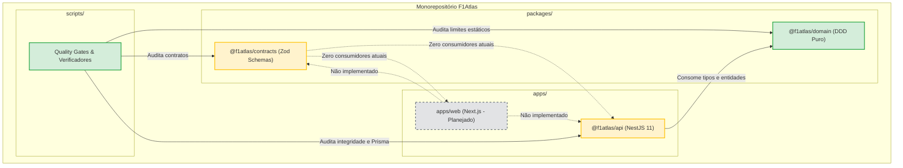
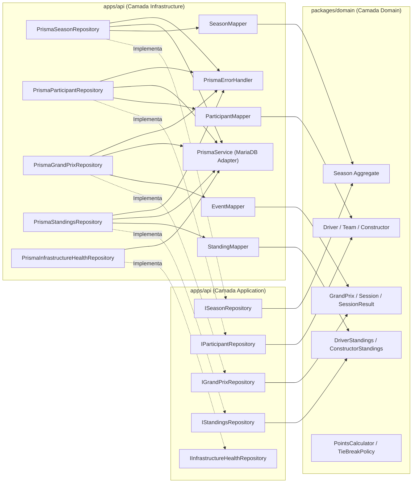
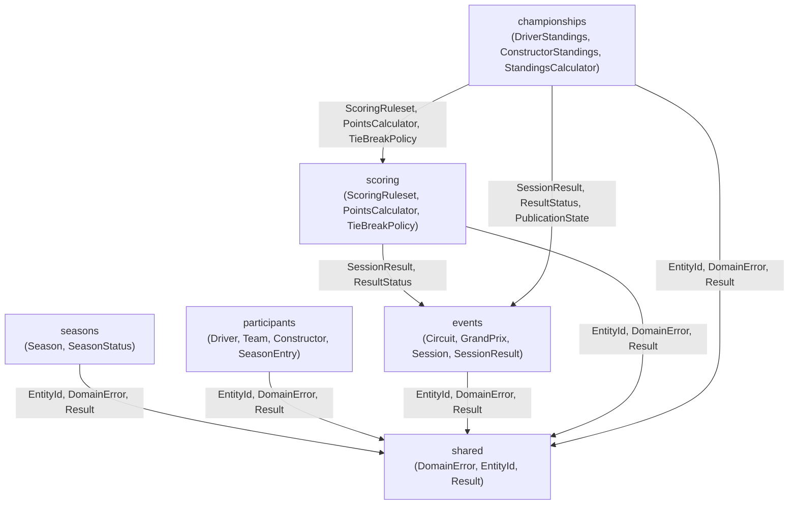
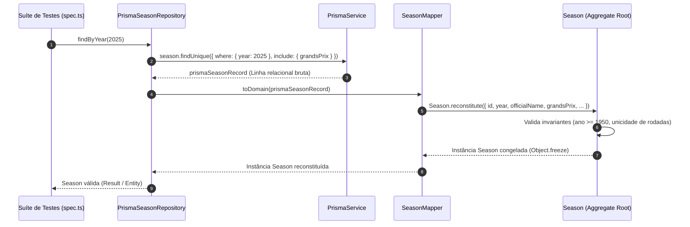
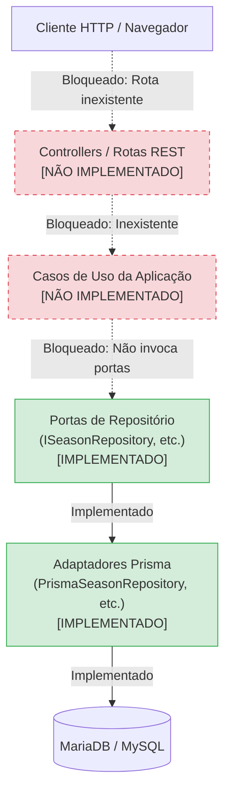

# F1Atlas — Auditoria Arquitetural de Componentes, Coesão e Acoplamento

> **Documento:** `docs/architecture/ARVORE-COMPONENTES-COESAO-ACOPLAMENTO.md`  
> **Natureza:** Relatório de Auditoria Arquitetural Independente (*Static & Structural Architectural Review*)  
> **Escopo da Inspeção:** Monorepositório integral (`apps/`, `packages/`, `scripts/`, `docs/`)  
> **Autoridade de Governança:** `AGENTS.md` (Seção 3 — Princípios Obrigatórios de Engenharia; Seção 7 — Fontes Canônicas; Seção 9 — Fluxo em 6 Etapas)  
> **Status:** Concluído / Oficial  

---

## 1. Resumo Executivo da Auditoria

Esta auditoria arquitetural realizou um diagnóstico exaustivo e determinístico sobre o estado real de implementação do **F1Atlas** (`F12027-harness-v0.2`), confrontando o código-fonte existente, seus testes automatizados e suas configurações de monorepositório com os documentos canônicos de arquitetura (`ARCHITECTURE.md`, `current-state.md`, ADRs e SPECs).

### Principais Conclusões:
1. **Domínio Puro Altamente Maduro e Desacoplado (M1 e M2 100% Concluídos):**  
   A camada de domínio esportivo localizada em [`packages/domain`](../../packages/domain) representa o núcleo mais sólido da base de código. Apresenta **399 testes automatizados** passando, **99.51% de cobertura de linhas**, **96.09% de cobertura de branches** e **100% de Mutation Testing Score** (73/73 mutantes eliminados). Não há qualquer dependência de frameworks web (Next.js, NestJS), ORMs ou transporte HTTP no domínio, respeitando com excelência a diretriz *Backend First*.
2. **Infraestrutura e Persistência Estabelecidas (Foundation M3 Parcial):**  
   A aplicação [`apps/api`](../../apps/api) possui NestJS 11 configurado, Prisma ORM 7 (`7.10.1`) com driver adapter MariaDB/MySQL (`@prisma/adapter-mariadb`), 5 adaptadores de repositório concretos, mappers bidirecionais e barreira de tratamento e sanitização de erros (`PrismaErrorHandler`), validados por **60 testes automatizados**.
3. **Lacuna Estrutural Crítica — Ausência de Casos de Uso e Camada de Apresentação:**  
   Embora os repositórios e mappers de infraestrutura existam e compilem, **não há Casos de Uso (`use-cases/`) implementados na camada de aplicação** de `apps/api`, nem **Controllers HTTP (`presentation/`)** ou rotas REST expostas. A API inicializa via NestJS, mas não expõe endpoints para clientes.
4. **Pacote de Contratos Desconectado:**  
   O pacote [`packages/contracts`](../../packages/contracts) define schemas Zod e tipos estáticos para respostas da API e consultas (34 testes passando), mas atualmente possui **zero consumidores reais**: nem a API consome os schemas para validação de entrada/saída, nem o frontend os utiliza.
5. **Frontend no Estado Planejado:**  
   O diretório [`apps/web`](../../apps/web) contém apenas um arquivo marcador `.gitkeep`, confirmando que a interface pública permanece estritamente em planejamento.
6. **Ausência Total de Ambiente em Produção:**  
   Nenhum componente do repositório encontra-se em produção confirmada. Não existem infraestruturas provisionadas em nuvem, pipelines ativos de CI/CD para deploy ou bancos de dados remotos conectados.

---

## 2. Identificação e Metadados da Inspeção

| Propriedade | Valor Observado | Evidência Mecânica |
|---|---|---|
| **Projeto** | F1Atlas (anteriormente F12027) | `package.json:2` (`"name": "f1atlas"`) |
| **Commit Auditado** | `3880f09d7389242f64b49b0dba1864fee039c0a1` | `git rev-parse HEAD` |
| **Branch Ativa** | `main` | `git branch --show-current` |
| **Data da Verificação** | 10 de Novembro de 2026 (21:06 BRT) | Relógio de execução do sistema |
| **Total de Testes Automatizados** | **543 testes** (399 domain + 34 contracts + 60 api + 50 harness) | Suítes de execução via `npm run verify` |
| **Taxa de Sucesso dos Testes** | **100% de aprovação (543 pass, 0 fail, 0 skipped nos testes ativos)** | Relatório do Node.js Test Runner |
| **Quality Gates Públicos** | 16 gates auditados: 14 PASS, 2 SKIP (Justificados: Dependências e SEO) | `scripts/quality/run-all.mjs` |

---

## 3. Metodologia e Limitações

### 3.1. Metodologia de Investigação
A auditoria operou sob o princípio **Read-Only / Zero Side-Effects**, estruturando-se em quatro etapas:
1. **Inspeção Estática de Arquivos e AST:** Mapeamento de imports estáticos (`import`, `require`, `from`), checagem de referências relativas e declarações de módulos em `package.json` e `tsconfig.json`.
2. **Execução Determinística de Verificadores Mecânicos:** Execução de scripts públicos (`verify:architecture`, `verify:boundaries`, `verify:current-state`, `test:domain`, `test:contracts`, `test:api`, `test:harness`).
3. **Análise de Coesão e Acoplamento Funcional:** Avaliação semântica dos limites de responsabilidade baseada nos princípios DDD, Clean Architecture e SOLID.
4. **Confronto Documento vs. Código:** Cruzamento das afirmações em `ARCHITECTURE.md`, `current-state.md` e ADRs contra arquivos físicos, classes, métodos e testes.

### 3.2. Limitações da Auditoria
- **Ambiente de Banco de Dados Real:** Os testes da camada `apps/api` utilizam mocks do `PrismaService` e instâncias locais isoladas; não foi testada conectividade com banco MariaDB remoto em produção.
- **Frontend Inexistente:** Não foi possível auditar renderização SSR/SSG, bundles client-side, tempos de carregamento ou acessibilidade de tela, visto que `apps/web` não possui código executável.
- **Mutações Não Executadas:** Respeitando as restrições mandatórias, nenhuma alteração em código ou schema foi realizada.

---

## 4. Inventário dos Componentes Reais

### 4.1. Vocabulário Padronizado de Estados
- **Produção confirmada:** Evidência verificável de implantação operacional e tráfego de usuários.
- **Implementado e validado:** Código completo existente com suíte automatizada de testes passando e conformidade comprovada.
- **Implementado parcialmente:** Código existente e funcional, mas com dependências, consumidores ou suítes incompletas.
- **Em desenvolvimento:** Implementação iniciada, porém sem consolidação ou fechamento de requisitos.
- **Planejado:** Especificado em documentação ou esqueleto JSDoc, sem código executável.
- **Obsoleto ou não utilizado:** Código ou contrato existente no repositório sem nenhum consumidor ativo.
- **Indeterminado:** Ausência de evidências suficientes para atestar o estado.

---

### 4.2. Tabela de Inventário Detalhado

| Identificador | Localização | Responsabilidade | Implementação Efetiva | Entradas / Dependências | Saídas / Disponibiliza | Consumidores | Testes e Evidências | Estado | Riscos Identificados |
|---|---|---|---|---|---|---|---|---|---|
| **Domain Shared** | `packages/domain/src/shared/` | Prover primitivas funcionais puras de erro, identidade e resultado. | `DomainError`, `EntityId` (com phantom types) e `Result<T, E>`. | Nenhuma (zero dependências externas ou internas). | Classes `DomainError`, `EntityId`, container `Result`. | Todos os módulos de `packages/domain` e adaptadores de `apps/api`. | 64 testes unitários e de tipagem em `test/shared/`; 100% de mutação. | **Implementado e validado** | Nenhum. Componente estável e amplamente coeso. |
| **Domain Seasons** | `packages/domain/src/seasons/` | Coordenar agregados anuais, calendário de GPs e máquina de status. | Aggregate Root `Season`, transições `SeasonStatus`, sequencialidade e cancelamento. | `EntityId`, `DomainError`, `Result` de `../shared/`. | Classes `Season`, `SeasonStatus`. | `apps/api` (`ISeasonRepository`, `SeasonMapper`). | 48 testes unitários e de tipos em `test/seasons/`; 100% de mutação. | **Implementado e validado** | Nenhum. Invariantes históricas (Imola 2023) comprovadas. |
| **Domain Participants** | `packages/domain/src/participants/` | Modelar entidades esportivas (pilotos, equipes, construtores e inscrições). | Entidades `Driver`, `Team`, `Constructor`, `SeasonEntry`, enum `EntryRole`. | `EntityId`, `DomainError`, `Result` de `../shared/`. | Classes `Driver`, `Team`, `Constructor`, `SeasonEntry`. | `apps/api` (`IParticipantRepository`, `ParticipantMapper`). | 64 testes em `test/participants/` (cenários Sainz, Bearman, Colapinto). | **Implementado e validado** | Nenhum. Distinção clara entre equipe comercial e fabricante WCC. |
| **Domain Events** | `packages/domain/src/events/` | Modelar circuitos, fins de semana de GP, sessões e súmulas de pista. | Entidades `Circuit`, `GrandPrix`, `Session`, `SessionEntry`, `SessionResult`. | `EntityId`, `DomainError`, `Result` de `../shared/`. | Classes `Circuit`, `GrandPrix`, `Session`, `SessionResult`. | `scoring/`, `championships/`, `apps/api` (`IGrandPrixRepository`, `EventMapper`). | 135 testes em `test/events/` (regras Art. 5.4 e Art. 62.1 FIA). | **Implementado e validado** | Complexidade moderada de reidratação em mappers de infraestrutura. |
| **Domain Scoring** | `packages/domain/src/scoring/` | Calcular pontos FIA (2024/2025), distâncias reduzidas e countback. | `ScoringRuleset`, `PointsCalculator`, política de desempate `TieBreakPolicy`. | `../shared/`, `SessionResult` e `ResultStatus` de `../events/`. | Classes de cálculo de pontuação e critérios de desempate. | `championships/standings-calculator.ts`. | 49 testes em `test/scoring/` cobrindo Art. 6.5 e Art. 7.2 FIA. | **Implementado e validado** | Nenhum. Algoritmos determinísticos puros sem efeito colateral. |
| **Domain Championships** | `packages/domain/src/championships/` | Projetar e acumular tabelas de classificação WDC e WCC. | Snapshots `DriverStandings`, `ConstructorStandings`, serviço `StandingsCalculator`. | `../shared/`, `events/`, `scoring/`. | Projeções imutáveis WDC/WCC e calculadora de evolução de ranking. | `apps/api` (`IStandingsRepository`, `StandingMapper`). | 39 testes em `test/championships/` com inversão de rodadas e desempate. | **Implementado e validado** | Sub-paths `./scoring` e `./championships` omitidos no `package.json` do domínio. |
| **Domain Simulations** | `packages/domain/src/simulations/` | Simular cenários alternativos "What-If" isolados do histórico real. | Apenas cabeçalhos JSDoc e especificações em `championship-scenario.ts` e `scenario-evaluator.ts`. | Nenhuma importação compilada. | Nenhuma capacidade executável disponibilizada. | Nenhum. | 0 testes. | **Planejado** | Risco de especulação sem caso de uso concreto que o ancore. |
| **Contracts Shared** | `packages/contracts/src/shared/` | Definir schemas de erro HTTP (RFC 7807) e paginação. | Schemas Zod `ApiErrorResponseSchema`, `PaginationQuerySchema` e envelopes de lista. | Biblioteca `zod`. | Schemas Zod e tipos estáticos exportados. | Nenhum consumidor ativo no código (apenas testes). | 10 testes em `test/shared.contract.test.ts`. | **Implementado e validado** *(sem consumidores)* | Contrato existente sem uso em controllers. |
| **Contracts Drivers & Teams** | `packages/contracts/src/drivers/`, `teams/` | Definir contratos públicos de transporte para pilotos, equipes e construtores. | Schemas Zod `DriverResponseSchema`, `TeamResponseSchema`, `ConstructorResponseSchema`. | Biblioteca `zod`. | Schemas e DTOs de serialização JSON. | Nenhum consumidor ativo. | 11 testes em `test/drivers.contract.test.ts` e `teams.contract.test.ts`. | **Implementado e validado** *(sem consumidores)* | Falta de sincronia com controllers da API. |
| **Contracts Seasons & Events** | `packages/contracts/src/seasons/`, `grand-prix/` | Definir contratos para temporadas e Grandes Prêmios. | Schemas Zod `SeasonResponseSchema`, `GrandPrixResponseSchema`. | Biblioteca `zod`. | Schemas e DTOs de calendário e etapas. | Nenhum consumidor ativo. | 7 testes em `test/seasons.contract.test.ts` e `grand-prix.contract.test.ts`. | **Implementado e validado** *(sem consumidores)* | Falta de sincronia com controllers da API. |
| **Contracts Standings** | `packages/contracts/src/standings/` | Definir contratos para tabelas do WDC e WCC com flag de simulação. | Schemas Zod `DriverStandingsResponseSchema`, `ConstructorStandingsResponseSchema`. | Biblioteca `zod`. | Schemas Zod e tipos estáticos de classificação. | Nenhum consumidor ativo. | 4 testes em `test/standings.contract.test.ts`. | **Implementado e validado** *(sem consumidores)* | Falta de sincronia com controllers da API. |
| **Contracts Analytics** | `packages/contracts/analytics.mjs` | Padronizar catálogo tipado de telemetria e consentimento GA4. | Funções utilitárias de validação de catálogo e filtragem PII. | JavaScript padrão (ESM puro). | Funções de envio seguro e checagem de consentimento. | Scripts de governança (`scripts/analytics/`). | 11 testes em `scripts/tests/analytics.test.ts`. | **Implementado e validado** | Desconectado de interfaces de frontend. |
| **API Application Ports** | `apps/api/src/application/ports/` | Definir interfaces de repositório puras da aplicação. | 5 interfaces (`ISeasonRepository`, `IParticipantRepository`, `IGrandPrixRepository`, `IStandingsRepository`, `IInfrastructureHealthRepository`). | `@f1atlas/domain` (tipos de entidades e EntityId). | Interfaces TypeScript puras para injeção de dependência. | `AppModule`, adaptadores Prisma de infraestrutura. | Tipagem estrita validada na compilação e nos testes de adaptador. | **Implementado e validado** | Ausência de portas para casos de uso ou serviços externos. |
| **API Use Cases** | `apps/api/src/application/use-cases/` | Orquestrar fluxos de negócio e interação entre domínio e persistência. | **Não existe fisicamente no repositório**. | N/A | N/A | N/A | 0 testes. | **Planejado** | **LACUNA CRÍTICA**: Repositórios de persistência sem casos de uso que os orquestrem. |
| **API Infrastructure Database** | `apps/api/src/infrastructure/database/prisma/` | Adaptar persistência relacional MySQL via Prisma ORM 7 e MariaDB adapter. | `PrismaService`, `PrismaModule`, `PrismaErrorHandler` e 5 repositórios concretos. | `@prisma/client`, `@prisma/adapter-mariadb`, `@nestjs/common`, `@f1atlas/domain`. | Provedores NestJS (`PrismaSeasonRepository`, etc.) implementando as portas. | `AppModule`. | 24 testes em `prisma-repositories.spec.ts`, `prisma-error-handler.spec.ts` e `prisma-service.spec.ts`. | **Implementado e validado** | Ausência de dependência declarada de `@f1atlas/domain` no `package.json` da API. |
| **API Infrastructure Mappers** | `apps/api/src/infrastructure/mappers/` | Traduzir bidirecionalmente entre modelos relacionais Prisma e entidades puras de domínio. | `SeasonMapper`, `ParticipantMapper`, `EventMapper`, `StandingMapper`, `InfrastructureHealthMapper`. | Modelos gerados pelo Prisma, `@f1atlas/domain`. | Métodos estáticos puros `toDomain` e `toPersistence`. | Repositórios Prisma. | 36 testes em `infrastructure/mappers/tests/`. | **Implementado e validado** | Mappers acumulam validações defensivas repetidas de nulos do banco. |
| **API Composition Root** | `apps/api/src/app.module.ts`, `main.ts` | Configurar container IoC do NestJS e ponto de inicialização HTTP. | `AppModule` registrando providers por token string; `bootstrap()` em `main.ts` na porta 3001. | `@nestjs/core`, `@nestjs/common`, `PrismaModule`, repositórios. | Aplicação NestJS executável. | Ponto de entrada do runtime da API. | Teste de instanciação do container NestJS aprovado. | **Implementado parcialmente** | Nenhum controller HTTP ou DTO registrado no container. |
| **API Presentation** | `apps/api/src/presentation/` | Expor endpoints REST e interceptores HTTP. | **Não existe fisicamente no repositório**. | N/A | N/A | N/A | 0 testes. | **Planejado** | **LACUNA CRÍTICA**: A API não expõe nenhuma rota para o exterior. |
| **Web Frontend** | `apps/web/` | Portal público SSR/SSG com design Precision Motorsport Editorial. | Diretório estruturado contendo apenas `.gitkeep`. | N/A | N/A | N/A | 0 testes. | **Planejado** | Totalmente não implementado. |
| **Scripts de Qualidade e Governança** | `scripts/` | Garantir verificação determinística de integridade, limites, banco, SEO e segurança. | Verificadores em Node.js ESM para arquitetura, testes, mutação, schema e segurança. | Módulos nativos Node.js (`fs`, `path`, `test`). | Comandos de CLI e quality gates orquestrados por `scripts/quality/run-all.mjs`. | CI/CD, comandos `npm run verify*`, desenvolvedores e agentes. | 110 testes em `scripts/tests/`. | **Implementado e validado** | Altíssima maturidade; garante estabilidade do monorepo. |

---

## 5. Árvore Arquitetural do Estado Atual

A representação abaixo reflete com fidelidade estrita a estrutura física e a maturidade dos componentes existentes no repositório F1Atlas:

```text
F1Atlas (Monorepositório npm workspaces)
│
├── apps/
│   │
│   ├── api/ [@f1atlas/api v0.1.0] ─────────────────────── [IMPLEMENTADO PARCIALMENTE]
│   │   ├── prisma/
│   │   │   ├── schema.prisma (33 modelos relacionais) ── [VALIDADO]
│   │   │   ├── migrations/ (1 migration declarativa) ─── [VALIDADO]
│   │   │   └── seed.ts (Baseline de health-check) ─────── [VALIDADO]
│   │   ├── prisma.config.ts (Configuração Prisma 7) ──── [VALIDADO]
│   │   ├── src/
│   │   │   ├── application/
│   │   │   │   ├── ports/ ────────────────────────────── [VALIDADO]
│   │   │   │   │   ├── season-repository.port.ts
│   │   │   │   │   ├── participant-repository.port.ts
│   │   │   │   │   ├── grand-prix-repository.port.ts
│   │   │   │   │   ├── standings-repository.port.ts
│   │   │   │   │   └── infrastructure-health-repository.port.ts
│   │   │   │   └── use-cases/ ────────────────────────── [PLANEJADO / INEXISTENTE]
│   │   │   ├── infrastructure/
│   │   │   │   ├── database/prisma/ ──────────────────── [VALIDADO]
│   │   │   │   │   ├── prisma.service.ts (Adapter MariaDB)
│   │   │   │   │   ├── prisma.module.ts
│   │   │   │   │   ├── errors/ (PrismaErrorHandler & PersistenceErrors)
│   │   │   │   │   └── repositories/ (5 adaptadores concretos)
│   │   │   │   └── mappers/ ──────────────────────────── [VALIDADO]
│   │   │   │       ├── season.mapper.ts
│   │   │   │       ├── participant.mapper.ts
│   │   │   │       ├── event.mapper.ts
│   │   │   │       ├── standing.mapper.ts
│   │   │   │       └── infrastructure-health.mapper.ts
│   │   │   ├── generated/prisma/ (Prisma Client tipado) ─ [GERADO / ATIVO]
│   │   │   ├── presentation/ ─────────────────────────── [PLANEJADO / INEXISTENTE]
│   │   │   ├── app.module.ts (Composition Root IoC) ──── [IMPLEMENTADO PARCIALMENTE]
│   │   │   └── main.ts (Bootstrap NestJS :3001) ──────── [IMPLEMENTADO PARCIALMENTE]
│   │   └── package.json (Faltam dependências de @f1atlas/*)
│   │
│   └── web/ ──────────────────────────────────────────── [PLANEJADO / APENAS .gitkeep]
│
├── packages/
│   │
│   ├── domain/ [@f1atlas/domain v0.2.0] ──────────────── [VALIDADO (M1 & M2 100%)]
│   │   ├── src/
│   │   │   ├── shared/ ───────────────────────────────── [VALIDADO]
│   │   │   │   ├── domain-error.ts (DomainError & Codes)
│   │   │   │   ├── entity-id.ts (EntityId com Phantom Types)
│   │   │   │   └── result.ts (Monad Result<T, E>)
│   │   │   ├── seasons/ ──────────────────────────────── [VALIDADO]
│   │   │   │   ├── season.ts (Aggregate Root Season)
│   │   │   │   └── season-status.ts (State Machine & Transitions)
│   │   │   ├── participants/ ─────────────────────────── [VALIDADO]
│   │   │   │   ├── driver.ts (Entidade Driver, FIA code, # permanente)
│   │   │   │   ├── team.ts (Entidade corporativa Team)
│   │   │   │   ├── constructor.ts (Fabricante de chassi WCC)
│   │   │   │   ├── season-entry.ts (Vínculo temporal piloto/equipe)
│   │   │   │   └── entry-role.ts (REGULAR, SUBSTITUTE, TEST)
│   │   │   ├── events/ ───────────────────────────────── [VALIDADO]
│   │   │   │   ├── circuit.ts (Autódromo & cálculo de voltas FIA)
│   │   │   │   ├── grand-prix.ts (Aggregate Root GP fim de semana)
│   │   │   │   ├── session.ts (Sessão de pista & lifecycle)
│   │   │   │   ├── session-entry.ts (Grid de largada & carro)
│   │   │   │   └── session-result.ts (Súmula, regra dos 90%, homologação)
│   │   │   ├── scoring/ ──────────────────────────────── [VALIDADO]
│   │   │   │   ├── scoring-ruleset.ts (Tabelas FIA 2024/2025, Art. 6.5)
│   │   │   │   ├── points-calculator.ts (Serviço de cálculo de pontos)
│   │   │   │   └── tie-break-policy.ts (Countback da FIA Art. 7.2)
│   │   │   ├── championships/ ────────────────────────── [VALIDADO]
│   │   │   │   ├── driver-standings.ts (Read-Model Snapshot WDC)
│   │   │   │   ├── constructor-standings.ts (Read-Model Snapshot WCC)
│   │   │   │   └── standings-calculator.ts (Calculadora de evolução)
│   │   │   ├── simulations/ ──────────────────────────── [PLANEJADO / JSDoc ONLY]
│   │   │   │   ├── championship-scenario.ts (Esqueleto)
│   │   │   │   └── scenario-evaluator.ts (Esqueleto)
│   │   │   └── index.ts (Ponto de entrada do pacote)
│   │   ├── test/ (399 testes unitários e de tipos) ───── [PASS (100%)]
│   │   └── package.json (Exports omitem sub-paths scoring e championships)
│   │
│   └── contracts/ [@f1atlas/contracts v0.1.0] ────────── [VALIDADO (SEM CONSUMIDORES)]
│       ├── src/
│       │   ├── shared/ (api-error.contract.ts, pagination.contract.ts)
│       │   ├── drivers/ (driver-response.contract.ts, list-drivers-query.contract.ts)
│       │   ├── teams/ (team-response.contract.ts, constructor-response.contract.ts)
│       │   ├── seasons/ (season-response.contract.ts)
│       │   ├── grand-prix/ (grand-prix-response.contract.ts)
│       │   ├── standings/ (driver-standing.contract.ts, constructor-standing.contract.ts)
│       │   └── index.ts
│       ├── analytics.mjs (Catálogo de telemetria sem PII) ── [VALIDADO]
│       ├── test/ (34 testes Zod e de inferência estática) ─ [PASS (100%)]
│       └── package.json
│
├── scripts/ (Verificadores e Harness Determinístico) ─── [VALIDADO (110 TESTES PASS)]
│   ├── architecture/ (verify-boundaries.mjs, verify-current-state.mjs)
│   ├── quality/ (run-all.mjs, verify-integrity.mjs, verify-mutation-quality.mjs, etc.)
│   ├── database/ (validate-schema.mjs, check-prisma-version.mjs, etc.)
│   ├── security/ (check-secrets.mjs, check-sensitive-files.mjs, validate-env.mjs, etc.)
│   ├── seo/ (validate-metadata.mjs, validate-canonical.mjs, etc.)
│   ├── analytics/ (validate-events.mjs, validate-privacy.mjs, etc.)
│   └── tests/ (9 suítes com 110 testes automatizados)
│
└── docs/ ─────────────────────────────────────────────── [DOCUMENTADO & AUDITADO]
    ├── architecture/ (Fundamentos, ADRs 0001, 0002, 0003, current-state.md)
    ├── domain/ (Documentos canônicos por módulo e development-status.md)
    └── Relatorios/ (Auditorias M1, M2, M3 e infraestrutura)
```

---

## 6. Diagramas de Relacionamento e Fluxos

### 6.1. Diagrama Estrutural (Pacotes, Camadas e Dependências)

O diagrama abaixo reflete a topologia de dependências estáticas identificadas no código-fonte real:



---

### 6.2. Diagrama de Componentes Internos da API e Domínio

Mostra a interação concreta entre as portas da aplicação, os adaptadores do Prisma e os agregados de domínio:



---

### 6.3. Diagrama do Grafo Acíclico Interno do Domínio (DAG)

Evidência de ausência de dependências circulares entre os módulos do domínio:



---

### 6.4. Diagrama de Fluxo Funcional Efetivamente Implementado

Demonstra a execução real existente no repositório (reconstituição de uma Temporada a partir do banco de dados através do adaptador Prisma e validação das invariantes do agregado):



---

### 6.5. Diagrama de Lacunas Arquiteturais (Gaps Comprovados)

Destaca a quebra na cadeia de execução entre a entrada do usuário e o acesso a dados:



---

## 7. Análise Individual de Coesão

| Módulo / Pacote | Nível de Coesão | Justificativa Baseada em Evidências | Princípios Respeitados / Desvios |
|---|---|---|---|
| **`packages/domain/src/shared`** | **Alta Coesão** | Concentra exclusivamente primitivas genéricas funcionais que viabilizam o design defensivo de todo o sistema (`DomainError`, `EntityId`, `Result`). Cada classe tem uma única e inequívoca responsabilidade. | Single Responsibility, Encapsulamento, Imutabilidade estrita. |
| **`packages/domain/src/seasons`** | **Alta Coesão** | Coesão funcional estrita em torno do conceito de ano de campeonato. Não gerencia participantes, não calcula pontos e não persiste dados; apenas coordena o calendário e valida o ciclo de vida anual. | Single Responsibility, Invariantes de agregado DDD. |
| **`packages/domain/src/participants`** | **Alta Coesão** | Agrupa entidades esportivas duráveis e seus papéis de inscrição (`SeasonEntry`). Resolve com precisão o problema da temporalidade entre piloto e equipe sem misturar com resultados de corrida. | Separação de Identidade e Participação, SRP. |
| **`packages/domain/src/events`** | **Alta Coesão** | Todos os componentes colaboram para a realização física e temporal de uma corrida (autódromo → fim de semana → sessão cronometrada → alinhamento no grid → súmula homologada). | Coesão funcional, isolamento de fatos esportivos. |
| **`packages/domain/src/scoring`** | **Alta Coesão** | Responsabilidade estritamente matemática e regulamentar: transformar posições de chegada e distâncias percorridas em pontos, e resolver empates por histórico de colocações. | Funções determinísticas puras, SRP. |
| **`packages/domain/src/championships`** | **Alta Coesão** | Focado na projeção do campeonato acumulado (WDC/WCC). O serviço `StandingsCalculator` orquestra a progressão rodada a rodada consumindo os módulos de scoring e events de maneira puramente determinística. | CQRS Read-Model puro, Coesão funcional. |
| **`packages/contracts`** | **Coesão Moderada** | Agrupa todos os contratos Zod de diferentes domínios (Drivers, Teams, Seasons, Standings, Erros, Paginação e Analytics) em um único pacote. Embora cada subdiretório seja coeso, o pacote mistura contratos de transporte REST com contratos de eventos analíticos client-side (`analytics.mjs`). | Oportunidade de separação entre API DTOs e Analytics Telemetry. |
| **`apps/api/src/infrastructure`** | **Alta Coesão** | Responsabilidade única de adaptação técnica de banco de dados: tradução de modelos Prisma para entidades de domínio através de mappers dedicados, pooling de conexão e tratamento de falhas SQL. | Ports & Adapters (Hexagonal Architecture). |
| **`apps/api/src/application`** | **Baixa Coesão (Incompleto)** | Atualmente contém apenas interfaces de repositório (`ports/`), sem nenhum serviço coordenador ou caso de uso que justifique a existência da camada como um todo executável. | Falta de componentes funcionais de orquestração. |

---

## 8. Análise Individual de Acoplamento

A auditoria classificou o acoplamento segundo quatro dimensões formais:

### 8.1. Acoplamento Estrutural (Tipos e Imports)
- **Domínio (`packages/domain`):** Apresenta **acoplamento estrutural zero** com dependências externas (não há dependências em `package.json`). O acoplamento interno é unidirecional e hierárquico, organizado em um Grafo Acíclico Dirigido (DAG) sem ciclos.
- **Contratos (`packages/contracts`):** Apresenta acoplamento estrutural apenas com `zod`. Não importa tipos de `packages/domain` (evitando vazamento de modelos internos para os DTOs públicos).
- **API (`apps/api`):** Importa tipos do domínio (`packages/domain`) diretamente nas portas e mappers. No entanto, **o manifesto `apps/api/package.json` omite a declaração de `@f1atlas/domain` nas dependências**, confiando exclusivamente na resolução via `tsconfig.json paths` e symlink do workspace.

### 8.2. Acoplamento de Execução (Runtime e Mensageria)
- **Isolamento de Runtime:** O domínio executa em runtime puro do Node.js, sem container de injeção de dependência e sem dependência de lifecycle.
- **Runtime da API:** O `PrismaService` conecta-se aos hooks de lifecycle do NestJS (`onModuleInit`, `onModuleDestroy`). Não há chamadas de rede externas ou acoplamento a serviços de mensageria (Redis, RabbitMQ), preservando a proposta do Monólito Modular (ADR-0001).

### 8.3. Acoplamento Semântico (Conhecimento Interno e Invariantes)
- **Preservação de Fronteiras:** Repositórios e mappers da API respeitam as invariantes do domínio. Ao reidratar registros do banco de dados, eles invocam os métodos de factory e `reconstitute` das entidades, garantindo que nenhum estado ilegal ou inconsistente exista em memória.
- **Tratamento de Simulação:** `StandingsCalculator` rejeita explicitamente resultados marcados com `publicationState: 'SIMULATED'` ao apurar classificações oficiais (`INV-CH-05`), mantendo o acoplamento semântico do isolamento de simulações.

### 8.4. Acoplamento de Infraestrutura (Frameworks e Persistência)
- **Confinamento do Prisma:** O Prisma ORM 7 está rigorosamente confinado a `apps/api/src/infrastructure/database/prisma/`. Nenhum tipo gerado pelo Prisma vaza para o Domínio ou para a camada de Aplicação.
- **Sanitização de Erros:** O `PrismaErrorHandler` traduz erros específicos do Prisma (`P2002`, `P2025`, `P2003`) em exceções limpas (`UniqueConstraintViolationError`, `EntityNotFoundError`, etc.), impedindo que a aplicação se acople às mensagens e códigos do ORM.

---

## 9. Matriz Consolidada de Qualidade Arquitetural

| Módulo / Camada | Coesão | Acoplamento | Fronteiras | Fan-In | Fan-Out | Ciclos | Estado | Avaliação Consolidada |
|---|---|---|---|:---:|:---:|:---:|---|---|
| **Domain: `shared`** | Alta | Baixo | Preservadas | 10 | 0 | 0 | Validado | **Excelente**. Fundação monádica e imutável impecável. |
| **Domain: `seasons`** | Alta | Baixo | Preservadas | 2 | 1 | 0 | Validado | **Excelente**. Invariantes históricas de calendário blindadas. |
| **Domain: `participants`** | Alta | Baixo | Preservadas | 2 | 1 | 0 | Validado | **Excelente**. Separação conceitual entre Driver, Team e Constructor. |
| **Domain: `events`** | Alta | Baixo | Preservadas | 4 | 1 | 0 | Validado | **Excelente**. Modela a dinâmica de pista com regras oficiais FIA. |
| **Domain: `scoring`** | Alta | Moderado | Preservadas | 1 | 2 | 0 | Validado | **Excelente**. Cálculos matemáticos puros e countback determinístico. |
| **Domain: `championships`** | Alta | Moderado | Preservadas | 2 | 3 | 0 | Validado | **Excelente**. Snapshots WDC/WCC protegidos contra dados simulados. |
| **Domain: `simulations`** | Indet. | Indet. | Preservadas | 0 | 0 | 0 | Planejado | **Pendente**. Apenas cabeçalhos JSDoc sem código executável. |
| **Packages: `contracts`** | Moderada | Baixo | Preservadas | 0 | 1 | 0 | Validado | **Alerta**. Contratos validados, mas sem consumidores ativos. |
| **API: `ports`** | Alta | Baixo | Preservadas | 2 | 1 | 0 | Validado | **Adequado**. Interfaces abstratas alinhadas ao DDD. |
| **API: `use-cases`** | N/A | N/A | Rompida | 0 | 0 | 0 | Planejado | **Crítico**. Camada inexistente; repositórios estão órfãos. |
| **API: `repositories`** | Alta | Moderado | Preservadas | 1 | 4 | 0 | Validado | **Bom**. Adaptadores funcionais com isolamento de transações. |
| **API: `mappers`** | Alta | Baixo | Preservadas | 2 | 2 | 0 | Validado | **Excelente**. Isolam o banco e garantem integridade na reidratação. |
| **API: `presentation`** | N/A | N/A | Rompida | 0 | 0 | 0 | Planejado | **Crítico**. Ausência total de controllers e rotas HTTP. |
| **Apps: `web`** | N/A | N/A | N/A | 0 | 0 | 0 | Planejado | **Neutro**. Frontend não iniciado (apenas marcador .gitkeep). |
| **Scripts: `governance`** | Alta | Baixo | Preservadas | N/A | 3 | 0 | Validado | **Excelente**. 110 testes automatizados garantindo qualidade contínua. |

---

## 10. Confronto com as Três Experiências do Produto

Confrontando o estado real com os objetivos estratégicos definidos na Seção 1 de `AGENTS.md` e `ARCHITECTURE.md`:

### 10.1. Acompanhamento da Fórmula 1 (Dados e Classificações Oficiais)
- **Suporte Existente:** O modelo de domínio dá suporte total a temporadas, etapas de GP, sessões de pista, pilotos, construtores, resultados oficiais e apuração de pontos com desempate.
- **Persistência Preparada:** Schema relacional de 33 tabelas suporta todo o histórico esportivo e proveniência de dados. Repositórios e mappers testados.
- **O que Falta para o Usuário Final:** Ingestão de dados reais autorizados (a base atual só possui seed de teste), Casos de Uso de consulta (`GetSeasonSchedule`, `GetDriverStandings`), Controllers HTTP na API e Telas no Frontend.

### 10.2. Simulação de Cenários ("What-If" Interativo e Determinístico)
- **Suporte Existente:** O módulo `championships/standings-calculator.ts` já implementa suporte nativo para isolar simulações (`isSimulation: true` e flags `SIMULATED`), e `packages/contracts` possui schemas Zod preparados para marcar projeções hipotéticas.
- **O que Falta para o Usuário Final:** Implementação real do módulo `packages/domain/src/simulations` (atualmente apenas documentado em JSDoc), Casos de Uso para criar cenários ramificados e interface interativa no frontend para manipulação de posições.

### 10.3. Exploração Histórica e Narrativa (Histórias Conectadas aos Fatos)
- **Suporte Existente:** O schema relacional do Prisma (`apps/api/prisma/schema.prisma`) possui 4 tabelas dedicadas a narrativas (`Story`, `StoryChapter`, `StoryReference`, `StoryEntityLink`), projetadas para ligar crônicas jornalísticas a pilotos, etapas e construtores.
- **O que Falta para o Usuário Final:** Nenhuma entidade de domínio editorial foi criada ainda em `packages/domain` (não há módulo `editorial/`). Não há repositórios Prisma implementados para carregar histórias. Esta experiência encontra-se na fase conceitual / schema apenas.

---

## 11. Divergências entre Documentação e Implementação

1. **Quantidade de Modelos no Schema Prisma:**  
   - *Documentação (`current-state.md:53`):* Afirma que existem 22 modelos no schema relacional.  
   - *Realidade no Código (`schema.prisma`):* Existem **33 modelos relacionais** declarados e migrados.
2. **Dependência de Domínio no `package.json` da API:**  
   - *Documentação (`ADR-0003` e `current-state.md`):* Estabelece `@f1atlas/domain` como dependência oficial de `apps/api`.  
   - *Realidade no Código (`apps/api/package.json`):* O pacote `@f1atlas/domain` **não consta** no campo `dependencies` do manifesto; a compilação só ocorre devido ao mapa estático de paths em `tsconfig.json`.
3. **Sub-paths de Exportação do Domínio:**  
   - *Documentação (`development-status.md`):* Registra `scoring` e `championships` como módulos concluídos e integrados.  
   - *Realidade no Código (`packages/domain/package.json`):* O campo `exports` expõe apenas `.`, `./shared`, `./seasons`, `./participants` e `./events`, omitindo os sub-paths `./scoring` e `./championships`.
4. **Camada de Apresentação da API:**  
   - *Documentação (`ARCHITECTURE.md:63`):* Cita "Presentation: controllers API, DTOs, componentes de interface e transporte".  
   - *Realidade no Código:* A pasta `apps/api/src/presentation` ou controllers equivalentes não existem.

---

## 12. Diagnóstico Técnico

### 12.1. Pontos Arquiteturais Adequados (Fortalezas)
1. **Respeito Absoluto ao Princípio Backend First:** As regras esportivas da FIA foram concebidas, modeladas, implementadas e cobertas por testes determinísticos antes de qualquer linha de tela ser escrita.
2. **Imutabilidade e Programação Defensiva no Domínio:** Todas as entidades de domínio realizam congelamento de instância (`Object.freeze(this)`), cópias defensivas de datas e arrays, e rejeitam estados ilegais logo na instanciação.
3. **Taxa de Mutação Impecável (100% Mutation Score):** As suítes de teste do domínio não contêm testes superficiais; todos os 73 mutantes sintéticos injetados são eliminados, garantindo antifragilidade.
4. **Governança Estrita do Prisma ORM 7:** O projeto evitou a armadilha do Prisma 8 instável, fixando `7.10.1` com `@prisma/adapter-mariadb`, com validações automatizadas em CI/CD que impedem `db push` ou imports indevidos de ORM no domínio.

### 12.2. Problemas Comprovados (Violações e Inconsistências)
1. **Falta de Declaração de Dependência no Workspace:** `apps/api/package.json` não declara `@f1atlas/domain` nem `@f1atlas/contracts` em `dependencies`. Isso pode causar falhas em ferramentas de bundling ou monorepo externos (como Turborepo, Docker builds ou CI limpo sem paths).
2. **Falta dos Sub-paths de Export em `packages/domain/package.json`:** Impede a importação granular `@f1atlas/domain/scoring` ou `@f1atlas/domain/championships` em outros consumidores futuros.
3. **Contratos Zod Não Consumidos:** `packages/contracts` existe isolado como um artefato sem utilidade prática no runtime atual.

### 12.3. Riscos Potenciais
1. **Risco de Construção Prematura da UI:** Se a equipe de frontend iniciar a construção de `apps/web` antes da implementação dos Casos de Uso e Controllers da API, haverá forte tendência de o frontend simular regras ou fazer chamadas desestruturadas, violando a Seção 3 do `AGENTS.md`.
2. **Sobrecarga de Modelagem no Prisma Schema:** Ter 33 tabelas no schema quando apenas 5 repositórios estão ativos aumenta a complexidade de manutenção do banco sem benefício imediato, exigindo atenção para não antecipar migrações especulativas.

---

## 13. Recomendações Priorizadas

A tabela a seguir consolida as ações técnicas recomendadas para destravar a evolução do F1Atlas, ordenadas por severidade:

| Item | Prioridade | Problema Identificado | Consequência Técnica | Solução Recomendada | Impacto nos Componentes |
|:---:|:---:|---|---|---|---|
| **REC-01** | **Crítica** | Ausência de Casos de Uso (`use-cases/`) em `apps/api/src/application`. | A camada de aplicação não coordena as operações do domínio com os repositórios; a API não executa nenhuma ação de negócio. | Implementar os primeiros Casos de Uso fundamentais (ex.: `GetSeasonScheduleUseCase`, `GetDriverStandingsUseCase`, `RegisterSessionResultsUseCase`). | Desbloqueia a conexão entre Domínio e Persistência na API. |
| **REC-02** | **Crítica** | Ausência de Controllers REST e Camada de Apresentação em `apps/api`. | A API inicializa na porta 3001 mas não responde a nenhuma rota HTTP, tornando o backend inacessível para clientes externos. | Criar controllers NestJS mapeando rotas REST padronizadas (ex.: `/seasons`, `/drivers`, `/standings`), injetando os Casos de Uso. | Habilita a camada Presentation em `apps/api`. |
| **REC-03** | **Alta** | `@f1atlas/contracts` não está conectado aos endpoints da API. | Os contratos tipados e validados por Zod permanecem sem uso; risco de divergência entre API e documentação pública. | Utilizar os schemas Zod de `packages/contracts` em pipes de validação e interceptores de resposta nos controllers NestJS. | Garante que as respostas HTTP correspondam 100% aos contratos públicos. |
| **REC-04** | **Alta** | Manifest `apps/api/package.json` omite dependências do monorepo. | Riscos de quebra em builds de produção isolados, Dockerfiles ou CI quando o TypeScript não aplicar o baseUrl relativo. | Declarar `"@f1atlas/domain": "*"` e `"@f1atlas/contracts": "*"` no campo `dependencies` de `apps/api/package.json`. | Zero impacto em tempo de execução; corrige rastreabilidade do npm. |
| **REC-05** | **Média** | Omissão de sub-paths de export em `packages/domain/package.json`. | Consumidores externos não conseguem importar `@f1atlas/domain/scoring` ou `@f1atlas/domain/championships` diretamente. | Adicionar os sub-paths `"./scoring"` e `"./championships"` no campo `exports` de `packages/domain/package.json`. | Amplia a ergonomia de importação do pacote de domínio. |
| **REC-06** | **Média** | Divergência numérica no documento vivo `current-state.md` (22 vs 33 modelos). | A documentação viva de arquitetura apresenta número defasado em relação ao arquivo real `schema.prisma`. | Atualizar o número de modelos em `docs/architecture/current-state.md:53` para refletir os 33 modelos reais. | Alinha documentação canônica à realidade do repositório. |
| **REC-07** | **Baixa** | Implementação de `packages/domain/src/simulations` permanece pendente. | O módulo de simulação contém apenas esqueletos JSDoc, sem código executável. | Implementar `ChampionshipScenario` e `ScenarioEvaluator` somente após consolidar os casos de uso oficiais de 2025. | Evita abstração prematura antes da entrega do MVP esportivo. |

---

## 14. Conclusão sobre a Capacidade de Evolução

A arquitetura do **F1Atlas** exibe uma das mais rigorosas e disciplinadas bases de engenharia de domínio já implementadas:
- O isolamento do domínio esportivo é **total e comprovado**, sem qualquer contaminação por frameworks web ou ORMs.
- A cobertura de testes automatizados e o mutation score de 100% garantem que regras esportivas complexas (desempates por countback, regras de 90% de volta completada, aposentadoria de números de pilotos e interrupções por bandeira vermelha) permaneçam matematicamente estáveis durante qualquer refatoração futura.
- O desacoplamento através de Portas & Adaptadores na API está pronto para sustentar o crescimento do monólito modular sem risco de vazamento do Prisma Client.

O próximo salto de maturidade do projeto exige concentrar esforços na **camada de aplicação (Casos de Uso)** e na **camada de apresentação (Controllers REST)**, integrando-as aos schemas já existentes em `packages/contracts`. Uma vez estabelecida essa fatia vertical de backend, o desenvolvimento do frontend em `apps/web` poderá prosseguir com total segurança, estabilidade e aderência ao princípio canônico *Backend First*.
