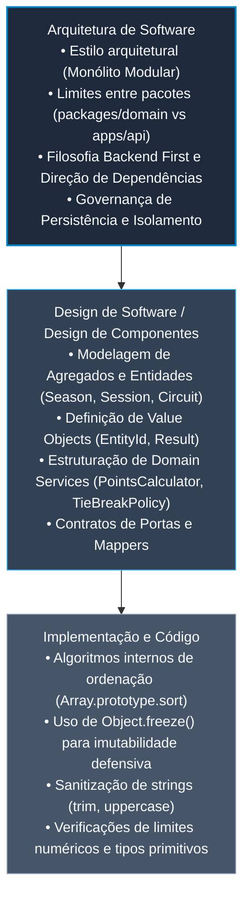
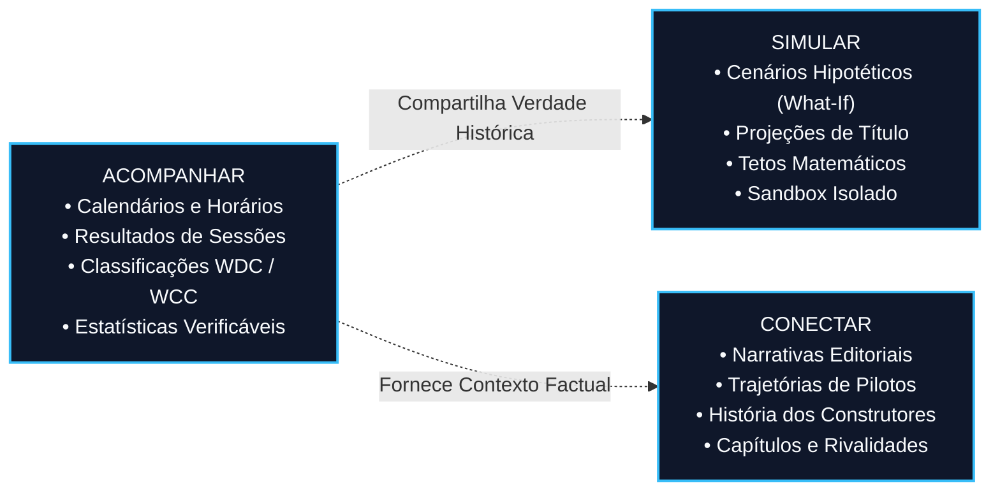
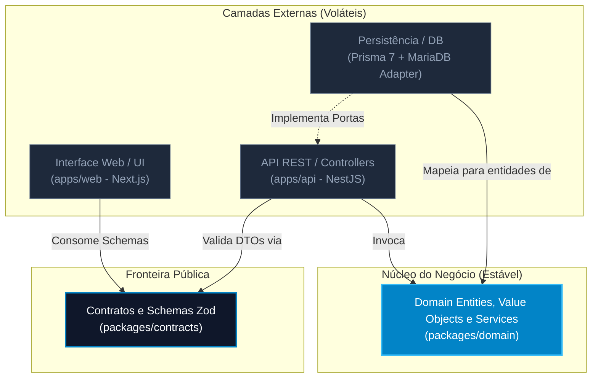
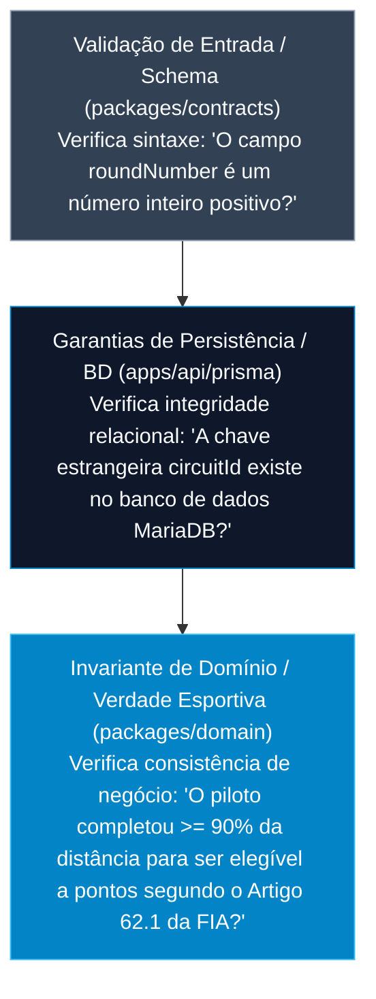
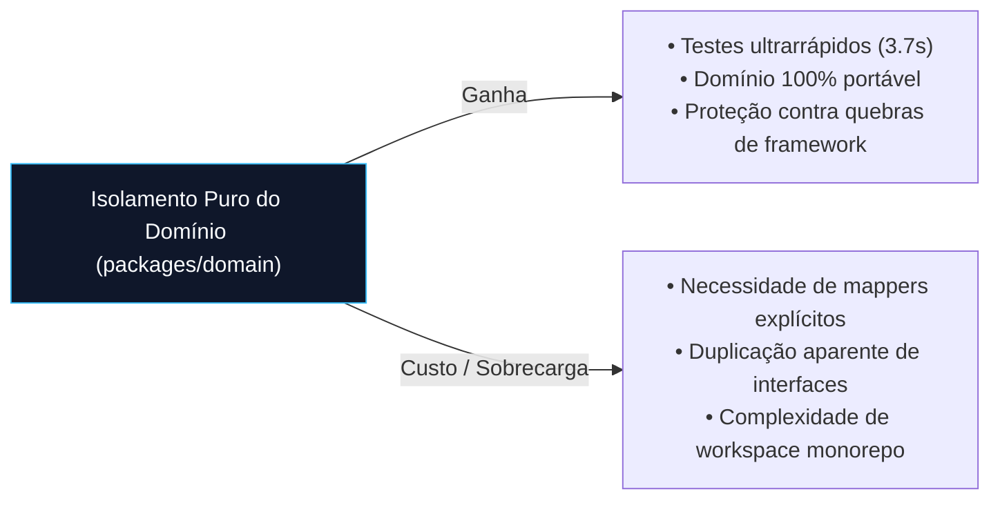

# Fundamentos de Arquitetura de Software — F1Atlas

> **Documento:** `docs/architecture/Fundamentos/Arquitetura.MD`  
> **Status:** Documentação de Referência e Fundamentação Arquitetural  
> **Data:** Novembro de 2026  
> **Público:** Engenheiros de software, arquitetos, revisores e estudantes de engenharia  
> **Natureza:** Documento pedagógico e canônico de fundamentos, decisões, estruturas e trade-offs  

---

## 1. Introdução e Objetivos de Aprendizagem

Este documento foi concebido para cumprir um duplo papel: ser um **material aprofundado de estudo de arquitetura de software** e, simultaneamente, a **documentação fundamentada das decisões e estruturas reais do F1Atlas**.

A premissa norteadora deste texto é:

> *Não documente apenas como o software está construído. Explique por que ele foi organizado dessa maneira, quais problemas motivaram cada decisão, quais alternativas existiam, quais custos foram conscientemente aceitos e como verificar se a arquitetura está atingindo seus objetivos.*

### Objetivos Pedagógicos
Ao concluir o estudo deste documento, o leitor deverá ser capaz de:
1. **Diferenciar com precisão** arquitetura de software, design detalhado, implementação e escolha de stack tecnológica.
2. **Reconhecer decisões arquiteturalmente significativas** por meio de suas características fundamentais: custo de reversão, impacto em atributos de qualidade e restrição a decisões subsequentes.
3. **Compreender a primazia do domínio** através da filosofia *Backend First*, entendendo por que regras esportivas e invariantes de negócio não devem depender de mecanismos de persistência, frameworks web ou bibliotecas de terceiros.
4. **Avaliar e modelar fronteiras arquiteturais**, dependências unidirecionais e contratos estáveis em um sistema modular.
5. **Analisar trade-offs reais**, superando o pensamento dogmático de que padrões de projeto ou estilos arquiteturais são virtudes intrínsecas.
6. **Descrever a arquitetura de um sistema sem recorrer a nomes de frameworks ou tecnologias**, focando exclusivamente no propósito, responsabilidades, colaborações e garantias.

---

## 2. O que é Arquitetura de Software em sua Essência?

Antes de diretórios, linguagens de programação ou ferramentas de infraestrutura, a arquitetura de software trata da estrutura fundamental de um sistema computacional.

### 2.1. Definições Canônicas Fundamentadas

Diversos teóricos e normas internacionais definem arquitetura sob ângulos complementares:

* **Norma ISO/IEC/IEEE 42010 (Systems and software engineering — Architecture description):**  
  Define arquitetura como os *"conceitos fundamentais ou propriedades de um sistema em seu ambiente, personificados em seus elementos, relacionamentos e nos princípios de seu projeto e evolução"*. A ênfase recai sobre propriedades essenciais e princípios orientadores, e não sobre minúcias operacionais.
* **Bass, Clements e Kazman (*Software Architecture in Practice*):**  
  Afirmam que *"a arquitetura de software de um sistema é o conjunto de estruturas necessárias para raciocinar sobre o sistema, compreendendo elementos de software, as relações entre eles e as propriedades de ambos"*. Destaca-se a palavra **estruturas** (no plural): um sistema não possui uma única arquitetura visível, mas múltiplos arranjos que dependem do ponto de vista adotado.
* **Mark Richards e Neal Ford (*Fundamentals of Software Architecture*):**  
  Conceituam arquitetura como uma composição de quatro dimensões indissociáveis:
  $$\text{Arquitetura} = \text{Estrutura} + \text{Características de Qualidade} + \text{Decisões de Arquitetura} + \text{Princípios de Design}$$
  Nessa visão, escolher o estilo (ex.: monólito modular ou microsserviços) é apenas a dimensão estrutural; a arquitetura é incompleta se não governar como o sistema preserva atributos (desempenho, modificabilidade, integridade) e como restrições são impostas e verificadas.
* **Robert C. Martin (*Clean Architecture*):**  
  Postula que a arquitetura de um sistema é a forma que os seus criadores dão a ele para minimizar os recursos humanos necessários para construir e manter o sistema. Seu objetivo primordial é facilitar o desenvolvimento, a implantação, a operação e a manutenção, mantendo opções abertas pelo maior tempo possível.

### 2.2. Por que Arquitetura Não é Stack, Pastas ou Padrões?

É comum encontrar confusões conceituais que reduzem a arquitetura a artefatos secundários:

* **Arquitetura $\neq$ Stack Tecnológica:** Dizer que um sistema é "Next.js, NestJS e PostgreSQL" descreve apenas as ferramentas eleitas para a execução técnica em dado momento. Duas equipes usando rigorosamente essa mesma stack podem produzir arquiteturas radicalmente opostas: uma pode criar um espaguete acoplado onde a interface chama SQL diretamente; outra pode construir um sistema em camadas estritas com inversão de dependência e núcleo de negócio agnóstico.
* **Arquitetura $\neq$ Estrutura de Pastas:** Diretórios (`/controllers`, `/services`, `/repositories`) organizam arquivos em um disco rígido, mas não impedem que classes de negócio façam acoplamentos destrutivos com bibliotecas de terceiros se não houver governança de dependências.
* **Arquitetura $\neq$ Catálogo de Padrões:** Aplicar *Repository Pattern*, *Factory* ou *Hexagonal Architecture* de maneira mecânica não garante uma boa arquitetura. Padrões são respostas consolidadas a problemas contextuais específicos; utilizá-los sem um problema correspondente gera complexidade incidental.

A essência da arquitetura reside na **gestão consciente do custo de mudança**, na **distribuição de responsabilidades** e no **estabelecimento de limites que impedem que o sistema se degenere** à medida que novas demandas emergem.

---

## 3. A Essência da Arquitetura: Estruturas, Responsabilidades e Decisões

### 3.1. Organização do Sistema e Limites Arquiteturais

Qualquer sistema complexo precisa ser decomposto em partes compreensíveis. Essa divisão não é meramente cosmética; ela cria **limites arquiteturais** (*architectural boundaries*).

Um limite arquitetural é uma linha divisória que separa elementos que mudam por razões diferentes e em ritmos diferentes. Quando o limite é respeitado:
* O que está de um lado da fronteira não precisa saber como o outro lado opera internamente.
* Mudanças tecnológicas em um dos lados (ex.: trocar um ORM ou atualizar um framework web) não provocam efeitos colaterais no outro lado.
* Decisões de alto nível de abstração (regras esportivas) são protegidas contra decisões de baixo nível de detalhe técnico (transporte HTTP, SQL, cabeçalhos de rede).

### 3.2. Coesão, Acoplamento e Encapsulamento

Estes três conceitos clássicos governam a saúde de qualquer arranjo modular:

1. **Coesão:** Mede o grau em que as responsabilidades internas de um módulo pertencem logicamente juntas. Um componente altamente coeso foca em uma única competência bem delimitada (ex.: calcular pontuações da FIA) e muda apenas quando essa competência sofre alterações regulamentares.
2. **Acoplamento:** Mede o nível de interdependência entre módulos distintos. O objetivo arquitetural não é eliminar todo o acoplamento (sistemas precisam se comunicar para produzir valor), mas garantir que o acoplamento seja **intencional, mínimo, estável e na direção correta**.
3. **Encapsulamento:** Prática de ocultar detalhes internos de implementação e estruturas de dados por trás de interfaces públicas bem definidas, impedindo que consumidores externos assumam dependências sobre mecanismos internos voláteis.

### 3.3. Decisões Arquiteturalmente Significativas

Nem toda decisão de código é uma decisão de arquitetura. Renomear uma variável local, extrair um método privado ou organizar um loop são decisões de implementação e design detalhado.

Uma decisão torna-se **arquiteturalmente significativa** quando atende a três propriedades:
1. **Alto Custo de Reversão:** Se voltar atrás na decisão após semanas de desenvolvimento exigir reescrever módulos inteiros ou remodelar toda a base de dados, a decisão é arquitetural.
2. **Impacto Direto em Características de Qualidade:** A decisão afeta transversalmente a testabilidade, a integridade, o desempenho ou a segurança do sistema.
3. **Restrição a Decisões Subsequentes:** Uma vez tomada, a decisão condiciona o que o restante do time pode ou não fazer nas implementações cotidianas.

---

## 4. Arquitetura versus Design e Implementação

Para manter o rigor técnico, é essencial diferenciar os níveis de abstração em engenharia de software:

| Nível | Escopo | Foco Principal | Exemplo Concreto no F1Atlas |
|---|---|---|---|
| **Arquitetura** | Transversal ao sistema | Limites, garantias de atributos, custos de reversão, separação física de responsabilidades. | A segregação física de `packages/domain` como biblioteca sem dependências (ADR-0003), proibindo importações de NestJS ou Prisma. |
| **Design de Componentes** | Limites do módulo ou agregado | Colaboração entre objetos, contratos de interfaces, papéis de domínio, distribuição de responsabilidade. | A criação do serviço de domínio puro `PointsCalculator` para calcular pontos de sessões, separando a regra da entidade `Session` e do snapshot `DriverStandings`. |
| **Implementação** | Linhas de código e métodos | Algoritmos locais, controle de fluxo, tratamento defensivo, consumo de APIs da linguagem. | O uso do algoritmo de arredondamento `Math.ceil((305 * 1000) / circuitLength)` e a validação estrita da exceção de Mônaco (260 km) no método `Circuit.calculateLapsForDistance()`. |

A fronteira entre esses níveis é determinada pelo **impacto e custo da mudança**, e não pelo tamanho do trecho de código. Uma única linha que importe uma biblioteca externa dentro do domínio pode ser uma violação arquitetural grave, pois compromete o isolamento de toda a camada.

---

## 5. O Propósito do F1Atlas e suas Implicações Arquiteturais

A arquitetura existe para servir ao produto. Ela não é uma escultura abstrata de software; é a estrutura física que viabiliza ou inviabiliza as promessas que o produto faz aos seus usuários.

### 5.1. A Tríade de Experiências do Produto

O F1Atlas propõe três experiências integradas ao entusiasta do automobilismo:

1. **Acompanhar (Verdade Esportiva e Confiabilidade):**  
   O usuário busca precisão absoluta sobre corridas, grids, voltas rápidas e tabelas de pontuação.  
   *Implicação Arquitetural:* As regras de cálculo da FIA (como atribuição de pontos, desempate por *countback* e elegibilidade por 90% da distância) devem ser tratadas como **invariantes determinísticos de software**, imunes a erros de sincronização ou inconsistências de banco de dados.
2. **Simular (Exploração Interativa Segura):**  
   O usuário deseja responder a perguntas como: *"E se o piloto X vencer as três corridas restantes com volta rápida?"*  
   *Implicação Arquitetural:* O motor de cálculo precisa ser uma **função pura e reutilizável**. Ele deve ser capaz de computar uma nova classificação sem que resultados simulados contaminem, modifiquem ou se misturem aos dados históricos consolidados.
3. **Conectar (Narrativa e Contexto Humano):**  
   O usuário busca entender o significado dos números através de capítulos narrativos e história esportiva.  
   *Implicação Arquitetural:* A camada editorial deve ser capaz de referenciar entidades esportivas estáveis (um Grande Prêmio, um piloto, uma equipe), sem acoplar a infraestrutura de publicação aos motores de cálculo matemático.

---

## 6. As Responsabilidades Fundamentais do Sistema

Para atender a esses propósitos sem gerar dependências desordenadas, o sistema divide suas responsabilidades em módulos conceituais de domínio e camadas técnicas.

### 6.1. Mapa de Responsabilidades do Domínio Esportivo

| Limite de Responsabilidade | Responsabilidade Essencial | O que NÃO é sua responsabilidade | Componentes Reais |
|---|---|---|---|
| **Identity / Participants** | Modelar a identidade esportiva e os vínculos temporais de pilotos, equipes e construtores. | Não armazena tabelas de pontuação, não manipula credenciais de usuários e não busca dados externos. | `Driver`, `Team`, `Constructor`, `SeasonEntry`, `EntryRole` |
| **Competition / Events** | Modelar circuitos, temporadas, finais de semana de GP e ciclo de vida de sessões esportivas. | Não define como os dados são serializados para JSON na API e não calcula os pontos acumulados do campeonato. | `Circuit`, `GrandPrix`, `Session`, `SessionEntry`, `SessionResult`, `Season` |
| **Scoring** | Definir e executar regras regulamentares de pontuação (corridas normais, sprints, corridas encurtadas do Art. 6.5 e desempates por *countback*). | Não decide quando uma corrida terminou, não grava resultados em disco e não conhece o protocolo HTTP. | `ScoringRuleset`, `PointsCalculator`, `TieBreakPolicy` |
| **Championships** | Agregar resultados de múltiplas etapas, mantendo projeções imutáveis de classificação de pilotos (WDC) e construtores (WCC). | Não altera resultados passados, não realiza mutações no banco e não lida com visualização em tela. | `DriverStandings`, `ConstructorStandings`, `StandingsCalculator` |
| **Simulation** *(Planejado)* | Executar cenários hipotéticos sem alterar dados reais, avaliando limites matemáticos de títulos. | Não persiste cenários fictícios no histórico oficial de corridas. | `ChampionshipScenario`, `ScenarioEvaluator` |
| **Data Integration** *(Planejado)* | Orquestrar adaptadores de fornecedores externos, normalizar payloads de terceiros e auditar a proveniência dos dados. | Não altera regras esportivas e não substitui a validação de invariantes do domínio. | Contratos e adaptadores em `packages/contracts` e `apps/api` |

---

## 7. Estruturas, Relações e Direção das Dependências

### 7.1. A Filosofia *Backend First* como Ordem de Precedência Cognitiva

O F1Atlas adota como diretriz estruturante a ordem:

$$\text{Problema} \longrightarrow \text{Regras e Invariantes} \longrightarrow \text{Casos de Uso} \longrightarrow \text{Contratos} \longrightarrow \text{Adaptadores/Persistência} \longrightarrow \text{Apresentação}$$

Isso significa que **a interface visual nunca dita as regras esportivas**. A tela exibe o estado e oferece controles, mas a verdade do domínio (quem é elegível a pontos, como desempatar pilotos com a mesma pontuação, qual o status de uma bandeira vermelha) é formulada, tipada e testada no núcleo de domínio antes de qualquer linha de CSS ou endpoint HTTP ser criado.

### 7.2. A Regra de Dependência (Dependency Rule)

Em respeito à *Clean Architecture* e aos princípios de Portas e Adaptadores (*Hexagonal Architecture*), as dependências do código-fonte apontam estritamente para dentro:

### 7.3. O Paradoxo do Fluxo de Execução versus Direção de Dependência

Um dos conceitos mais importantes em arquitetura de software é a **Inversão de Dependências** (*Dependency Inversion Principle* — DIP):

* **Fluxo de Controle (Runtime):**  
  A requisição chega pela rede $\rightarrow$ atinge o controller NestJS $\rightarrow$ executa o caso de uso $\rightarrow$ o caso de uso chama o repositório $\rightarrow$ o repositório consulta o MySQL via Prisma. O controle trafega de fora para dentro e depois para fora novamente.
* **Direção do Código-Fonte (Compile Time):**  
  O caso de uso e o domínio não conhecem o Prisma ou o NestJS. O caso de uso declara uma **Porta** (interface abstrata em TypeScript, ex.: `ISeasonRepository`). O repositório real (`PrismaSeasonRepository`) reside na infraestrutura e implementa essa interface. Dessa forma, **o código-fonte da infraestrutura depende da abstração do caso de uso**, invertendo o acoplamento que tradicionalmente tornava as regras escravas do banco de dados.

---

## 8. As Decisões Arquiteturais do F1Atlas

Para compreender a arquitetura do F1Atlas, examinamos as decisões registradas nos *Architecture Decision Records* (ADRs) aprovados no projeto, detalhando o contexto, alternativas, benefícios e custos.

### 8.1. Análise Aprofundada das Decisões Principais

#### Decisão 1: Monólito Modular como Estilo Inicial (ADR-0001)
* **Contexto e Problema:** O projeto está em fase de fundação (M1/M2), com equipe focada em delimitar as regras de domínio esportivo complexas da Fórmula 1. Não há métricas de tráfego massivo que exijam escalabilidade elástica independente por componente.
* **Alternativas:**
  1. *Microsserviços distribuídos:* Criar múltiplos serviços autônomos (um serviço para classificação, outro para pilotos, outro para corridas).
  2. *Aplicação full-stack no frontend:* Colocar regras de persistência e apuração diretamente em Server Actions do Next.js.
  3. *Monólito Modular (Escolhida):* Um único repositório e processo de execução estruturado internamente em módulos com limites estritos.
* **Trade-offs:**  
  *Benefícios:* Facilidade de testes, transações atômicas nativas, simplificação de deployment e refatorações sem custo de rede ou latência de serialização RPC.  
  *Custos e Riscos:* Exige disciplina ferrenha dos engenheiros para que módulos internos não façam acoplamentos acidentais via importações cruzadas desordenadas.

#### Decisão 2: Persistência com Prisma ORM 7 e Driver Adapter MariaDB no NestJS (ADR-0002)
* **Contexto e Problema:** A plataforma precisa de persistência relacional fortemente tipada para o backend NestJS, hospedada em infraestrutura baseada em MySQL/MariaDB (Hostinger), com governança estrita de migrations e limites de conexão.
* **Alternativas:**
  1. *Drizzle ORM:* Extremamente performático e leve, porém com menor maturidade em ferramentas de migração para o ecossistema NestJS.
  2. *TypeORM:* Tradicional no NestJS, mas com decorators que incentivam poluição das entidades e histórico de instabilidade em migrations complexas.
  3. *Prisma ORM 8:* Nova geração, porém sem estabilidade comprovada para drivers MySQL/MariaDB em runtime no momento da decisão.
  4. *Prisma ORM 7.10.1 (Escolhida):* Suporte estável com driver adapter oficial `@prisma/adapter-mariadb`, geração de tipos estáticos rigorosos e controle de pool de conexões.
* **Trade-offs:**  
  *Benefícios:* Schema declarativo centralizado, migrations reproduzíveis e tipagem em tempo de compilação na camada de infraestrutura.  
  *Custos e Riscos:* O Prisma Client não pode vazar para o domínio; toda persistência exige mappers explícitos entre o modelo de banco e as entidades de domínio puro.

#### Decisão 3: Segregação do Domínio em Pacote Independente — `packages/domain` (ADR-0003)
* **Contexto e Problema:** Havia a opção de colocar as regras esportivas em uma pasta dentro da API (`apps/api/src/domain/`) ou separá-las em um pacote próprio do monorepositório (`packages/domain/`).
* **Alternativas:**
  1. *Domínio interno à API:* Menor atrito de build e configuração, mas facilidade excessiva para vazamento de decorators `@Injectable()` e anotações do NestJS no coração do negócio.
  2. *Pacote independente `packages/domain` (Escolhida):* Biblioteca pura sem dependência externa, governada por seu próprio `package.json` e verificada por script mecânico.
* **Trade-offs:**  
  *Benefícios:* Execução de 399 testes de domínio em meros 3,7 segundos, sem sobrecarga de compilação de frameworks; portabilidade completa do motor esportivo; imunidade a quebras decorrentes de upgrades de NestJS ou Next.js.  
  *Custos e Riscos:* Exige manutenção de workspaces no monorepositório e proibição explícita de imports relativos que fujam da fronteira.

---

## 9. O Papel do Domínio e a Proteção das Regras Esportivas

### 9.1. Entidades, Value Objects e Invariantes no F1Atlas

No Domain-Driven Design (DDD), os blocos fundamentais de construção desempenham papéis precisos:

1. **Value Objects (Objetos de Valor):**  
   Não possuem identidade temporal própria; são definidos exclusivamente por suas propriedades e são estritamente imutáveis.
   * *Exemplo real no F1Atlas:* `EntityId` ([packages/domain/src/shared/entity-id.ts](../../../packages/domain/src/shared/entity-id.ts)). Garante que nenhum identificador do sistema seja uma string vazia, possua espaços nas pontas ou permita mutação após ser instanciado (`Object.freeze(this)`).
   * *Exemplo real no F1Atlas:* `Result<T, E>` ([packages/domain/src/shared/result.ts](../../../packages/domain/src/shared/result.ts)). Modela explicitamente o sucesso ou falha funcional de operações, eliminando exceções descontroladas.
2. **Entidades (Entities):**  
   Possuem uma identidade contínua que persiste ao longo do tempo, mesmo que seus atributos sofram transformações.
   * *Exemplo real no F1Atlas:* `Driver` ([packages/domain/src/participants/driver.ts](../../../packages/domain/src/participants/driver.ts)). Um piloto possui um `driverId` permanente. Seu nome ou número permanente (Art. 8.2 da FIA, entre 1 e 99) podem ser alterados ou suspensos temporariamente, mas sua identidade permanece estável.
   * *Exemplo real no F1Atlas:* `Circuit` ([packages/domain/src/events/circuit.ts](../../../packages/domain/src/events/circuit.ts)). Possui extensão métrica homologada (limites entre 2.000m e 15.000m) e número de curvas $\ge 3$.
3. **Invariantes de Domínio:**  
   São regras de negócio que devem permanecer obrigatoriamente válidas em 100% dos momentos no ciclo de vida de uma entidade ou serviço.
   * *Exemplo de Invariante no F1Atlas (`INV-CH-01` e `INV-CH-03`):* Na tabela de classificação de pilotos (`DriverStandings`), as posições devem ser rigorosamente sequenciais ($1, 2, 3, \dots, N$), não pode haver buracos no ranking e a pontuação deve ser monotonicamente não-crescente (o 2º colocado nunca pode ter mais pontos que o líder).
   * *Exemplo de Invariante de Simulação (`INV-CH-05`):* Um cálculo oficial de campeonato rejeita sumariamente resultados com status `SIMULATED`. Cenários hipotéticos só podem ser processados por rotinas expressamente configuradas para simulação.

### 9.2. Verdade Esportiva, Validação de Esquema e Garantias de Persistência

É fundamental compreender as três dimensões de validação em um sistema de dados esportivos:

> [!IMPORTANT]
> Passar pela validação de esquema (`packages/contracts`) e ser gravado com sucesso no MySQL (`apps/api/prisma`) **não prova que um resultado é o resultado esportivo verídico da Fórmula 1**. A validação técnica apenas garante que o payload é estruturalmente válido e que as restrições relacionais foram atendidas. A conformidade com a realidade esportiva depende de auditoria de fontes autorizadas e proveniência de dados (`SPEC-DATA-001`).

---

## 10. Características de Qualidade e Critérios de Avaliação

Em arquitetura de software, atributos de qualidade não são promessas verbais; são requisitos funcionais transversais que precisam de **mecanismos mecânicos de verificação**.

### 10.1. Matriz de Atributos e Mecanismos no F1Atlas

| Característica de Qualidade | Definição Conceitual | Como o F1Atlas Implementa e Garante | Mecanismo de Verificação e Evidência Real |
|---|---|---|---|
| **Manutenibilidade** | Facilidade de modificar, corrigir ou evoluir o software sem introduzir regressões. | Limites modulares estritos entre pacotes; segregação física do domínio; código limpo sem acoplamento a frameworks. | `scripts/architecture/verify-boundaries.mjs` (quality gate aprovado em CI/local). |
| **Testabilidade** | Eficiência e facilidade com que o software permite a elaboração e execução de testes. | Domínio modelado como classes puras e funções sem efeitos colaterais de I/O, dispensando mocks complexos de banco para validar regras de negócio. | Suíte de testes nativa de domínio executando 399 testes em 3,7 segundos (`npm run test:domain`). |
| **Integridade de Testes** | Capacidade da suíte de testes de realmente detectar defeitos, evitando testes vazios ou ineficazes. | Governança mandatória de testes com metas mínimas de cobertura de código e testes de mutação semântica (*Mutation Testing*). | `scripts/quality/verify-test-quality.mjs` e `verify-mutation-quality.mjs` (Score: **100% dos mutantes eliminados**, cobertura: **99.51%** linhas). |
| **Confiabilidade e Determinismo** | Certeza de que as mesmas entradas produzirão exatamente os mesmos cálculos esportivos em qualquer ambiente. | Funções matemáticas puras em `PointsCalculator` e `StandingsCalculator` com imutabilidade estrita (`Object.freeze`). | Testes de countback com dados sintéticos reproduzindo fielmente os critérios de desempate do Artigo 7.2 da FIA. |
| **Segurança** | Proteção contra exposição de dados confidenciais, vazamento de credenciais e acessos indevidos. | Varredura estática de segredos no repositório, validação de arquivos sensíveis e controle de variáveis de ambiente. | Quality gates automáticos `check-secrets.mjs`, `check-sensitive-files.mjs` e `validate-env.mjs`. |

---

## 11. Trade-offs e Consequências Arquiteturais

Na engenharia de software não existem soluções perfeitas; existem apenas **compensações conscientes** (*trade-offs*). Toda escolha que prioriza uma característica sacrifica, em alguma medida, outra propriedade.

### 11.1. Principais Trade-offs Assumidos no F1Atlas

1. **Pureza do Domínio vs. Esforço de Mapeamento:**  
   *Escolha:* O domínio não possui decorators do Prisma nem do NestJS.  
   *Compensação:* Exige escrever mappers tipados em `apps/api/src/infrastructure/mappers/` para traduzir modelos relacionais do banco em entidades de domínio ricas e vice-versa. Aceitamos esse custo deliberadamente para garantir que uma futura migração de banco de dados não contamine nenhuma regra de cálculo do campeonato.
2. **Monólito Modular vs. Velocidade Inicial de Setup:**  
   *Escolha:* Segregar pacotes (`packages/domain`, `packages/contracts`, `apps/api`).  
   *Compensação:* Cria uma curva de aprendizado inicial maior do que um projeto Next.js tradicional em diretório único, mas evita que a dívida técnica torne o sistema inalterável no segundo ano de evolução.
3. **Validação em Duas Fronteiras (Zod nos Contratos e Invariantes no Domínio):**  
   *Escolha:* Validar payloads externos via Zod em `packages/contracts` e validar invariantes nas entidades de `packages/domain`.  
   *Compensação:* Parece haver redundância, mas os propósitos são distintos: o Zod valida a **fronteira sintática da rede** (comunicação externa não confiável), enquanto o Domínio valida a **semântica profunda e o estado esportivo consistente**.

---

## 12. Arquitetura como Instrumento de Evolução

Uma arquitetura não é julgada apenas pelo que ela suporta hoje, mas pela sua **capacidade de acomodar mudanças inevitáveis sem demandar reescrita geral**.

Abaixo, analisamos quatro cenários reais de evolução do F1Atlas:

### Cenário A: Nova Temporada Histórica com Regulamento Distinto
* **Problema:** Em 2026, a Fórmula 1 pode adotar regras de pontuação de Sprint ou critérios de volta mais rápida diferentes dos anos de 2024/2025.
* **Comportamento Arquitetural:** O módulo `scoring` foi construído com base no padrão *Strategy* por meio de `ScoringRuleset` ([packages/domain/src/scoring/scoring-ruleset.ts](../../../packages/domain/src/scoring/scoring-ruleset.ts)).
* **Responsabilidades Estáveis:** `PointsCalculator`, `StandingsCalculator` e a entidade `Driver` permanecem intactos.
* **O que muda:** Apenas uma nova factory de regras (ex.: `create2026ScoringRuleset()`) é registrada, passando suas tabelas e políticas específicas sem alterar uma única linha do regulamento de 2025.

### Cenário B: Evolução do Simulador de Cenários Hipotéticos
* **Problema:** Desenvolver um simulador complexo que permita ao usuário prever combinações de resultados de corridas futuras.
* **Comportamento Arquitetural:** O motor de cálculo `StandingsCalculator` é uma função pura que recebe resultados e projeta classificações.
* **Responsabilidades Estáveis:** As entidades persistidas no MySQL e o histórico oficial consolidado nunca são tocados.
* **O que muda:** O módulo `simulations` utiliza as mesmas entidades do domínio em memória para calcular tabelas virtuais marcadas com a flag `isSimulation: true`, prevenindo contaminação de dados oficiais (`INV-CH-05`).

### Cenário C: Evolução ou Troca da Tecnologia de Persistência
* **Problema:** A equipe decide migrar do MariaDB/MySQL para PostgreSQL ou adotar Drizzle ORM no lugar do Prisma.
* **Comportamento Arquitetural:** A persistência está inteiramente isolada atrás de portas em `apps/api/src/application/ports/` e implementada na infraestrutura.
* **Responsabilidades Estáveis:** Todo o pacote `packages/domain` e seus 399 testes continuam 100% válidos sem modificação de um único caractere.
* **O que muda:** Apenas a pasta `apps/api/src/infrastructure/database/` é reimplementada com o novo driver ou ORM.

### Cenário D: Expansão das Narrativas Editoriais
* **Problema:** Criar biografias longas, artigos editoriais e conteúdos multimídia contextualizados.
* **Comportamento Arquitetural:** O domínio editorial consome apenas os identificadores canônicos (`EntityId`) dos pilotos e GPs disponibilizados através de contratos estáveis (`packages/contracts`).
* **Responsabilidades Estáveis:** O motor de cálculo esportivo e os algoritmos de desempate não conhecem textos jornalísticos ou artigos.
* **O que muda:** O módulo editorial pode crescer independentemente, referenciando eventos esportivos sem gerar acoplamento cíclico.

---

## 13. Explicando a Arquitetura do F1Atlas sem Mencionar Tecnologias

Um dos exercícios definitivos para validar se uma arquitetura é sólida consiste em responder:

> *"Você conseguiria descrever a arquitetura do F1Atlas sem mencionar frameworks, linguagens, bancos de dados ou nomes de pastas?"*

### 13.1. Descrição Puramente Conceitual

O **F1Atlas** é uma plataforma concebida para **proteger, calcular e contextualizar o conhecimento esportivo da Fórmula 1**, operando em três níveis conceituais de abstração:

1. **O Núcleo de Verdade Esportiva (O Domínio):**  
   No coração do sistema encontra-se um motor conceitual isolado, responsável por representar com fidelidade matemática e histórica o regulamento do automobilismo. Este núcleo compreende a temporalidade das competições: entende que pilotos mudam de equipes entre temporadas, que nomes de equipes comerciais diferem da identidade técnica de seus construtores e que resultados esportivos passam por estados de validação (programado, em andamento, bandeira vermelha, oficializado ou desclassificado). Este núcleo não tem conhecimento de redes, discos magnéticos ou interfaces visuais; ele opera puramente como um guardião das regras esportivas e dos critérios de desempate homologados.
2. **A Fronteira de Contratos Estáveis:**  
   Entre o mundo externo e o núcleo de regras existe uma fronteira formal de contratos. Toda informação que entra ou sai do sistema passa por validações de formato e integridade. Esta fronteira impede que dados ruidosos, incompletos ou não normalizados de fontes terceiras atinjam o núcleo do sistema, ao mesmo tempo em que garante que os consumidores externos recebam representações imutáveis e consistentes do estado esportivo.
3. **Os Mecanismos de Persistência e Apresentação (Adaptadores):**  
   Ao redor da fronteira de contratos operam dois mecanismos subordinados: um mecanismo encarregado de armazenar com segurança os registros históricos em mídia permanente e outro mecanismo encarregado de compor as telas e renderizar as narrativas editoriais para o usuário final. Ambos adaptam-se aos contratos estabelecidos pelo sistema, e nenhum deles tem permissão para inventar, burlar ou redefinir regras de pontuação esportiva.
4. **Isolamento de Simulação:**  
   O sistema possui um compartimento estrito de simulação: quando um usuário projeta resultados futuros ou cenários hipotéticos, o motor de regras é acionado para calcular as consequências matemáticas em uma área isolada, impedindo categoricamente que projeções imaginadas modifiquem os registros oficiais do campeonato.

---

### 13.2. Como essa Visão se Concretiza no Repositório

| Conceito Arquitetural Puro | Concretização Real no F1Atlas | Evidência no Repositório |
|---|---|---|
| **Núcleo de Verdade Esportiva** | Biblioteca TypeScript pura sem dependências externas. | Pacote [packages/domain/](../../../packages/domain/) e seus 399 testes unitários. |
| **Fronteira de Contratos Estáveis** | Schemas Zod executáveis e tipos estáticos exportados. | Pacote [packages/contracts/](../../../packages/contracts/). |
| **Mecanismo de Persistência** | Implementação com Prisma ORM 7 e driver adapter MariaDB. | Módulo [apps/api/src/infrastructure/database/prisma/](../../../apps/api/src/infrastructure/database/prisma/). |
| **Mecanismo de Apresentação** | Aplicação web com Next.js orientada a design editorial de precisão. | Aplicação `apps/web/` (planejada para o MVP 2025). |
| **Governança de Limites** | Verificadores automatizados executados nos quality gates. | Scripts mecânicos [scripts/architecture/verify-boundaries.mjs](../../../scripts/architecture/verify-boundaries.mjs) e `verify-current-state.mjs`. |

---

## 14. Exercícios de Raciocínio Arquitetural

Para exercitar o pensamento arquitetural, considere os seguintes problemas práticos inspirados nos desafios reais do F1Atlas:

### Exercício 1: O Dilema da Desclassificação Tardia
* **Problema:** Um Grande Prêmio terminou, os pontos foram computados e publicados. Três horas depois, a FIA desclassifica um piloto por irregularidade na prancha de assoalho (caso real do GP dos EUA de 2023).
* **Reflexão Arquitetural:** O sistema deve simplesmente alterar o registro anterior no banco de dados sobrescrevendo-o, ou deve tratar resultados como uma sequência histórica de revisões com proveniência e timestamps explícitos? Quais são os impactos dessa decisão no cache e na integridade de dados do simulador?

### Exercício 2: Mudança de Fornecedor de Dados
* **Problema:** A API pública que fornece dados de tempos e voltas encerra suas atividades ou muda o formato de suas respostas.
* **Reflexão Arquitetural:** Onde essa quebra deve ser contida? O que garante que o domínio (`packages/domain`) não sofra nenhum impacto quando os adaptadores de ingestão tiverem que ser reescritos?

### Exercício 3: O Teste da Reutilização Offline
* **Problema:** É solicitada uma ferramenta CLI para executar localmente nos computadores dos editores, permitindo validar projeções de campeonato sem conexão com a internet e sem ligar o servidor NestJS.
* **Reflexão Arquitetural:** A decisão de isolar o domínio em `packages/domain` (ADR-0003) facilita ou dificulta essa demanda? Como essa ferramenta consumiria as regras esportivas?

---

## 15. Síntese dos Fundamentos

Ao final desta análise, consolidam-se as seguintes teses fundamentais de engenharia de software praticadas no F1Atlas:

1. **A arquitetura é a soma das decisões difíceis de reverter:** Ela estabelece as restrições necessárias para que o sistema continue compreensível e modificável ao longo dos anos.
2. **O domínio é o ativo mais valioso de um sistema de informação:** Frameworks, drivers de banco e bibliotecas visuais são detalhes descartáveis de infraestrutura. As regras do negócio devem ser soberanas e autônomas.
3. **Não existe qualidade sem verificação mecânica:** Afirmar que um software é testável, desacoplado ou seguro só tem valor se houver scripts e pipelines determinísticos auditando e comprovando essas afirmações de forma contínua.
4. **Decisões conscientes superam dogmas:** Padrões arquiteturais devem ser adotados para responder a problemas concretos, com seus custos e limitações explicitamente documentados e compreendidos pela equipe.

---

## 16. Referências Bibliográficas e Documentos Internos

### Referências Teóricas e Normativas
* **BASS, Len; CLEMENTS, Paul; KAZMAN, Rick.** *Software Architecture in Practice*. 4. ed. Boston: Addison-Wesley, 2021.
* **RICHARDS, Mark; FORD, Neal.** *Fundamentals of Software Architecture: An Engineering Approach*. Sebastopol: O'Reilly Media, 2020.
* **MARTIN, Robert C.** *Clean Architecture: A Craftsman's Guide to Software Structure and Design*. Boston: Prentice Hall, 2017.
* **EVANS, Eric.** *Domain-Driven Design: Tackling Complexity in the Heart of Software*. Boston: Addison-Wesley, 2003.
* **ISO/IEC/IEEE 42010:2011.** *Systems and software engineering — Architecture description*. Geneva: International Organization for Standardization, 2011.
* **FIA.** *2025 Formula One Sporting Regulations*. Fédération Internationale de l'Automobile, 2025.

### Documentos Internos e Fontes Canônicas do F1Atlas
* [ARCHITECTURE.md](../../ARCHITECTURE.md) — Filosofia Backend First, limites conceituais e roadmap arquitetural.
* [AGENTS.md](../../AGENTS.md) — Contrato público de governança, fluxo de trabalho em 6 etapas e matriz de responsabilidades.
* [docs/architecture/current-state.md](../current-state.md) — Retrato vivo da arquitetura efetivamente implementada e validada.
* [docs/domain/architectural-separation.md](../../domain/architectural-separation.md) — Justificativa técnica detalhada da segregação física de `packages/domain`.
* [docs/domain/development-status.md](../../domain/development-status.md) — Painel de status e evidências componente a componente da camada Domain.
* [ADR-0001: Monólito Modular como Hipótese Inicial](../adr/0001-modular-monolith.md).
* [ADR-0002: Persistência com Prisma ORM 7 e MySQL no NestJS](../adr/0002-prisma-mysql-persistence.md).
* [ADR-0003: Segregação do Domínio em Pacote Independente](../adr/0003-domain-package-separation.md).
* [docs/development/test-governance.md](../../development/test-governance.md) — Política de governança de testes, cobertura mínima e mutation testing.
