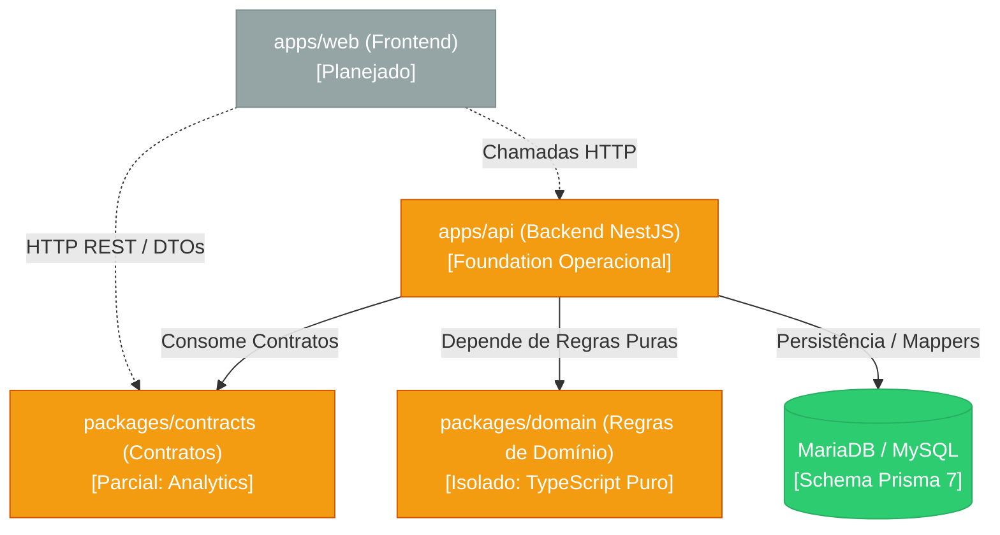
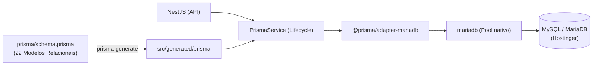
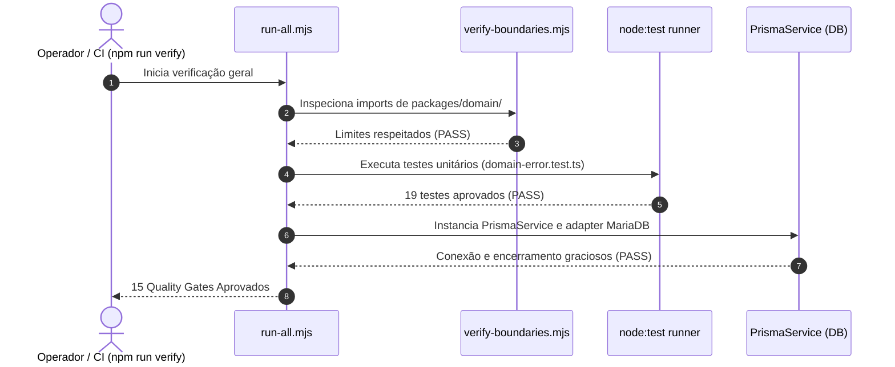

# F1Atlas — Estado Atual da Arquitetura (*Living Architecture Documentation*)

> **Arquivo:** `docs/architecture/current-state.md`  
> **Status:** Documentação Arquitetural Viva (Ativo)  
> **Data da última verificação:** 2026-11-02  
> **Commit de referência:** `284f8a04eb4f6902960a8433e61bf10d7ed1661b`  
> **Branch ativa:** `chore/deps-update-f1atlas`  
> **Escopo da inspeção:** Monorepositório integral (`apps/`, `packages/`, `scripts/`, `docs/`)  
> **Princípio fundamental:** Este documento descreve **a arquitetura que efetivamente existe**, e não apenas a arquitetura que desejamos construir. Diferencia categoricamente código implementado e verificado de estruturas preliminares e componentes planejados.

---

## 1. Identificação

| Propriedade | Valor Observado |
|---|---|
| **Projeto** | F1Atlas (anteriormente F12027 durante o bootstrap) |
| **Natureza** | Plataforma Digital Independente de Automobilismo (Fórmula 1) |
| **Finalidade do Documento** | Retrato arquitetural vivo do repositório, servindo de fonte canônica para desenvolvedores e agentes de IA sobre o estado real da implementação, dependências, fronteiras e decisões ativas. |
| **Fase do Projeto** | Transição entre **M0 (Fundação Arquitetural e Governança)** e **M1 (Modelo de Domínio Fundamental)** |
| **Mecanismo de Manutenção** | Atualização contínua obrigatória pelo fluxo em 6 etapas dos agentes e verificador mecânico automatizado (`scripts/architecture/verify-current-state.mjs`). |

---

## 2. Visão Geral da Arquitetura

O F1Atlas adota como estilo arquitetural o **Monólito Modular** organizado em um monorepositório com **npm workspaces** (`apps/*`, `packages/*`).

A arquitetura é regida estritamente pela diretriz **Backend First**, que estabelece a seguinte ordem conceitual de precedência:
$$\text{Problema} \longrightarrow \text{Regras e Invariantes} \longrightarrow \text{Casos de Uso} \longrightarrow \text{Contratos} \longrightarrow \text{Adaptadores/Persistência} \longrightarrow \text{Apresentação}$$

### Princípios Efetivamente Aplicados vs. Conformidade Verificada

| Princípio | Estado de Conformidade | Evidência no Repositório |
|---|---|---|
| **Isolamento do Domínio** | **Efetivamente Verificado** | O domínio reside no pacote independente `packages/domain` (ADR-0003), sem qualquer dependência de frameworks web, ORMs ou transporte. Verificado mecanicamente por `scripts/architecture/verify-boundaries.mjs`. |
| **Persistência Desacoplada** | **Efetivamente Verificado (Foundation)** | Configurada em `apps/api/src/infrastructure/database/prisma/` com Prisma ORM 7 e driver adapter MariaDB. Modelos isolados do domínio através de portas e mappers (ADR-0002). |
| **Clean Architecture / Portas e Adaptadores** | **Implementação Parcial (Foundation)** | Porta `infrastructure-health-repository.port.ts` e adaptador Prisma implementados em `apps/api`. Casos de uso esportivos ainda não implementados. |
| **Domain-Driven Design (DDD)** | **Estruturado e Planejado** | Módulos conceituais e agregados desenhados e documentados em `packages/domain/src/`. Apenas o componente compartilhado `DomainError` está implementado e validado com testes no momento. |
| **Frontend Precision Motorsport Editorial** | **Apenas Planejado** | Diretrizes visuais e de UX especificadas em `DESIGN.md`. A aplicação `apps/web` ainda não possui código executável. |

---

## 3. Estrutura do Monorepositório

A árvore abaixo reflete exclusivamente os diretórios e arquivos arquiteturalmente relevantes existentes no repositório:

```text
F12027-harness-v0.2/
├── apps/
│   ├── api/                                    # Backend NestJS 11 + Prisma ORM 7
│   │   ├── prisma/
│   │   │   ├── schema.prisma                  # Schema relacional centralizado (22 modelos)
│   │   │   ├── migrations/                    # Diretório de migrações declarativas
│   │   │   └── seed.ts                        # Script de seed da base
│   │   ├── src/
│   │   │   ├── application/
│   │   │   │   └── ports/                     # Interfaces hexagonais (ex: health repo)
│   │   │   ├── infrastructure/
│   │   │   │   ├── database/prisma/           # PrismaService, PrismaModule e repositórios
│   │   │   │   └── mappers/                   # Mapeadores entidade ↔ banco
│   │   │   ├── generated/prisma/              # Prisma Client tipado (gerado pelo Prisma 7)
│   │   │   ├── app.module.ts                  # Módulo raiz NestJS
│   │   │   └── main.ts                        # Ponto de entrada HTTP do NestJS
│   │   ├── prisma.config.ts                   # Configuração de conexão e drivers Prisma 7
│   │   ├── nest-cli.json                      # Configuração de build do NestJS
│   │   ├── tsconfig.json                      # Configuração TypeScript da API
│   │   └── package.json                       # Manifest da API (@f1atlas/api v0.1.0)
│   └── web/                                   # Frontend Next.js (Diretório criado com .gitkeep)
│
├── packages/
│   ├── contracts/                             # Contratos públicos e schemas compartilhados
│   │   └── analytics.mjs                      # Catálogo e validação de eventos analíticos
│   └── domain/                                # Camada pura de domínio (ADR-0003)
│       ├── src/
│       │   ├── shared/                        # Primitivas (domain-error.ts implementado)
│       │   ├── seasons/                       # Temporadas e status (planejado via comentários)
│       │   ├── participants/                  # Pilotos, equipes, construtores (planejado)
│       │   ├── events/                        # GPs, circuitos, sessões, resultados (planejado)
│       │   ├── scoring/                       # Regras FIA, calculadora, desempates (planejado)
│       │   ├── championships/                 # Standings WDC e WCC (planejado)
│       │   └── simulations/                   # Projeções e cenários hipotéticos (planejado)
│       └── test/
│           └── shared/
│               └── domain-error.test.ts       # 19 testes unitários puros (node:test)
│
├── scripts/                                   # Infraestrutura de governança e quality gates
│   ├── quality/                               # Verificadores de integridade, testes e cobertura
│   ├── security/                              # Scanners de segredos, env, symlinks e dependências
│   ├── architecture/                          # Verificadores de limites e conformidade
│   ├── database/                              # Validações de schema, migrations e Prisma
│   ├── analytics/                             # Validação de eventos e privacidade
│   ├── seo/                                   # Validação de metadados e contratos SEO
│   └── tests/                                 # Suíte de testes automatizados do harness
│
├── docs/                                      # Documentação canônica versionada
│   ├── architecture/                          # ADRs, limites modulares e fluxos
│   ├── domain/                                # Documentação dos 7 módulos e status
│   ├── development/                           # Governança de testes, scripts e segurança
│   └── specs/                                 # Especificações de engenharia e produto
│
├── package.json                               # Raiz do monorepositório (npm workspaces)
├── AGENTS.md                                  # Contrato público de governança dos agentes
└── GEMINI.md                                  # Contexto operacional local do Gemini CLI
```

---

## 4. Componentes e Responsabilidades

| Componente | Localização | Papel Previsto | Estado Real Implementado | Tecnologias Verificadas |
|---|---|---|---|---|
| **API Backend** | `apps/api` | Servir dados esportivos via HTTP REST, orquestrar casos de uso, autenticação e persistência. | **Foundation Operacional:** Módulo raiz NestJS, configuração Prisma 7, ciclo de vida de conexões MariaDB e health-check. Sem controllers ou rotas esportivas. | NestJS 11.2, Prisma ORM 7.10.1, MariaDB 3.5, TypeScript 5.9 |
| **Frontend Web** | `apps/web` | Portal público interativo, exploração de dados históricos, visualização de narrativas e simulações. | **Não Iniciado:** Apenas diretório estrutural com `.gitkeep`. Regras visuais documentadas em `DESIGN.md`. | Nenhuma dependência instalada no momento. |
| **Domain** | `packages/domain` | Regras desportivas puras, invariantes da FIA, cálculo determinístico de pontuação, desempates e simulações. | **Em Desenvolvimento Ativo:** 7 módulos estruturados; `domain-error.ts` 100% implementado e validado com testes unitários, cobertura e mutation testing; 21 componentes documentados via comentários. | TypeScript puro, Node.js Test Runner (`node:test`, `node:assert/strict`) |
| **Contracts** | `packages/contracts` | DTOs tipados compartilhados, schemas JSON de API, contratos de integração e catálogo de eventos. | **Foundation Inicial:** `analytics.mjs` implementado com validações de eventos e privacidade (sem PII). DTOs esportivos planejados. | JavaScript ESM nativo |
| **Governança & Scripts** | `scripts/` | Garantir conformidade mecânica contínua, limites arquiteturais, segurança e qualidade de testes. | **Totalmente Operacional:** 15 quality gates públicos integrados via `npm run verify` e suite de 118 testes automatizados. | Node.js v24 ESM nativo |

---

## 5. Dependências Arquiteturais

### 5.1. Matriz de Dependências Permitidas e Observadas



### 5.2. Regras e Limites Arquiteturais Restritivos

1. **Fronteira Inviolável do Domínio:**
   - **Regra:** `packages/domain` **NUNCA** pode importar frameworks HTTP (`@nestjs/*`, `next`, `react`), ORMs (`@prisma/*`, `drizzle-orm`) ou bibliotecas de I/O de rede.
   - **Garantia Mecânica:** Auditado continuamente pelo quality gate `scripts/architecture/verify-boundaries.mjs` (`npm run verify:architecture`).
2. **Direção Unidirecional de Dependência:**
   - `apps/api` $\longrightarrow$ `packages/domain` (Permitido).
   - `packages/domain` $\longrightarrow$ `apps/api` (**Terminantemente Proibido**).
3. **Persistência Confinada à Infraestrutura:**
   - O `PrismaClient` é instanciado exclusivamente dentro de `apps/api/src/infrastructure/database/prisma/`.
   - Entidades de domínio nunca utilizam anotações `@Injectable()` do NestJS ou tipos gerados do banco de dados.

---

## 6. Organização Detalhada da API (`apps/api`)

### Estrutura Real de Diretórios e Componentes

- **`src/main.ts`**: Ponto de entrada da aplicação NestJS. Inicializa a fábrica `NestFactory.create(AppModule)` e gerencia escuta HTTP.
- **`src/app.module.ts`**: Módulo central que importa `ConfigModule.forRoot` e `PrismaModule`.
- **`src/application/ports/`**:
  - `infrastructure-health-repository.port.ts`: Interface abstrata que desacopla a verificação de saúde da tecnologia do banco.
- **`src/infrastructure/database/prisma/`**:
  - `prisma.service.ts`: Serviço que encapsula o ciclo de vida da conexão com o banco utilizando `OnModuleInit` e `OnModuleDestroy`. Instancia o `PrismaClient` com o driver adapter MariaDB (`@prisma/adapter-mariadb`).
  - `prisma.module.ts`: Exporta `PrismaService` e os provedores de repositórios concretos.
  - `repositories/prisma-infrastructure-health.repository.ts`: Implementação concreta da porta utilizando o cliente gerado.
  - `tests/prisma-service.spec.ts`: Teste de integração do ciclo de vida do serviço de persistência.
- **`src/infrastructure/mappers/`**:
  - `infrastructure-health.mapper.ts`: Conversor bidirecional entre o modelo de banco e o contrato de aplicação.
- **`src/generated/prisma/`**: Código do cliente tipado gerado deterministicamente a partir de `schema.prisma`.

> [!NOTE]
> **Componentes Ausentes (Ainda não implementados):** Controllers REST esportivos (`DriversController`, `SeasonsController`, etc.), casos de uso de negócio da F1, middlewares de autenticação, interceptors globais de logging e pipes de validação customizados.

---

## 7. Organização Detalhada do Domain (`packages/domain`)

O domínio é estruturado em **7 módulos conceituais**, agrupando agregados, entidades duráveis, value objects e funções puras conforme modelado em `docs/domain/`:

| Módulo | Documento Especializado | Responsabilidade Principal | Componentes Estruturados | Estado Atual |
|---|---|---|---|---|
| **`shared`** | [`docs/domain/shared.md`](../domain/shared.md) | Primitivas compartilhadas, tratamento de erros semântico e mônadas. | `domain-error.ts`, `entity-id.ts`, `result.ts` | **Em Desenvolvimento:** `domain-error.ts` implementado e validado com 19 testes; `entity-id.ts` e `result.ts` documentados. |
| **`seasons`** | [`docs/domain/seasons.md`](../domain/seasons.md) | Calendário da temporada, ciclo de homologação de etapas e regras vigentes. | `season.ts`, `season-status.ts` | **Documentado:** Planejado via comentários níveis 1 e 2. |
| **`participants`** | [`docs/domain/participants.md`](../domain/participants.md) | Identidades duráveis de competidores e contratos temporais. | `driver.ts`, `team.ts`, `constructor.ts`, `season-entry.ts` | **Documentado:** Invariantes temporais desenhadas. |
| **`events`** | [`docs/domain/events.md`](../domain/events.md) | Grandes Prêmios, circuitos, sessões cronometradas e resultados de pista. | `circuit.ts`, `grand-prix.ts`, `session.ts`, `session-entry.ts`, `session-result.ts` | **Documentado:** Ciclo de homologação de resultados planejado. |
| **`scoring`** | [`docs/domain/scoring.md`](../domain/scoring.md) | Motor determinístico de cálculo de pontos da FIA e desempates (*countback*). | `scoring-ruleset.ts`, `points-calculator.ts`, `tie-break-policy.ts` | **Documentado:** Regra 2025 (volta rápida = 0) planejada. |
| **`championships`** | [`docs/domain/championships.md`](../domain/championships.md) | Apuração acumulada de pontuações de pilotos (WDC) e construtores (WCC). | `driver-standings.ts`, `constructor-standings.ts`, `standings-calculator.ts` | **Documentado:** Acumuladores e variações de grid planejados. |
| **`simulations`** | [`docs/domain/simulations.md`](../domain/simulations.md) | Simulações determinísticas de cenários sem violar dados históricos. | `championship-scenario.ts`, `scenario-evaluator.ts` | **Documentado:** Isolamento estrito de resultados simulados. |

---

## 8. Organização do Frontend (`apps/web`)

- **Estado Efetivo:** Diretório criado com `.gitkeep`. Nenhuma dependência instalada, nenhum arquivo de configuração (`next.config.js`, `tsconfig.json`) ou rotas existem no disco.
- **Diretriz de Design Aprovada:** A linguagem visual adotada é a **Precision Motorsport Editorial** (alinhada à estética Solo Clarity), documentada em [`DESIGN.md`](../../DESIGN.md):
  - Interface responsiva com foco em tipografia editorial, hierarquia de dados e tabelas legíveis.
  - Acessibilidade WCAG 2.2 AA como meta normativa.
  - Separação estrita: o frontend nunca calculará pontuações nem ditará regras de domínio; apenas consumirá contratos da API.

---

## 9. Dados e Persistência

A infraestrutura de dados foi padronizada na decisão arquitetural **ADR-0002**:



- **SGBD Alvo:** MySQL / MariaDB (compatível com a infraestrutura Hostinger).
- **ORM:** Prisma ORM 7 fixado estritamente na versão estável `7.10.1`.
- **Driver Adapter:** `@prisma/adapter-mariadb@7.10.1` com driver nativo `mariadb@3.5.4`.
- **Configuração de Conexão:** Centralizada em `apps/api/prisma.config.ts` (sem URL hardcoded no schema).
- **Schema Centralizado:** `apps/api/prisma/schema.prisma` modelando 22 tabelas relacionais com índices determinísticos e integridade referencial.
- **Governança de Migrations:**
  - Migrações versionadas em `apps/api/prisma/migrations/`.
  - Verificador estático de migrations (`scripts/database/check-migrations.mjs`) que bloqueia instruções SQL destrutivas proibidas (`DROP DATABASE`, `DROP TABLE` em prod).
  - Verificador anti-regressão do Prisma 6 (`scripts/database/check-prisma-version.mjs`).

---

## 10. Comunicação e Fluxo de Dados

### 10.1. Fluxo Efetivamente Implementado no Momento
No estado atual da fundação, o fluxo de execução validado é o ciclo de **Inicialização de Infraestrutura e Validação**:



### 10.2. Fluxo Planejado para a Plataforma Completa
1. **Ingestão Histórica:** Provedor autorizado $\longrightarrow$ Validador de payload $\longrightarrow$ Normalizador $\longrightarrow$ Persistência relacional com proveniência de dados (`SPEC-DATA-001`).
2. **Consulta e Apuração Esportiva:** `apps/web` $\longrightarrow$ Chamada HTTP REST $\longrightarrow$ `apps/api` (Controllers/Casos de Uso) $\longrightarrow$ Invocação das regras de cálculo de `packages/domain` $\longrightarrow$ Resposta DTO serializada $\longrightarrow$ Renderização contextual.

---

## 11. Mecanismos de Teste e Quality Gates

O F1Atlas possui uma robusta infraestrutura de verificação automatizada, governada por [`docs/development/test-governance.md`](../development/test-governance.md):

| Mecanismo de Teste | Script Verificador | Comando | Estado Atual | Evidências / Métricas |
|---|---|---|---|---|
| **Testes Unitários de Domínio** | `node:test` nativo | `npm run test:domain` | **Ativo** | 19 testes unitários em `domain-error.test.ts` (100% aprovados em ~290ms). |
| **Integridade e Antifrágilidade** | `scripts/quality/verify-test-quality.mjs` | `npm run test:quality` | **Ativo** | 8 suítes auditadas contra testes vazios, sem asserções, com skips sem justificativa ou catches mascaradores. |
| **Cobertura de Código** | `scripts/quality/verify-test-coverage.mjs` | `npm run test:coverage` | **Ativo** | Linhas: **100%** (alvo $\ge 90\%$), Branches: **93.75%** (alvo $\ge 85\%$), Funções: **100%** (alvo $\ge 90\%$). |
| **Mutation Testing** | `scripts/quality/verify-mutation-quality.mjs` | `npm run test:mutation` | **Ativo** | **100.0% de score** (7 de 7 mutantes semânticos eliminados; alvo $\ge 80\%$). |
| **Testes de Persistência** | `apps/api/src/.../prisma-service.spec.ts` | `npm run db:verify` | **Ativo** | Validação em runtime de compilação, conexão com adapter MariaDB e encerramento. |
| **Testes de Governança** | `scripts/tests/*.test.mjs` | `npm run test:harness` | **Ativo** | 99 testes automatizados cobrindo segurança, envs, regras de agentes, SPECs e scripts de teste. |
| **Orquestrador Central** | `scripts/quality/run-all.mjs` | `npm run verify` | **Ativo** | 15 gates sequenciais (13 PASS, 2 SKIP justificados, 0 FAIL). |

---

## 12. Limitações Conhecidas e Divergências Arquiteturais

1. **Camada Domain Incompleta:** Dos 22 arquivos planejados em `packages/domain/src/`, apenas 1 está implementado (`shared/domain-error.ts`). Os demais 21 contêm apenas o planejamento em comentários estruturados.
2. **Ausência de Endpoints de Negócio na API:** A API NestJS possui scaffold funcional e persistência configurada, mas nenhum controller ou caso de uso esportivo foi implementado ainda.
3. **Frontend Inexistente:** `apps/web` não possui arquivos de código ou dependências instaladas.
4. **Gates em Estado SKIP Legítimo:**
   - *Dependências:* `scripts/security/verify-dependencies.mjs` relata `SKIP` na raiz porque o pacote raiz não declara dependências externas diretas.
   - *SEO Técnico:* `scripts/seo/validate-metadata.mjs` relata `SKIP` por não haver rotas web públicas implementadas.
5. **Decisões Arquiteturais Pendentes:**
   - Modelagem de contratos DTOs em `packages/contracts` para intercâmbio com a API.
   - Escolha do motor de testes de integração ponta a ponta para a aplicação web quando for iniciada.

---

## 13. Referências Arquiteturais e Fontes Canônicas

- **Separação Arquitetural do Domínio:** [`docs/domain/architectural-separation.md`](../domain/architectural-separation.md)
- **Status Detalhado de Componentes do Domínio:** [`docs/domain/development-status.md`](../domain/development-status.md)
- **Índice da Documentação do Domínio:** [`docs/domain/README.md`](../domain/README.md)
- **Decisões Arquiteturais Aprovadas (ADRs):**
  - [ADR-0001: Monólito Modular como Hipótese Inicial](adr/0001-modular-monolith.md)
  - [ADR-0002: Persistência com Prisma ORM 7 e MySQL no NestJS](adr/0002-prisma-mysql-persistence.md)
  - [ADR-0003: Segregação do Domínio em Pacote Independente](adr/0003-domain-package-separation.md)
- **Governança de Engenharia e Testes:**
  - [Política de Testes e Quality Gates](../development/test-governance.md)
  - [Governança de Persistência e Banco](../development/technology-governance.md)
  - [Governança de Variáveis de Ambiente](../development/environment-variables.md)
  - [Governança de Segurança](../development/security-governance.md)
  - [Contrato Canônico de Agentes](../../AGENTS.md)
