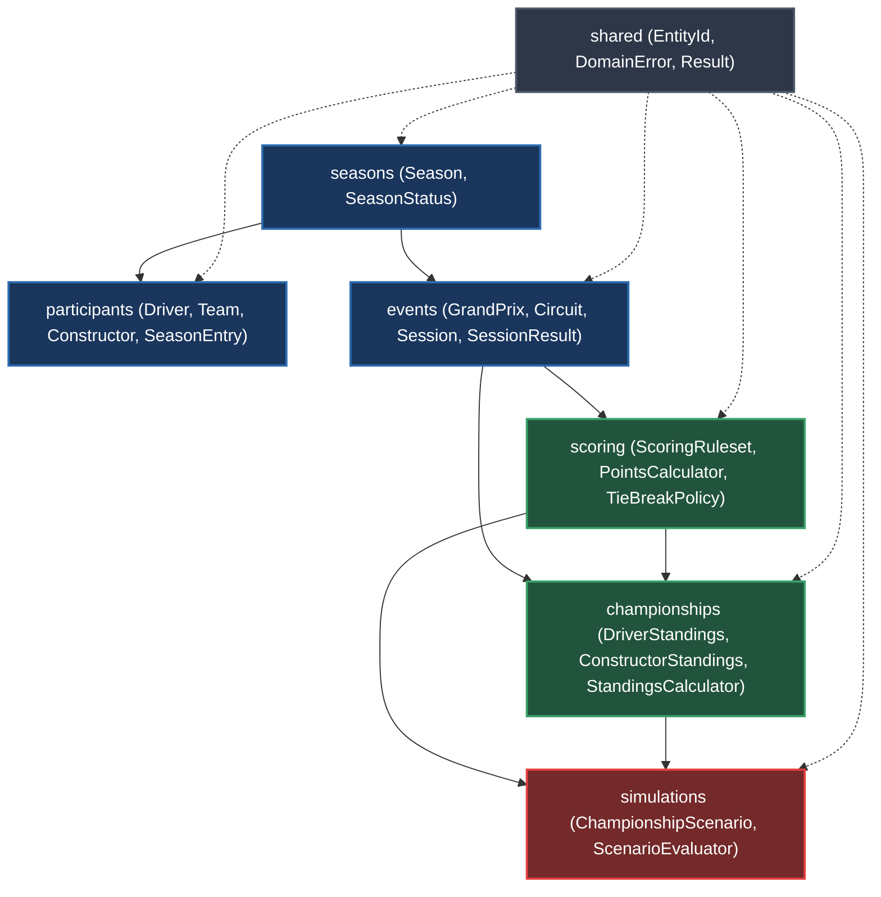
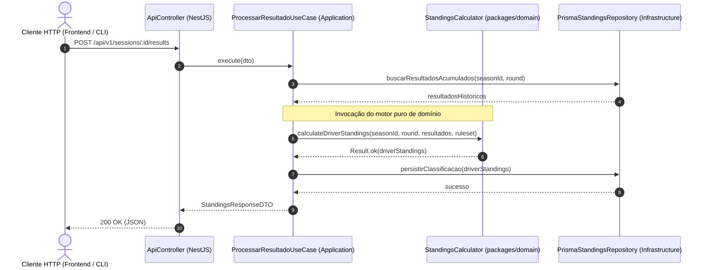

# Arquitetura da Camada Domain — F1Atlas

> **Localização:** `docs/domain/README.md`  
> **Escopo:** Visão geral da camada de regras de negócio esportivas do F1Atlas  
> **Pacote correspondente:** `packages/domain/`  
> **Status:** Fundação estruturada e documentada; implementação incremental em andamento  

---

## 1. O que representa a camada Domain no F1Atlas?

A camada **Domain** (`packages/domain`) é o núcleo conceitual e funcional soberano do **F1Atlas**. Ela encapsula as **regras de negócio do automobilismo**, os modelos das entidades esportivas (pilotos, equipes, construtores, temporadas, circuitos e eventos), as fórmulas determinísticas de pontuação da FIA e os mecanismos de simulação hipotética.

No F1Atlas, o domínio não é um reflexo de tabelas de banco de dados nem uma camada subordinada a endpoints HTTP. Ele modela a realidade do esporte a motor de forma pura, agnóstica a detalhes de infraestrutura e independente de qualquer framework tecnológico.

---

## 2. Relação com Domain-Driven Design (DDD) e Clean Architecture

A arquitetura do F1Atlas adota o princípio **Backend First** estabelecido no contrato canônico (`AGENTS.md`):

$$\text{Problema} \longrightarrow \text{Regras e Invariantes} \longrightarrow \text{Casos de Uso} \longrightarrow \text{Contratos} \longrightarrow \text{Adaptadores/Persistência} \longrightarrow \text{Apresentação}$$

Nesse fluxo, a camada Domain situa-se no centro da aplicação:

- **Isolamento Tecnológico:** O código de domínio não importa `@nestjs`, `@prisma`, `next`, `react`, nem bibliotecas de persistência ou rede. Ele expressa regras puras em TypeScript.
- **Entidades e Agregados:** Componentes como `Season`, `GrandPrix`, `DriverStandings` e `ChampionshipScenario` atuam como raízes de agregação garantindo a consistência transacional e as invariantes esportivas.
- **Objetos de Valor (Value Objects):** Conceitos como `EntityId`, `DomainError` e `ScoringRuleset` operam como estruturas imutáveis comparadas por valor.
- **Serviços de Domínio (Domain Services):** Operações puras e sem efeitos colaterais como `PointsCalculator`, `TieBreakPolicy`, `StandingsCalculator` e `ScenarioEvaluator` executam cálculos complexos que não pertencem a uma única entidade.

---

## 3. Diferença entre Regras de Negócio, Casos de Uso e Infraestrutura

Para preservar os limites arquiteturais, o F1Atlas diferencia categoricamente as três camadas:

| Camada | Localização | Responsabilidade | O que NÃO faz |
|---|---|---|---|
| **Domínio (Domain)** | `packages/domain` | Invariantes esportivas, cálculo de pontos, validação de regras de corrida, desempates e simulações determinísticas. | Não acessa banco de dados, não conhece rotas HTTP, não gera DTOs para frontend, não serializa JSON de rede. |
| **Aplicação (Application / Use Cases)** | `apps/api/src/application` | Orquestração de fluxos, transações de negócio, chamadas a repositórios, despacho de eventos e autenticação. | Não define regras de pontuação da FIA, não altera fórmulas de campeonato, não acopla a telas. |
| **Infraestrutura (Infrastructure)** | `apps/api/src/infrastructure` | Implementação de repositórios com Prisma ORM / MySQL, chamadas a APIs externas, adaptadores de telemetria e mensageria. | Não decide se um resultado é oficial, não calcula posições na tabela sem o domínio. |

---

## 4. Mapa dos Módulos do Domínio

O domínio do F1Atlas está organizado em sete módulos funcionais e um módulo compartilhado transversal:

---

## 5. Resumo dos Módulos e Estado Atual de Implementação

> [!NOTE]
> O detalhamento granular do progresso, evidências de testes e pendências de cada componente reside centralizadamente em [development-status.md](./development-status.md).

A tabela abaixo resume o catálogo dos módulos da camada `packages/domain/src/`:

| Módulo | Documento Dedicado | Responsabilidade Principal | Arquivos e Componentes | Estado Atual |
|---|---|---|---|---|
| **shared** | [shared.md](./shared.md) | Primitivas transversais, Value Objects de identidade, erros de domínio e padrão Result. | `entity-id.ts`, `domain-error.ts`, `result.ts` | **Em desenvolvimento** (1 validado; 2 documentados) |
| **seasons** | [seasons.md](./seasons.md) | Ciclo de vida de temporadas, transições de status e enquadramento de calendário. | `season.ts`, `season-status.ts` | **Documentado** (planejamento via comentários nível 1 e 2) |
| **participants** | [participants.md](./participants.md) | Pilotos, equipes, construtores e inscrições temporais oficiais por temporada. | `driver.ts`, `team.ts`, `constructor.ts`, `season-entry.ts` | **Documentado** |
| **events** | [events.md](./events.md) | Grandes Prêmios, autódromos/circuitos, sessões cronometradas e resultados oficiais. | `grand-prix.ts`, `circuit.ts`, `session.ts`, `session-entry.ts`, `session-result.ts` | **Documentado** |
| **scoring** | [scoring.md](./scoring.md) | Regulamentos de pontuação FIA (GP e Sprint), motor de cálculo determinístico e desempates (*countback*). | `scoring-ruleset.ts`, `points-calculator.ts`, `tie-break-policy.ts` | **Documentado** |
| **championships** | [championships.md](./championships.md) | Tabelas consolidadas do WDC e WCC, cálculo acumulado de posições e rastreabilidade esportiva. | `driver-standings.ts`, `constructor-standings.ts`, `standings-calculator.ts` | **Documentado** |
| **simulations** | [simulations.md](./simulations.md) | Cenários hipotéticos ("What-If"), avaliação de resultados simulados e chances matemáticas de título. | `championship-scenario.ts`, `scenario-evaluator.ts` | **Documentado** |

---

## 6. Como a Camada Domain é Consumida pela API

A aplicação de backend (`apps/api`) consome `packages/domain` como um pacote interno de dependência direta no monorepositório npm.

1. **Os controladores do NestJS** recebem requisições HTTP e validam formatos básicos via DTOs da camada de aplicação/contratos.
2. **Os casos de uso (Application Services)** coordenam o fluxo: buscam entidades necessárias via portas de repositórios, acionam as regras de negócio puras em `packages/domain` e persistem o novo estado homologado.
3. **O domínio emite entidades ou objetos de valor** protegidos por invariantes. Em caso de falha de negócio, retorna `Result.fail(DomainError)`, que a API traduz em códigos semânticos e status HTTP adequados.

---

## 7. Princípios que Orientam a Evolução da Camada Domain

1. **Backend First:** A interface nunca dita as regras do campeonato nem a integridade de dados do automobilismo.
2. **Determinismo Absoluto:** Cálculos de pontos e tabelas não sofrem efeitos colaterais de relógio de sistema, variáveis de ambiente ou estado externo. As mesmas entradas sempre geram exatamente a mesma pontuação.
3. **Isolamento de Simulação:** Resultados hipotéticos (`SIMULATED`) são estruturalmente segregados de resultados oficiais (`OFFICIAL`), impossibilitando a contaminação acidental de dados históricos.
4. **Resolução de Erros Funcional:** Preferência pelo padrão monádico `Result<T, DomainError>` para falhas esperadas de negócio, reservando o lançamento de exceções (`throw`) apenas para quebras inegociáveis de invariantes em construtores.
5. **Independência Física do Pacote:** O domínio reside em `packages/domain`, e não acoplado dentro do framework NestJS em `apps/api`. A justificativa detalhada dessa decisão arquitetural pode ser consultada em [architectural-separation.md](./architectural-separation.md).

---

## 8. Navegação da Documentação

- [development-status.md](./development-status.md) — **Painel Central de Acompanhamento de Desenvolvimento e Evidências**
- [shared.md](./shared.md) — Elementos Compartilhados e Primitivas Fundamentais
- [seasons.md](./seasons.md) — Temporadas e Ciclo de Vida
- [participants.md](./participants.md) — Pilotos, Equipes, Construtores e Inscrições
- [events.md](./events.md) — Grandes Prêmios, Circuitos, Sessões e Resultados
- [scoring.md](./scoring.md) — Regras e Motor de Cálculo de Pontuação
- [championships.md](./championships.md) — Classificação dos Campeonatos de Pilotos e Construtores
- [simulations.md](./simulations.md) — Cenários Hipotéticos e Avaliação de Simulações
- [architectural-separation.md](./architectural-separation.md) — Justificativa Arquitetural: Por que Domain está fora da API?
