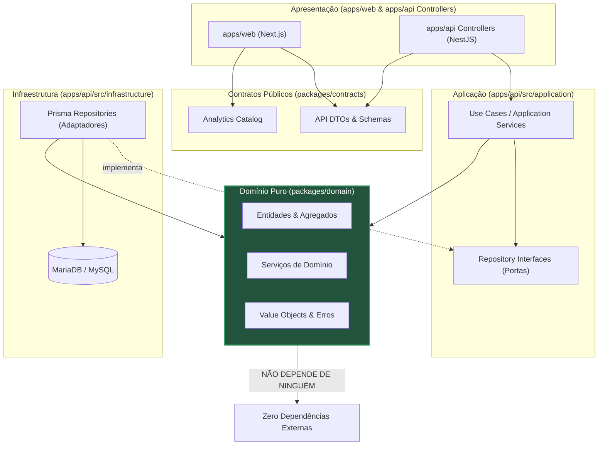

# Justificativa Arquitetural: Por que o Domínio está fora da API?

> **Localização:** `docs/domain/architectural-separation.md`  
> **Tema:** Decisão arquitetural de segregação física entre `packages/domain` e `apps/api`  
> **Papel arquitetural:** Justificativa técnica, análise de trade-offs e limites no monorepositório  
> **Documento pai:** [README.md](./README.md)  

---

## 1. Contexto da Decisão

No **F1Atlas**, a arquitetura do monorepositório organiza o código-fonte em duas macro-regiões:

```text
f1atlas/
├── apps/
│   ├── api/             → Backend da aplicação (NestJS, controllers, infraestrutura, persistência)
│   └── web/             → Aplicação de apresentação web (Next.js, UI, páginas, design system)
│
└── packages/
    ├── contracts/       → Contratos públicos de comunicação, schemas de API e eventos analíticos
    └── domain/          → Regras de negócio puras, entidades esportivas, pontuação e simulações
```

Uma das primeiras decisões estruturais tomadas no projeto foi: **a camada de domínio reside em um pacote de biblioteca independente (`packages/domain`), e não dentro da árvore de diretórios da aplicação backend (`apps/api/src/domain/`)**.

Este documento apresenta a justificativa técnica, os benefícios concretos, os custos assumidos e os critérios para eventual reavaliação dessa decisão.

---

## 2. Alternativas Consideradas

### Alternativa A — Domínio Colocalizado na API (`apps/api/src/domain/`)

Nesta abordagem, as regras de negócio, entidades e serviços residiriam como subdiretório interno da aplicação NestJS.

- **Vantagens:**
  - Menor overhead inicial de configuração: sem necessidade de pacotes npm intermediários, exports ou compilação de biblioteca interna.
  - Fluxo de trabalho simplificado para desenvolvedores acostumados com scaffolds convencionais do NestJS.
  - Menor quantidade de arquivos `package.json` e `tsconfig.json`.
- **Limitações e Riscos:**
  - **Vazamento de Framework:** Tendência crônica de injetar decorators do NestJS (`@Injectable()`, `@Module()`) e anotações de validação HTTP (`class-validator`) diretamente dentro das entidades de domínio.
  - **Acoplamento Tecnológico:** O domínio torna-se prisioneiro do ecossistema de runtime da API.
  - **Impossibilidade de Reutilização Direta:** O frontend (`apps/web`), ferramentas de console (CLI) ou workers assíncronos não conseguem consumir as regras puras de cálculo de pontos ou simulação sem importar o monólito backend completo ou duplicar código.
- **Quando seria adequada:** Em microsserviços pequenos, monólitos estritamente focados em CRUD ou projetos de curta duração onde a lógica esportiva é mínima.

---

### Alternativa B — Domínio como Pacote Independente (`packages/domain/`) *(Escolhida)*

Nesta abordagem, a camada de domínio é um pacote TypeScript independente dentro dos workspaces do monorepositório.

- **Vantagens:**
  - **Isolamento Absoluto:** Impossibilidade mecânica de importar dependências do NestJS, Prisma ou Next.js (protegida inclusive pelo verificador de limites `scripts/architecture/verify-boundaries.mjs`).
  - **Testabilidade Ultra-Rápida:** Testes de regras esportivas executam diretamente contra funções puras e classes do TypeScript, sem precisar inicializar containers de injeção de dependência ou instâncias do NestJS.
  - **Reutilização Universal:** A mesma lógica determinística de cálculo de pontos ou de avaliação de cenários hipotéticos pode ser consumida pela API, por ferramentas CLI de administração, por pipelines de ingestão ou até pelo cliente frontend para simulações interativas offline.
  - **Respeito Estrito ao Backend First:** As regras esportivas são concebidas, modeladas e testadas antes e independentemente de como serão expostas via HTTP ou persistidas em banco de dados.
- **Custos e Responsabilidades:**
  - Configuração de monorepo (npm workspaces, referências de build no TypeScript).
  - Necessidade de disciplina rigorosa de contratos para que a API não tente expor diretamente entidades internas para a web.

---

## 3. Desmistificação: Separação Física vs. Teoria Arquitetural

> [!NOTE]
> **Esclarecimento Importante sobre DDD e Clean Architecture:**  
> A separação em pacotes npm físicos **NÃO é uma exigência dogmática de Domain-Driven Design nem de Clean Architecture**.  
> Ambos os paradigmas exigem **fronteiras lógicas claras** e **inversão de dependências**, o que pode perfeitamente ser alcançado dentro de um mesmo repositório ou pasta através de convenções de diretórios.  
> 
> No F1Atlas, a escolha de um pacote físico independente em `packages/domain` foi uma **decisão de engenharia deliberada de proteção arquitetural**: no ecossistema Node.js/TypeScript, fronteiras apenas lógicas tendem a se degradar com o tempo através de "auto-imports" acidentais de IDEs. A segregação em pacote físico torna a violação de limites detectável de forma imediata por linters, scripts de build e quality gates.

---

## 4. Direção das Dependências (Dependency Rule)

A arquitetura do F1Atlas aplica com rigor a regra de dependências da Clean Architecture: **as dependências de código-fonte apontam sempre para dentro, em direção aos conceitos de mais alto nível (Domínio)**.



### Distinção entre Fluxo de Execução e Direção de Dependência:
- **No fluxo de execução (Runtime):** A requisição HTTP entra pelo Controller, passa pelo Use Case, consulta o banco via Prisma e aciona o Domínio para apuração.
- **Na direção de dependência de código (Compile-time):** A infraestrutura e a aplicação dependem do domínio; o domínio **não conhece** a infraestrutura, nem o Prisma, nem o NestJS. As portas (interfaces) residem nas camadas internas, e os adaptadores de banco implementam essas portas do lado externo (Inversão de Controle).

---

## 5. Papel de Cada Componente no Monorepositório

| Componente | Papel Arquitetural | O que contém | O que NÃO pode conter |
|---|---|---|---|
| **`packages/domain`** | Núcleo do Domínio | Entidades puras, regras da FIA, cálculo de pontuação, desempates e simulações. | Dependências de frameworks, ORMs, I/O de disco ou rede, variáveis de ambiente. |
| **`packages/contracts`** | Contratos de Comunicação | DTOs de API, schemas de validação de payload, catálogos de eventos analíticos e tipos de transporte. | Regras esportivas complexas de corrida ou acesso a persistência. |
| **`apps/api`** | Aplicação Backend | Casos de uso, controladores NestJS, injeção de dependência, migrations do Prisma e adaptadores MariaDB/MySQL. | Regras de pontuação duplicadas fora de `packages/domain`. |
| **`apps/web`** | Aplicação Frontend | Páginas Next.js, componentes React, design system (Solo Clarity), telemetria e interações do usuário. | Conexão direta a banco de dados ou reescrita das regras esportivas. |

---

## 6. Custos Reais e Trade-offs Assumidos

A escolha de manter `packages/domain` fora da API acarreta custos de engenharia que o projeto reconhece e assume conscientemente:

1. **Configuração de Workspaces:** Requer orquestração correta do `package.json` raiz (`workspaces: ["apps/*", "packages/*"]`) e referências nos `tsconfig.json`.
2. **Ciclo de Build e Resolução de Módulos:** O código TypeScript da API precisa resolver os módulos do domínio sem criar caminhos quebrados em produção.
3. **Mapeamento de Objetos (Anti-Corruption Layer):** A API não pode simplesmente retornar entidades de domínio brutas como JSON na resposta HTTP. É necessário mapear explicitamente entidades de domínio para DTOs de resposta da camada `packages/contracts`.
4. **Governança Ativa de Limites:** Exige a manutenção de scripts determinísticos (como `verify-boundaries.mjs`) no pipeline de CI/CD para impedir que desenvolvedores importem dependências indevidas.

---

## 7. Critérios para Reavaliar a Decisão

A organização atual não é um dogma imutável. Ela deverá ser formalmente reavaliada caso:

1. **Sobrecarga de Manutenção Injustificada:** Se a complexidade de compilação, link de pacotes e exports no monorepositório começar a consumir tempo excessivo sem contrapartida de reutilização.
2. **Escopo Unificado Estritamente Backend:** Se for comprovado documentalmente que nenhuma ferramenta adicional (nem frontend, nem CLI, nem workers analíticos) jamais precisará consumir as regras de domínio fora do processo do NestJS.
3. **Adoção de Monólito Integrado:** Caso se decida que o monorepositório deve ser consolidado em uma única aplicação autônoma sem pacotes compartilhados.

Enquanto esses critérios não se confirmarem, a separação em `packages/domain` permanece como a decisão oficial de arquitetura do F1Atlas.

---

## 8. Conclusão

A segregação do domínio em `packages/domain` protege o maior patrimônio de software do **F1Atlas**: **a fidelidade, o determinismo e a auditabilidade das regras esportivas do automobilismo**. 

Essa organização garante que a evolução do framework web, a troca de versão do NestJS ou a substituição de ORMs de infraestrutura nunca ameacem nem contaminem a precisão dos cálculos do Campeonato Mundial de Fórmula 1.
