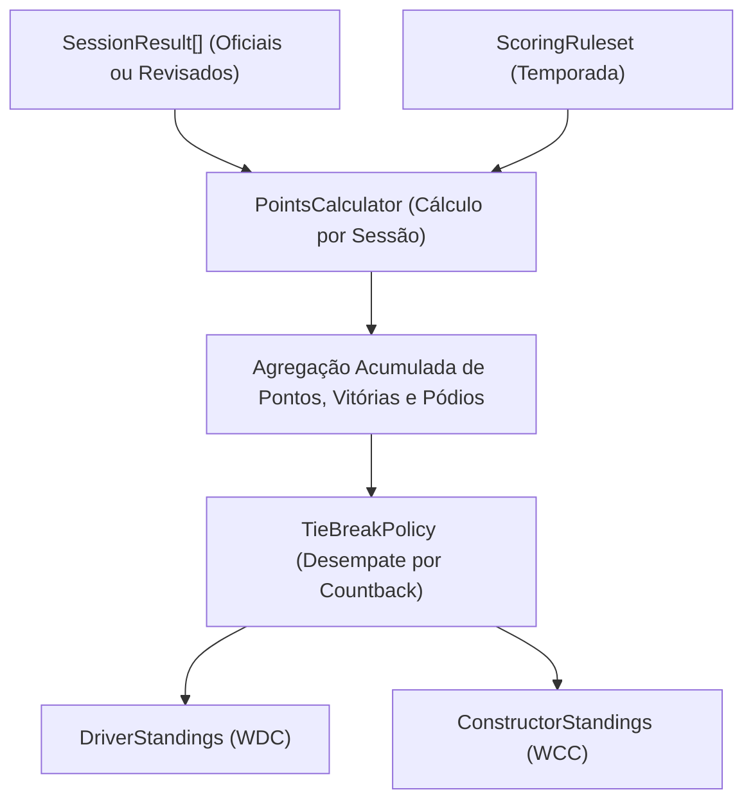

# Módulo Championships — Classificação dos Campeonatos de Pilotos e Construtores

> **Localização:** `docs/domain/championships.md`  
> **Caminho no código:** `packages/domain/src/championships/`  
> **Papel arquitetural:** Agregados de classificação e serviço de apuração de campeonatos mundiais  
> **Documento pai:** [README.md](./README.md)  

---

## 1. Visão Geral

O módulo **`championships`** gerencia as tabelas consolidadas do Campeonato Mundial de Pilotos (World Drivers' Championship — WDC) e do Campeonato Mundial de Construtores (World Constructors' Championship — WCC). Ele orquestra o acúmulo progressivo de pontos, vitórias e pódios ao longo das etapas da temporada, fornecendo visões imutáveis e auditáveis da disputa pelo título.

A integridade do F1Atlas exige que **cada ponto na tabela de classificação seja matematicamente rastreável** até os resultados individuais de corrida que o originaram.

---

## 2. Responsabilidades

### O que pertence ao módulo `championships`:
- A raiz de agregado `DriverStandings`, representando a tabela do campeonato de pilotos acumulada até uma determinada rodada (`roundNumber`).
- A raiz de agregado `ConstructorStandings`, representando a tabela de equipes/construtores acumulada.
- O serviço de domínio `StandingsCalculator`, que orquestra a leitura dos resultados homologados, o cálculo de pontos via `PointsCalculator` e o desempate via `TieBreakPolicy`.
- A distinção rigorosa entre classificações oficiais da temporada e projeções hipotéticas de simulação.
- O cálculo da variação de posições (`rankChange`) em relação à etapa anterior.

### O que NÃO pertence ao módulo `championships`:
- O cálculo isolado da pontuação de uma única corrida (escopo de `scoring/points-calculator`).
- O armazenamento persistente em tabelas SQL ou execução de queries complexas (escopo de persistência/Prisma em `apps/api`).
- A renderização visual das tabelas no frontend (escopo de UI/Design).

---

## 3. Componentes

| Arquivo TypeScript | Conceito Representado | Papel Arquitetural | Estado Atual |
|---|---|---|---|
| `championships/driver-standings.ts` | Tabela do Campeonato de Pilotos | Raiz de Agregado / Visão Consolidada | **Planejado** (planejamento via comentários nível 1 e 2) |
| `championships/constructor-standings.ts` | Tabela do Campeonato de Construtores | Raiz de Agregado / Visão Consolidada | **Planejado** (planejamento via comentários nível 1 e 2) |
| `championships/standings-calculator.ts` | Calculadora de Classificação Geral | Serviço de Domínio (Domain Service) | **Planejado** (planejamento via comentários nível 1 e 2) |

---

## 4. Fluxo de Apuração de Classificação

O serviço `StandingsCalculator` atua como agregador puro conectando os blocos fundamentais de domínio:

---

## 5. Regras de Negócio e Invariantes

### 5.1. Regras Confirmadas
1. **Sequencialidade de Posições (Rank):** A ordem de classificação deve formar uma sequência inteira rigorosa ($1, 2, 3, \dots, N$) sem saltos ou buracos.
2. **Unicidade de Competidores:** Não pode existir mais de uma entrada para o mesmo `driverId` em `DriverStandings` ou para o mesmo `constructorId` em `ConstructorStandings`.
3. **Liderança por Pontuação:** O competidor na posição 1 (`rank = 1`) deve possuir a maior pontuação acumulada ou ter vencido os critérios de desempate da `TieBreakPolicy`.
4. **Isolamento de Simulação:** Uma tabela gerada com dados hipotéticos deve possuir obrigatoriamente a flag `isSimulation = true`, impedindo sua persistência como dado oficial da FIA.

### 5.2. Regras Propostas
- **Auditabilidade Retroativa:** Para qualquer rodada $K$ da temporada, o domínio deve ser capaz de reconstruir deterministicamente a tabela exata que existia ao término daquela rodada, garantindo a navegação histórica do F1Atlas ("Como estava a tabela após o GP de Mônaco?").

---

## 6. Operações e Comportamentos

- **`createDriverStandings(props): Result<DriverStandings, DomainError>`:**  
  Instancia a tabela imutável de pilotos garantindo ordenação estrita e unicidade de participantes.
- **`getDriverStandingEntry(standings, driverId): DriverStandingEntry | null`:**  
  Consulta a situação competitiva atual de um determinado piloto (posição, pontos, vitórias).
- **`createConstructorStandings(props): Result<ConstructorStandings, DomainError>`:**  
  Instancia a tabela imutável de equipes/construtores.
- **`getConstructorStandingEntry(standings, constructorId): ConstructorStandingEntry | null`:**  
  Consulta os dados consolidados de um construtor na tabela.
- **`calculateDriverStandings(seasonId, roundNumber, results, ruleset, previousStandings?): Result<DriverStandings, DomainError>`:**  
  Orquestra a apuração completa da tabela de pilotos a partir dos resultados de pista até a rodada informada.
- **`calculateConstructorStandings(seasonId, roundNumber, results, ruleset, previousStandings?): Result<ConstructorStandings, DomainError>`:**  
  Orquestra a apuração consolidada das equipes.

---

## 7. Exemplo Prático: Evolução de Classificação em Duas Etapas

1. **Round 1 (GP da Austrália):**
   - Piloto A vence a corrida: 25 pontos (`rank = 1`).
   - Piloto B chega em 2º lugar: 18 pontos (`rank = 2`).
2. **Round 2 (GP da China - fim de semana Sprint):**
   - Na Sprint: Piloto B vence (8 pts), Piloto A chega em 2º (7 pts).
   - Na Corrida Principal: Piloto B vence (25 pts), Piloto A chega em 2º (18 pts).
3. **Apuração Consolidada pós-Round 2:**
   - Piloto B: $18 + 8 + 25 = 51\text{ pontos}$ (`rank = 1`, `rankChange = +1`).
   - Piloto A: $25 + 7 + 18 = 50\text{ pontos}$ (`rank = 2`, `rankChange = -1`).
   - `StandingsCalculator` emite a nova tabela com a liderança invertida de forma transparente e verificável.

---

## 8. Decisões Arquiteturais e Pendências

1. **Recálculo Funcional Puro vs. Acúmulo Incremental:**  
   *Alternativa A (Recálculo Puro):* A tabela da etapa $N$ é calculada reprocessando todos os resultados de $1$ a $N$. Elimina qualquer risco de desvio de estado, mas tem custo $O(N)$ de resultados.  
   *Alternativa B (Incremental com Snapshot):* A tabela da etapa $N$ é calculada somando os pontos do GP $N$ ao snapshot homologado da etapa $N-1$. Tem custo $O(1)$ por etapa.  
   *Decisão:* Para o domínio puro, adota-se o cálculo funcional determinístico. A aplicação pode armazenar snapshots históricos em banco para consultas ultra-rápidas na API, mantendo o domínio como árbitro supremo da integridade matemática.
