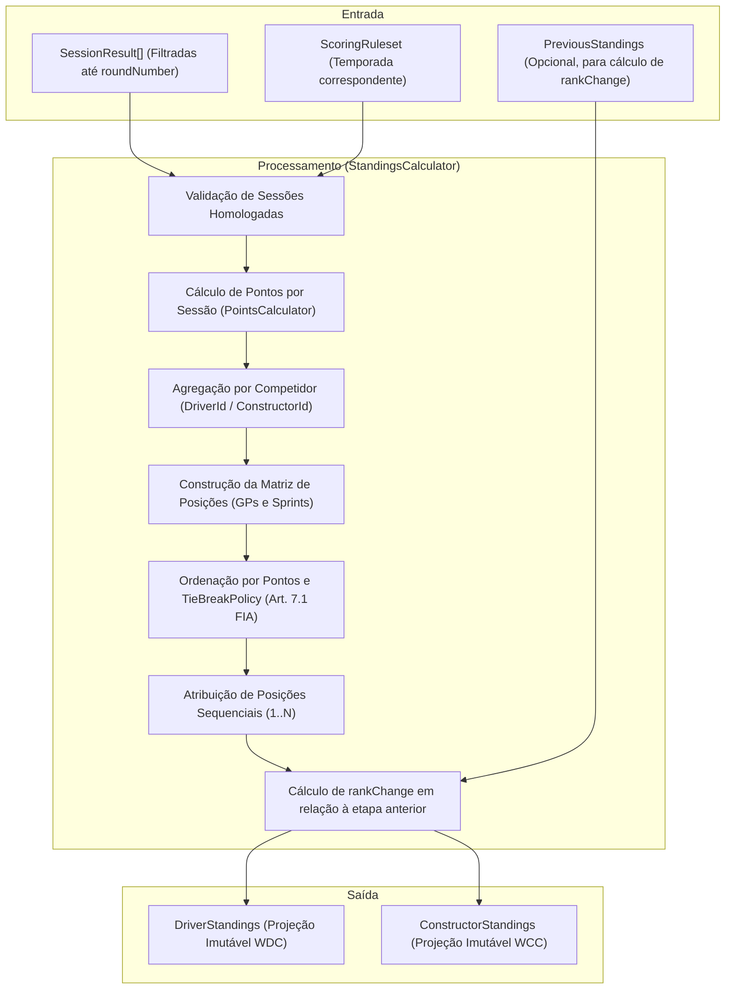

# Módulo Championships — Classificação dos Campeonatos de Pilotos e Construtores

> **Localização:** `docs/domain/championships.md`  
> **Caminho no código:** `packages/domain/src/championships/`  
> **Papel arquitetural:** Projeções imutáveis de classificação e serviço de apuração de campeonatos mundiais  
> **Documento pai:** [README.md](./README.md)  
> **Status:** Implementado e Validado (Suíte de 49 testes automatizados nos módulos, cobertura consolidada >99% e 100% Mutation Testing)

---

## 1. Visão Geral e Propósito

O módulo **`championships`** gerencia as tabelas oficiais e os instantâneos analíticos do Campeonato Mundial de Pilotos (*World Drivers' Championship* — WDC) e do Campeonato Mundial de Construtores (*World Constructors' Championship* — WCC). Ele orquestra o acúmulo progressivo de pontos, vitórias, pódios e colocações ao longo das etapas da temporada, fornecendo visões imutáveis, historicamente auditáveis e matematicamente rastreáveis da disputa pelo título.

### Princípios de Engenharia e Integridade
1. **Rastreabilidade Absoluta:** Cada ponto, vitória e colocação presente na tabela de classificação deve ser matematicamente derivável a partir dos resultados de sessão individuais (`SessionResult`) homologados.
2. **Projeções Imutáveis (Read-Model Snapshots):** Ao contrário de agregados mutáveis tradicionais, as tabelas de classificação são projetadas como instantâneos imutáveis (*snapshots* de domínio). Uma tabela de classificação da Rodada 5 não sofre mutação quando a Rodada 6 ocorre; uma nova tabela imutável para a Rodada 6 é gerada.
3. **Idempotência e Resiliência a Retificações:** Se uma decisão dos comissários da FIA desclassificar um competidor horas ou dias após a bandeirada (ou após julgamento de apelação), o recálculo da tabela a partir das sessões homologadas produz deterministicamente a classificação correta sem necessidade de operações de compensação reversa (*revert mutations*).
4. **Isolamento entre Fatos Homologados e Simulações:** Classificações oficiais da FIA jamais compartilham contexto de persistência ou identidade com simulações hipotéticas.

---

## 2. Limites de Responsabilidade (Boundaries)

### O que PERTENCE ao módulo `championships`:
- A representação da tabela imutável do campeonato de pilotos (`DriverStandings`).
- A representação da tabela imutável do campeonato de construtores (`ConstructorStandings`).
- As entradas individuais de classificação (`DriverStandingEntry` e `ConstructorStandingEntry`), contendo posição atual, pontos acumulados, vitórias, pódios, matriz de posições para desempate e variação de posição (`rankChange`).
- O serviço de domínio puro `StandingsCalculator`, que orquestra a leitura dos resultados homologados, aciona o `PointsCalculator` para cada sessão, aplica a `TieBreakPolicy` para desempates e calcula as variações em relação à etapa anterior.
- O tratamento de trocas de equipe intra-temporada (pontos do piloto acompanham o piloto; pontos da equipe acompanham o construtor do carro utilizado na prova).

### O que NÃO PERTENCE ao módulo `championships`:
- A definição das tabelas de pontos ou o cálculo pontual de uma corrida (escopo do módulo `scoring/scoring-ruleset` e `scoring/points-calculator`).
- O algoritmo comparativo de desempate por *countback* (escopo do módulo `scoring/tie-break-policy`).
- O armazenamento persistente em tabelas relacionais SQL ou execução de transações com ORMs (escopo da camada de persistência/infraestrutura).
- A apresentação visual, renderização gráfica ou formatação de tabelas no frontend (escopo de UI/Apps).

---

## 3. Classificação Arquitetural Precisa

Uma análise rigorosa de Domain-Driven Design esclarece a natureza dos componentes do módulo:

| Componente | Classificação DDD | Justificativa Arquitetural |
|---|---|---|
| `DriverStandings` | **Projeção de Domínio Imutável (Snapshot)** | Não possui identidade transacional de ciclo de vida com mutação de entidades filhas. Representa uma fotografia imutável do estado do campeonato em um determinado ponto no tempo (`roundNumber`). |
| `ConstructorStandings` | **Projeção de Domínio Imutável (Snapshot)** | Fotografia imutável da disputa entre equipes em um determinado ponto no tempo. |
| `DriverStandingEntry` | **Objeto de Valor (Value Object)** | Elemento posicional dentro da tabela. É totalmente definido por seus atributos (posição, pontos, vitórias). |
| `ConstructorStandingEntry` | **Objeto de Valor (Value Object)** | Elemento posicional das equipes na tabela. |
| `StandingsCalculator` | **Serviço de Domínio Puro (Domain Service)** | Encapsula a lógica de negócio que não pertence a uma única entidade, agregando múltiplos resultados de sessão para gerar as projeções de classificação. |

---

## 4. Análise de Complexidade: Recálculo Funcional Puro vs. Acúmulo Incremental

### O Mito da Complexidade $O(1)$ Incremental
Documentações anteriores sugeriam que o acúmulo incremental de pontos a partir de um snapshot prévio operava em complexidade $O(1)$. **Isso é incorreto em um domínio competitivo**.  
Mesmo que a soma aritmética dos novos pontos ocorra em tempo constante por piloto, **a determinação da nova classificação geral exige a reordenação dos competidores e a reavaliação de políticas de desempate (*countback*)**, o que impõe um custo mínimo de:
$$\Omega(P \log P)$$
onde $P$ é o número de pilotos ou equipes participantes ($P \approx 20\text{ a }24$).

### Comparação Técnica Formal

| Dimensão | Alternativa A: Recálculo Funcional Puro (Adotada) | Alternativa B: Acúmulo Incremental por Snapshot |
|---|---|---|
| **Custo Computacional** | $O(R \cdot P + P \log P)$ onde $R \le 24$ etapas e $P \approx 20$ pilotos. Para uma temporada completa, $24 \times 20 = 480\text{ resultados}$. Tempo de execução: **$< 1\text{ milissegundo}$ em memória**. | $O(P + P \log P)$. Tempo de execução: $< 0.1\text{ milissegundo}$ em memória. |
| **Integridade e Consistência** | **Absoluta e à prova de desvios**. O estado é 100% derivado dos resultados fundamentais. | Risco de desvio cumulativo (*drift*) se uma etapa intermediária for recalculada ou retificada. |
| **Tratamento de Retificações** | Trivial e idempotente: basta reexecutar o cálculo com a lista de sessões corrigida. | Complexo: exige operações manuais de estorno, recálculo em cascata e sincronização. |
| **Navegação Histórica** | Nativa: a tabela de qualquer etapa $K$ é calculada filtrando sessões com $\text{round} \le K$. | Requer preservação ou reconstrução sequencial de snapshots. |

**Decisão do F1Atlas:** O domínio implementa o **Recálculo Funcional Puro** como garantia inegociável de verdade matemática. A camada de aplicação/infraestrutura tem total liberdade para persistir os *snapshots* resultantes em banco de dados para indexação e consultas ultra-rápidas na API, sem violar a autoridade do domínio.

---

## 5. Fluxo de Orquestração da Classificação

O serviço `StandingsCalculator` orquestra a transformação de resultados atômicos de pista em tabelas ordenadas de classificação:



---

## 6. Regras de Negócio e Casos Especiais do Domínio

### 6.1. Trocas de Equipe Intra-Temporada
Na Fórmula 1 moderna, é comum que pilotos troquem de equipe durante a temporada (ex: Max Verstappen em 2016 da Toro Rosso para a Red Bull; George Russell em Sakhir 2020 correndo pela Mercedes; ou pilotos reservas substituindo titulares):
1. **Campeonato de Pilotos (WDC):** Os pontos, vitórias e colocações obtidos pelo piloto pertencem integralmente à pessoa do competidor (`driverId`), independentemente do carro utilizado. Na entrada da tabela (`DriverStandingEntry`), o campo `constructorId` reflete a equipe atual ou mais recente do piloto.
2. **Campeonato de Construtores (WCC):** Os pontos conquistados por um carro são creditados única e exclusivamente ao construtor (`constructorId`) associado à inscrição daquela prova específica. Se um piloto marcou pontos pela Equipe X e depois pela Equipe Y, a Equipe X retém os pontos obtidos em seu carro e a Equipe Y recebe apenas os pontos obtidos em seu respectivo veículo.

### 6.2. Status de Classificação do Campeonato
Tabelas de classificação possuem três estados fundamentais:
- **`OFFICIAL`:** Classificação consolidada após a homologação definitiva de todos os resultados da etapa pela FIA e expiração dos prazos regulamentares de protesto.
- **`PROVISIONAL`:** Classificação gerada imediatamente após a prova, enquanto vigoram apurações de comissários ou verificações técnicas pendentes.
- **`SIMULATED`:** Classificação gerada em cenários hipotéticos ("E se o Piloto X tivesse vencido?"). Possui obrigatoriamente a flag `isSimulation = true`, impedindo sua persistência como registro histórico real.

### 6.3. Cálculo da Variação de Posição (`rankChange`)
Para apoiar a experiência do usuário e enriquecer as narrativas esportivas:
- $\text{rankChange} = \text{previousRank} - \text{currentRank}$
- Se um piloto subiu de 4º para 2º lugar: $\text{rankChange} = 4 - 2 = +2$ (ganhou duas posições).
- Se caiu de 1º para 3º lugar: $\text{rankChange} = 1 - 3 = -2$ (perdeu duas posições).
- Se manteve a posição: $\text{rankChange} = 0$.
- Se estreou no campeonato naquela rodada: $\text{rankChange} = 0$ (ou nulo, indicando ausência de histórico anterior).

---

## 7. Invariantes do Módulo

O módulo `championships` protege de forma estrita as seguintes invariantes:

- **INV-CH-01 (Sequencialidade Rigorosa de Posições):** O campo `rank` das entradas em `DriverStandings` e `ConstructorStandings` deve formar uma sequência inteira estrita ($1, 2, 3, \dots, N$) sem duplicidades, saltos ou lacunas.
- **INV-CH-02 (Unicidade de Competidores):** É terminantemente proibido haver mais de uma entrada para o mesmo `driverId` em uma tabela de pilotos ou para o mesmo `constructorId` em uma tabela de construtores.
- **INV-CH-03 (Ordenação Monotônica por Mérito Esportivo):** Para quaisquer duas entradas consecutivas na tabela ($E_i$ e $E_{i+1}$):
  $$\text{points}(E_i) \ge \text{points}(E_{i+1})$$
  Se $\text{points}(E_i) == \text{points}(E_{i+1})$, então o competidor $E_i$ deve ter vencido o desempate oficial contra $E_{i+1}$ segundo a `TieBreakPolicy` (Art. 7.1 FIA).
- **INV-CH-04 (Conservação de Pontos):** A pontuação total acumulada na tabela do WDC até a rodada $K$ deve ser exatamente igual à soma de todos os pontos de pilotos concedidos nas sessões até a rodada $K$.
- **INV-CH-05 (Isolamento de Simulações):** Qualquer projeção contendo resultados hipotéticos é rotulada com `isSimulation = true` e é hermeticamente isolada das consultas oficiais da temporada.

---

## 8. Exemplo Prático: Evolução de Classificação em Duas Etapas com Desempate

### Etapa 1: GP da Austrália (Grand Prix Regular)
- Resultado: P1 = Piloto A (25 pts, 1 vitória), P2 = Piloto B (18 pts, 0 vitórias).
- **WDC pós-Round 1:**
  1. Piloto A: 25 pts (1 vitória, 1x P1) | `rank = 1` | `rankChange = 0`
  2. Piloto B: 18 pts (0 vitórias, 1x P2) | `rank = 2` | `rankChange = 0`

### Etapa 2: GP da China (Sprint + Grand Prix)
- Sprint: P1 = Piloto B (8 pts), P2 = Piloto A (7 pts).
- Grand Prix: P1 = Piloto B (25 pts, 1 vitória), P2 = Piloto A (18 pts).
- **Total acumulado pós-Round 2:**
  - Piloto B: $18 + 8 + 25 = 51\text{ pontos}$ (1 vitória em GP, 1x P2, 1 vitória em Sprint).
  - Piloto A: $25 + 7 + 18 = 50\text{ pontos}$ (1 vitória em GP, 1x P2, 0 vitórias em Sprint).
- **WDC pós-Round 2:**
  1. Piloto B: 51 pts | `rank = 1` | `rankChange = +1` (assume a liderança).
  2. Piloto A: 50 pts | `rank = 2` | `rankChange = -1` (cai para vice-líder).

### Etapa Hipotética: Empate Perfeito e Aplicação de Countback
Se após a Rodada 3 ambos terminassem rigorosamente empatados com 75 pontos cada:
- O `StandingsCalculator` aciona a `TieBreakPolicy`.
- Se Piloto A tem 2 vitórias em GP e Piloto B tem 1 vitória em GP, Piloto A é alocado na posição 1 e Piloto B na posição 2, acompanhado pelo contrato auditável `TieBreakResult` que documenta a vitória de Piloto A pelo critério `GP_POSITIONS (P1: 2 vs 1)`.

---

## 9. Contratos TypeScript Planejados

```typescript
export interface DriverStandingEntry {
  readonly rank: number;
  readonly driverId: EntityId<'Driver'>;
  readonly constructorId: EntityId<'Constructor'>; // Construtor atual/mais recente
  readonly points: number;
  readonly wins: number;
  readonly podiums: number;
  readonly positions: readonly number[]; // Histórico completo para countback
  readonly sprintPositions: readonly number[];
  readonly rankChange: number; // Diferença em relação ao round anterior
}

export interface DriverStandings {
  readonly seasonId: EntityId<'Season'>;
  readonly roundNumber: number;
  readonly status: 'OFFICIAL' | 'PROVISIONAL' | 'SIMULATED';
  readonly entries: readonly DriverStandingEntry[];
  readonly updatedAt: Date;
}
```

---

## 10. Referências Oficiais da FIA

1. **FIA Formula One Sporting Regulations 2024 & 2025:**
   - *Article 6:* Points and Championships.
   - *Article 7:* Dead heat and Championship classification.
   - *Article 9.2:* Allocation of points for Drivers and Constructors upon team changes.
