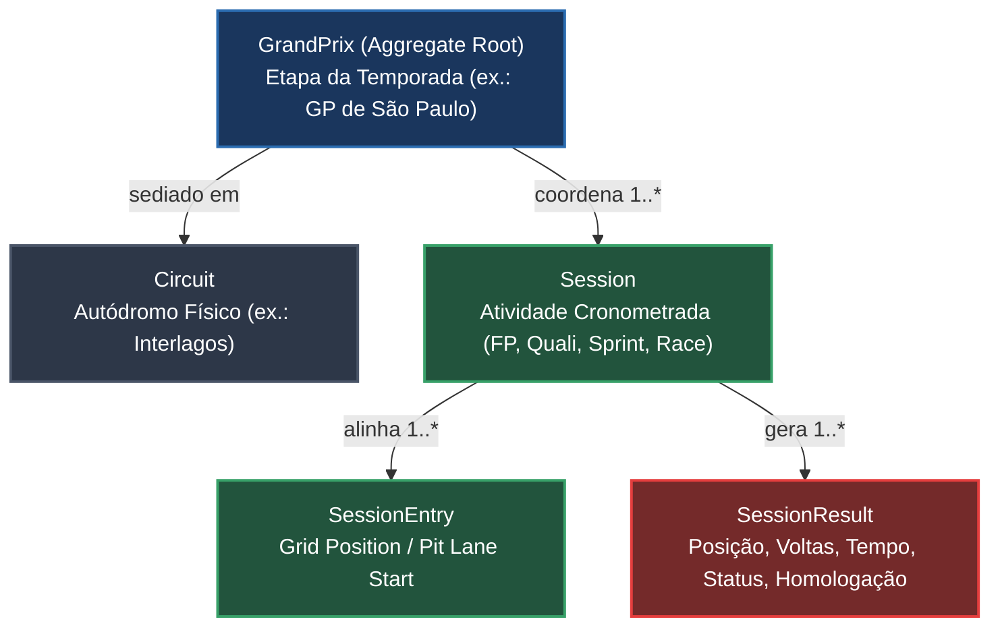
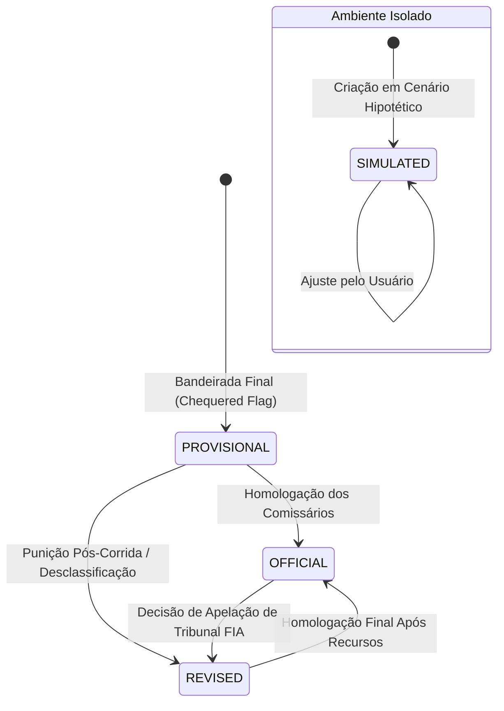

# Módulo Events — Grandes Prêmios, Circuitos, Sessões e Resultados

> **Localização:** `docs/domain/events.md`  
> **Caminho no código:** `packages/domain/src/events/`  
> **Papel arquitetural:** Modelagem de autódromos, fins de semana de corrida e apuração de resultados  
> **Documento pai:** [README.md](./README.md)  

---

## 1. Visão Geral

O módulo **`events`** modela a execução concreta das atividades esportivas da Fórmula 1 em pista. Ele abrange desde a infraestrutura física dos autódromos (`Circuit`) e a coordenação do fim de semana de Grande Prêmio (`GrandPrix`), até a realização atômica de sessões cronometradas (`Session`), condições de largada (`SessionEntry`) e a apuração verificável dos resultados de chegada (`SessionResult`).

A integridade do automobilismo repousa sobre a distinção precisa entre o que acontece no cronômetro da pista e a homologação formal pelas autoridades desportivas (comissários da FIA).

---

## 2. Hierarquia e Estrutura dos Eventos

---

## 3. Responsabilidades

### O que pertence ao módulo `events`:
- O autódromo (`Circuit`) com sua extensão métrica, curvas e fuso horário.
- A coordenação do fim de semana de corrida (`GrandPrix`), seu formato (`STANDARD` vs `SPRINT`) e cronograma.
- O ciclo de vida de cada sessão de pista (`Session`): agendada, em andamento, bandeira vermelha, concluída ou cancelada.
- As condições de largada de cada piloto (`SessionEntry`), incluindo punições de grid e largadas do pit lane.
- A apuração dos tempos, voltas completadas e estados de chegada dos participantes (`SessionResult`).
- A gestão do estado de homologação do resultado (`PROVISIONAL`, `OFFICIAL`, `REVISED`, `SIMULATED`).

### O que NÃO pertence ao módulo `events`:
- O cálculo da tabela do campeonato mundial (escopo de `scoring` e `championships`).
- O streaming de vídeo ou telemetria segundo a segundo (escopo de adaptadores de dados ao vivo).
- A redação de reportagens jornalísticas sobre a corrida (escopo editorial).

---

## 4. Componentes

| Arquivo TypeScript | Conceito Representado | Papel Arquitetural | Estado Atual |
|---|---|---|---|
| `events/grand-prix.ts` | Grande Prêmio | Raiz de Agregado (Aggregate Root) | **Planejado** (planejamento via comentários nível 1 e 2) |
| `events/circuit.ts` | Autódromo / Circuito de Rua | Entidade de Domínio | **Planejado** (planejamento via comentários nível 1 e 2) |
| `events/session.ts` | Sessão Cronometrada de Pista | Entidade de Domínio | **Planejado** (planejamento via comentários nível 1 e 2) |
| `events/session-entry.ts` | Alinhamento na Sessão | Entidade de Domínio | **Planejado** (planejamento via comentários nível 1 e 2) |
| `events/session-result.ts` | Registro de Resultado | Entidade de Domínio / Registro | **Planejado** (planejamento via comentários nível 1 e 2) |

---

## 5. Ciclo de Homologação e Revisão de Resultados

Um resultado de sessão no F1Atlas percorre estados regulamentares estritos:

- **`PROVISIONAL` (Provisório):** Emitido imediatamente após o término da sessão na pista. Sujeito a penalidades de tempo (ex.: track limits) e verificações da pesagem/combustível pela delegacia técnica.
- **`OFFICIAL` (Oficial):** Emitido pela FIA após o encerramento da janela de protestos e inspeções técnicas. É o único estado aceito para cálculo oficial de campeonato.
- **`REVISED` (Revisado):** Reflete decisões dos comissários esportivos (Stewards) que alteram a ordem após a bandeirada (ex.: perda de posições, penalidade em segundos ou desclassificação técnica).
- **`SIMULATED` (Simulado):** Rótulo obrigatório e imutável para resultados criados em cenários de simulação. **Resultados com este status nunca podem ser marcados como `OFFICIAL`**.

---

## 6. Regras de Negócio e Invariantes

### 6.1. Regras Confirmadas
1. **Composição Mínima de Grande Prêmio:** Um fim de semana de GP deve conter obrigatoriamente ao menos uma sessão de Corrida (`RACE`) e uma sessão de Classificação (`QUALIFYING`).
2. **Coerência de Chegada:** Se o status de um piloto for `FINISHED`, sua posição de chegada (`position`) e o número de voltas completadas (`lapsCompleted`) devem ser números inteiros maiores que zero.
3. **Não Largada (DNS):** Competidores com status `DNS` (Did Not Start) possuem rigorosamente `lapsCompleted = 0` e não recebem posição classificada.
4. **Desclassificação (DSQ):** Um competidor com status `DSQ` perde a posição de chegada pontuável e seu tempo não é considerado para premiações desportivas.
5. **Largada do Pit Lane:** Pilotos que iniciam do pit lane (`startedFromPitLane = true`) não ocupam uma caixa física no grid de largada.

### 6.2. Regras Propostas
- **Extensão da Pista e Distância Total:** O cálculo do número de voltas programadas deve derivar da regra da FIA: menor número de voltas para ultrapassar 305 km (exceto Mônaco, que adota 260 km).

---

## 7. Operações e Comportamentos

- **`createGrandPrix(props): Result<GrandPrix, DomainError>`:** Instancia o GP validando número de rodada positivo e datas de início/fim consistentes.
- **`addSessionToGrandPrix(grandPrix, session): Result<GrandPrix, DomainError>`:** Incorpora sessões respeitando a sequência cronológica (ex.: Classificação antes da Corrida).
- **`createCircuit(props): Result<Circuit, DomainError>`:** Cadastra autódromo validando extensão em metros (> 2000 m) e número de curvas.
- **`createSessionEntry(props): Result<SessionEntry, DomainError>`:** Registra a presença de um carro na sessão com posição de largada ou indicação de pit lane.
- **`createSessionResult(props): Result<SessionResult, DomainError>`:** Formaliza a chegada com status (`FINISHED`, `DNF`, `DNS`, `DSQ`, `NC`), tempos e voltas.
- **`homologateResult(result: SessionResult): Result<SessionResult, DomainError>`:** Transiciona de `PROVISIONAL` para `OFFICIAL`.
- **`applyStewardsRevision(result, revision): Result<SessionResult, DomainError>`:** Aplica acréscimo de tempo ou desclassificação registrando o motivo auditável da revisão.

---

## 8. Exemplo Prático: GP dos Estados Unidos 2023 (Austin)

1. **Na Pista:** Lewis Hamilton cruzou a linha de chegada em 2º lugar e Charles Leclerc em 6º. Os resultados foram emitidos como `PROVISIONAL`.
2. **Inspeção Técnica Pós-Corrida:** A prancha sob o assoalho dos carros #44 e #16 foi medida pela FIA e apresentou desgaste superior ao limite de 9 mm permitido pelo regulamento técnico.
3. **Revisão dos Comissários:**
   - A operação `applyStewardsRevision` foi acionada para ambos os competidores com novo status `DSQ` e motivo *"Prancha de madeira com espessura abaixo do limite regulamentar"*.
   - A publicação transicionou para `REVISED`.
   - Todos os pilotos que cruzaram atrás de Hamilton e Leclerc avançaram de posição na classificação oficial subsequente (`OFFICIAL`).

---

## 9. Decisões Arquiteturais e Pendências

1. **Modelagem de Formatos de Tempo (`LapTime` Value Object):**  
   *Questão:* Devemos armazenar tempos de volta e intervalos puramente como inteiros em milissegundos (`fastestLapTimeMillis: number`) ou criar um Value Object `LapTime` com métodos de formatação textual ("1:20.543") e aritmética de gaps?  
   *Decisão:* Recomenda-se criar um Value Object `LapTime` para evitar obsessão por primitivos na telemetria, mantendo o armazenamento bruto em milissegundos.
2. **Paralisações por Bandeira Vermelha e Janela de 3 Horas:**  
   *Questão:* Como modelar a duração limite de tempo da FIA (máximo de 2 horas de corrida em bandeira verde ou 3 horas no total com paralisações)?  
   *Decisão:* As interrupções serão registradas como eventos de tempo na entidade `Session`, permitindo reconstruir a duração efetiva de prova.
