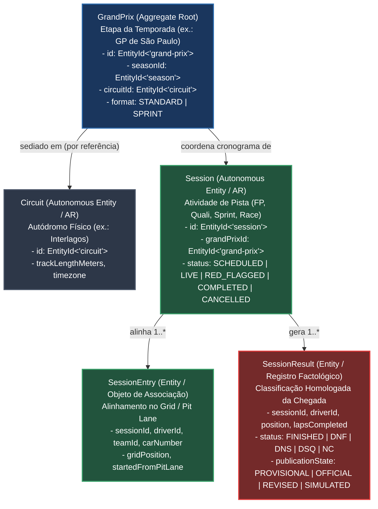
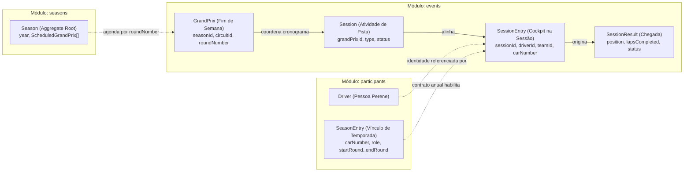
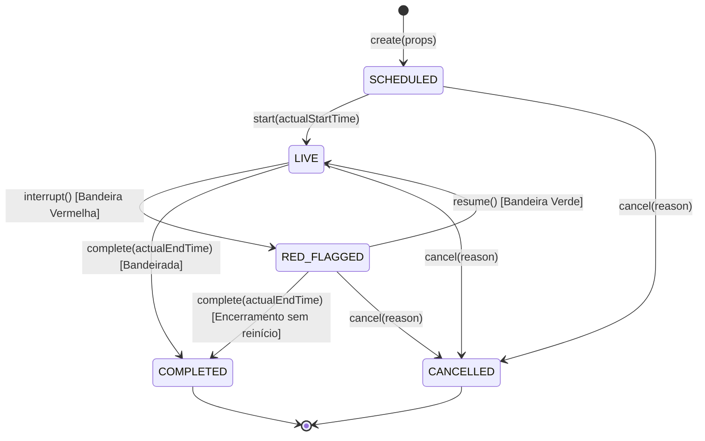
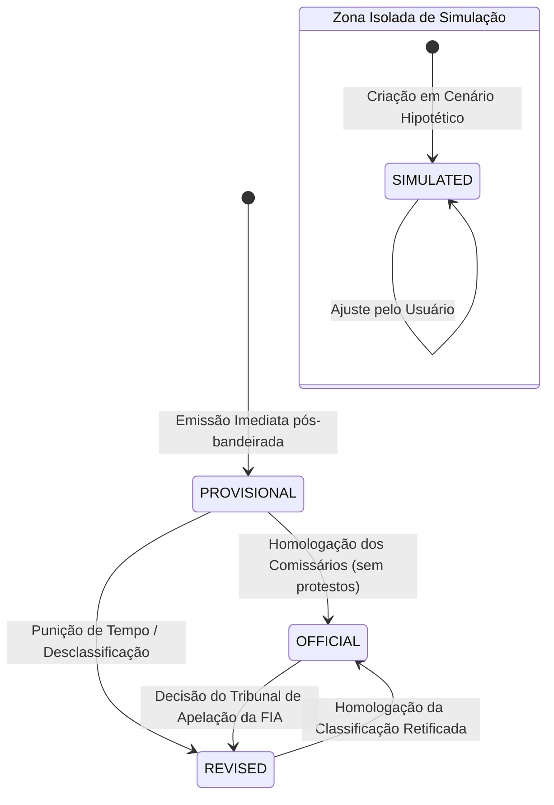

# Módulo Events — Grandes Prêmios, Circuitos, Sessões e Resultados

> **Localização:** `docs/domain/events.md`  
> **Caminho no código:** `packages/domain/src/events/`  
> **Papel arquitetural:** Modelagem de autódromos, fins de semana de corrida, alinhamentos de pista e apuração de resultados  
> **Estado de desenvolvimento:** Implementado e Validado (5/5 componentes: `circuit.ts`, `grand-prix.ts`, `session.ts`, `session-entry.ts`, `session-result.ts`)  
> **Documento pai:** [README.md](./README.md)  
> **Retrato arquitetural vivo:** [current-state.md](../architecture/current-state.md)  

---

## 1. Visão Geral e Linguagem Ubíqua

O módulo **`events`** modela a execução física e desportiva concreta das atividades da Fórmula 1 em pista. Ele abrange desde a infraestrutura dos autódromos (`Circuit`) e a coordenação do fim de semana de Grande Prêmio (`GrandPrix`), até a realização atômica de sessões cronometradas (`Session`), condições de alinhamento e largada (`SessionEntry`) e a apuração verificável dos resultados de chegada (`SessionResult`).

A integridade do automobilismo repousa sobre a distinção rigorosa entre:
1. **O que ocorre no cronômetro da pista:** tempos de volta brutos, voltas completadas e ordem física de passagem pela linha de chegada.
2. **A homologação formal pelas autoridades desportivas:** aplicação de penalidades pelos comissários da FIA (Stewards), pesagem e inspeção técnica em parque fechado (*parc fermé*), recursos pós-prova e publicação do resultado oficial definitivo.

### 1.1. Linguagem Ubíqua do Subdomínio de Pista

- **Grande Prêmio (`GrandPrix`):** O evento desportivo oficial do fim de semana que integra o calendário de uma temporada anual (ex.: *Grande Prêmio de São Paulo 2025*). Possui datas de início e fim, autódromo sede e formato de disputa.
- **Circuito (`Circuit`):** O autódromo permanente, circuito de rua ou traçado misto onde o evento é realizado. Possui extensão física, número de curvas, localização geográfica e fuso horário oficial (IANA).
- **Sessão (`Session`):** Atividade cronometrada atômica em pista durante o evento. Pode ser preparatória (Treinos Livres: `FP1`, `FP2`, `FP3`), classificatória (`QUALIFYING`, `SPRINT_QUALIFYING`, `SPRINT_SHOOTOUT`) ou competitiva (`SPRINT`, `RACE`).
- **Alinhamento na Sessão (`SessionEntry`):** A condição inicial sob a qual um carro/piloto se apresenta para disputar a sessão (posição no grid físico de largada ou largada a partir do pit lane).
- **Resultado da Sessão (`SessionResult`):** O desfecho desportivo de um participante ao término da sessão, englobando status regulamentar de conclusão (`FINISHED`, `DNF`, `DNS`, `DSQ`, `NC`), posição classificada, tempo total e estado de publicação.
- **Estado de Publicação (`PublicationState`):** O ciclo de homologação documental da FIA: `PROVISIONAL` (imediato pós-bandeirada), `OFFICIAL` (homologado após inspeções e recursos), `REVISED` (retificado por punições posteriores dos comissários) ou `SIMULATED` (isolado em cenários hipotéticos de simulação).

---

## 2. Hierarquia, Agregados e Limites de Consistência



### 2.1. Avaliação Arquitetural: Monólito de GP versus Agregados Desacoplados

Uma decisão central de modelagem em DDD consiste em definir os **limites de consistência transacional**:

| Modelo Avaliado | Vantagens | Desvantagens | Decisão Adotada |
|---|---|---|:---:|
| **Opção 1: GrandPrix como Agregado Monolítico Único** (contém todas as sessões, alinhamentos e resultados internamente) | Centraliza todas as validações de fim de semana na mesma raiz. | - Alto acoplamento e concorrência intensa.<br/>- Carregamento de grafos gigantescos de objetos em memória para registrar uma simples volta ou troca de pneus.<br/>- Dificulta evolução para acompanhamento em tempo real (*live timing*). | Rejeitada |
| **Opção 2: Agregados Desacoplados com Associação por Identidade Tipada** (`GrandPrix`, `Session`, `Circuit`, `SessionResult`) | - Limites de consistência pequenos e focados.<br/>- `Session` transiciona seu ciclo de vida em tempo real sem bloquear o GP.<br/>- `SessionResult` pode ser auditado e homologado independentemente.<br/>- Alinhado com a implementação já existente e validada de `Session` (`grandPrixId: EntityId<'grand-prix'>`). | Exige que serviços de domínio ou aplicação coordenem regras transversais (ex.: garantir que horários da sessão estejam dentro do fim de semana do GP). | **Adotada** |

**Fundamentação:** No código real do F1Atlas, [`Session`](../../packages/domain/src/events/session.ts) já foi implementada como entidade autônoma referenciando `grandPrixId: EntityId<'grand-prix'>`. Manter os agregados desacoplados respeita o princípio de limites coesos e previne gargalos transacionais.

---

## 3. Integração e Fronteiras com Seasons e Participants

Para evitar duplicação de dados e anacronismos históricos, o módulo `events` consome e referencia entidades de outros subdomínios através da **hierarquia tripartite de participação**:



### 3.1. Matriz de Responsabilidades entre Módulos

| Módulo | O que este módulo consome de `events` | O que este módulo NUNCA deve transferir para `events` |
|---|---|---|
| **`seasons`** | Consome a identidade do Grande Prêmio (`EntityId<'grand-prix'>`) e o `roundNumber` para compor o calendário anual (`ScheduledGrandPrix`). | Não transfere controle de sessões, cronometragem de voltas ou condições meteorológicas para `seasons`. |
| **`participants`** | Fornece `driverId`, `teamId`, `constructorId` e `carNumber` para compor o alinhamento de pista (`SessionEntry`). | Não transfere posições no grid, dados de largada ou punições de pista para `participants`. |
| **`scoring`** | Consome `SessionResult` oficial para apurar pontos e bônus da corrida ou sprint. | Não transfere regras de pontuação, tabelas de pontos ou descarte de resultados para `events`. |
| **`championships`** | Agrega os resultados homologados para acumular vitórias, pódios e classificação geral (WDC e WCC). | Não transfere tabelas de pontos, contadores acumulados ou desempates para `events`. |

---

## 4. Circuitos e Variações Históricas (`Circuit`)

### 4.1. Responsabilidade de `Circuit`
A entidade `Circuit` modela a infraestrutura física e os atributos geográficos e dimensionais do autódromo onde os Grandes Prêmios são disputados.

### 4.2. Propriedades e Invariantes
- **`id: EntityId<'circuit'>`:** Identificador único e duradouro do autódromo (ex.: `circuit-interlagos`, `circuit-silverstone`, `circuit-monaco`).
- **`name: string`:** Denominação canônica do autódromo (ex.: "Autódromo José Carlos Pace", "Silverstone Circuit").
- **`city: string`:** Cidade onde a pista está situada (ex.: "São Paulo", "Silverstone").
- **`country: string`:** País de localização (ex.: "BRA", "GBR", "MCO").
- **`trackLengthMeters: number`:** Extensão oficial de uma volta no traçado em metros.
  - *Invariante:* Deve ser um valor positivo razoável ($2.000 \le \text{trackLengthMeters} \le 15.000$).
- **`cornersCount: number`:** Quantidade oficial de curvas do traçado homologado pela FIA ($\ge 3$).
- **`timezone: string`:** Fuso horário oficial registrado na base IANA (ex.: `"America/Sao_Paulo"`, `"Europe/London"`), essencial para conversões determinísticas de horários UTC em relatórios locais.

### 4.3. Regra de Distância de Corrida da FIA (Artigo 5.4)
O Regulamento Esportivo da FIA estipula que a distância total programada de um Grande Prêmio deve ser a **menor quantidade de voltas completas necessária para ultrapassar 305 quilômetros**:

$$\text{laps} = \left\lceil \frac{305.000}{\text{trackLengthMeters}} \right\rceil$$

- **Exceção Histórica Obrigatória de Mônaco:** O Grande Prêmio de Mônaco é a única etapa do campeonato mundial isenta da regra dos 305 km, possuindo um teto regulamentar histórico de **260 km** ($\approx 78$ voltas no traçado de 3.337 m $= 260,286\text{ km}$).
- **Variações de Traçado:** Reformas estruturais na pista (como a introdução do novo traçado Arena em Silverstone em 2010 ou a reforma de curvas em Abu Dhabi em 2021) são modeladas pela operação imutável `updateTrackConfiguration`, gerando uma nova versão do circuito sem adulterar o registro de eventos passados.

---

## 5. Fim de Semana de Grande Prêmio (`GrandPrix`)

### 5.1. Responsabilidade de `GrandPrix`
`GrandPrix` é o Aggregate Root que governa o evento oficial de fim de semana do campeonato. Ele coordena o formato da competição, as datas oficiais e a agregação das sessões cronometradas.

### 5.2. Propriedades e Formatos de Fim de Semana
- **`id: EntityId<'grand-prix'>`:** Identificador único do evento (ex.: `gp-monaco-2025`, `gp-sao-paulo-2025`).
- **`seasonId: EntityId<'season'>`:** Referência à temporada oficial em que a etapa está inserida.
- **`circuitId: EntityId<'circuit'>`:** Referência ao circuito físico que sedia a prova.
- **`name: string`:** Denominação oficial do Grande Prêmio (ex.: "Grande Prêmio de São Paulo 2025").
- **`roundNumber: number`:** Número de ordem da etapa no calendário oficial da temporada ($1 \le \text{roundNumber} \le 30$).
- **`format: GrandPrixFormat`:** Formato do evento:
  - **`STANDARD`:** Formato tradicional contendo Treinos Livres 1, 2 e 3 (`FP1`, `FP2`, `FP3`), Classificação (`QUALIFYING`) e Corrida Principal (`RACE`).
  - **`SPRINT`:** Formato com corrida curta de 100 km, contendo `FP1`, Qualificação Sprint (`SPRINT_QUALIFYING` / `SPRINT_SHOOTOUT`), Corrida Sprint (`SPRINT`), Classificação da Corrida (`QUALIFYING`) e Corrida Principal (`RACE`).
- **`startDate: Date` e `endDate: Date`:** Período de vigência oficial do fim de semana desportivo (`startDate <= endDate`).

---

## 6. Sessões Esportivas de Pista (`Session`)

### 6.1. Componente Validado em Produção
O componente [`Session`](../../packages/domain/src/events/session.ts) já está plenamente implementado e validado no repositório com 29 testes automatizados e 100% de score de mutação.

### 6.2. Tipos de Sessão Homologados (`SessionType`)
- **Treinos Livres:** `FP1`, `FP2`, `FP3` (sessões preparatórias e de acerto, sem atribuição de pontos).
- **Classificação:** `QUALIFYING` (definição do grid da corrida de domingo), `SPRINT_QUALIFYING` e `SPRINT_SHOOTOUT` (definição do grid da Sprint).
- **Corridas Competitivas:** `SPRINT` (corrida curta de 100 km que atribui pontos aos 8 primeiros) e `RACE` (Grande Prêmio principal com pontuação completa).

### 6.3. Máquina de Estados e Ciclo de Vida (`SessionStatus`)



### 6.4. Limites Temporais Regulamentares da FIA (Artigos 54 e 55)
- **Tempo Limite em Bandeira Verde:** A duração máxima de uma corrida de F1 é de **2 horas de tempo de prova ativo**.
- **Janela Máxima com Interrupções:** Caso a sessão seja interrompida por bandeira vermelha (`RED_FLAGGED`), o tempo total transcorrido desde a largada original até o encerramento não pode exceder **3 horas**.

---

## 7. Alinhamento de Participantes na Sessão (`SessionEntry`)

### 7.1. Responsabilidade de `SessionEntry`
Representa a inscrição pontual de um conjunto carro/piloto para a disputa de uma sessão específica de pista. Isola as condições iniciais de largada do resultado de chegada.

### 7.2. Propriedades e Regras de Largada
- **`id: EntityId<'session-entry'>`:** Identificador da entrada.
- **`sessionId: EntityId<'session'>`:** Referência à sessão de pista.
- **`driverId: EntityId<'driver'>`:** Referência ao piloto no cockpit naquela sessão.
- **`teamId: EntityId<'team'>`:** Equipe operadora do carro.
- **`constructorId: EntityId<'constructor'>`:** Fabricante técnico do chassi.
- **`carNumber: number`:** Número com o qual o carro alinhou na sessão ($1 \le n \le 99, n \ne 17$).
- **`gridPosition?: number | null`:** Posição física na caixa do grid de largada ($1 \le \text{gridPosition} \le 20+$).
- **`startedFromPitLane: boolean`:** Indicador booleano de que o competidor largou do pit lane (decorrente de quebra de parque fechado, troca de motor ou penalidade técnica).
- **`status: SessionEntryStatus`:** Condição de alinhamento (`CONFIRMED`, `WITHDRAWN`, `REPLACED`).

> [!IMPORTANT]
> **Invariante de Pit Lane vs Grid:** Se `startedFromPitLane === true`, o competidor **não pode possuir uma posição física no grid de largada** (`gridPosition` deve ser nulo ou omitido). Dois carros não podem alargar na mesma posição física de grid.

---

## 8. Resultados da Sessão e Homologação (`SessionResult`)

### 8.1. Responsabilidade de `SessionResult`
Representa o desfecho factual oficial ou simulado obtido por um participante na sessão. É o registro factual auditável consumido pelos motores de pontuação (`scoring`) e tabelas de classificação (`championships`).

### 8.2. Status de Finalização do Competidor
- **`FINISHED`:** O piloto cruzou a linha de chegada sob bandeira quadriculada e cumpriu a distância regulamentar. Possui obrigatoriamente `position >= 1` e `lapsCompleted >= 1`.
- **`DNF` (Did Not Finish):** O competidor abandonou a prova antes da bandeirada final (por acidente, falha mecânica ou recolhimento aos boxes).
- **`NC` (Not Classified / Não Classificado):** Aplicado quando o competidor não atinge o critério regulamentar mínimo de voltas (ver regra dos 90% abaixo).
- **`DNS` (Did Not Start):** O competidor constava da lista de inscritos, mas não tomou a largada na volta de apresentação ou na corrida. Possui obrigatoriamente `lapsCompleted = 0` e `position = null`.
- **`DSQ` (Disqualified):** Desclassificado formalmente pelos comissários desportivos por violação técnica ou desportiva. Tem sua posição anulada (`position = null`), perde pontuação e não é classificado.

### 8.3. Regra dos 90% para Classificação de DNF (FIA Artigo 62.1)
De acordo com o Regulamento Esportivo da FIA, para que um competidor que abandonou a prova seja classificado na tabela oficial da corrida, ele deve ter completado **pelo menos 90% do número total de voltas completadas pelo vencedor da prova** (arredondado para baixo):

$$\text{lapsRequired} = \lfloor 0.90 \times \text{lapsCompleted}_{\text{winner}} \rfloor$$

- Se $\text{lapsCompleted} \ge \text{lapsRequired}$: O piloto é considerado **classificado** na tabela de chegada com base na ordem de voltas completadas (status esportivo `DNF`, mas classificado com posição numérica).
- Se $\text{lapsCompleted} < \text{lapsRequired}$: O competidor recebe o status **`NC`** e não tem direito a posição classificada nem a pontos.

### 8.4. Ciclo de Homologação e Revisão Documental



- **`PROVISIONAL`:** Resultados preliminares emitidos minutos após a prova. Sujeitos a penalidades de tempo (ex.: track limits, colisões) e inspeções técnicas (pesagem, combustível, prancha do assoalho).
- **`OFFICIAL`:** Resultado homologado após expiração dos prazos de protesto e recursos imediatos. **Apenas resultados `OFFICIAL` podem alimentar o cálculo oficial do campeonato mundial**.
- **`REVISED`:** Classificação alterada por decisão colegiada dos Comissários da FIA (ex.: GP dos EUA 2023 com desclassificação de Hamilton e Leclerc por desgaste da prancha).
- **`SIMULATED`:** Rótulo obrigatório e imutável para cenários de simulação ("What-If"). **Resultados com este status NUNCA podem transicionar para `OFFICIAL` nem influenciar registros históricos reais**.

---

## 9. Catálogo de Invariantes Canônicas do Módulo Events

| Identificador | Entidade Alvo | Tipo | Descrição e Regra de Validação |
|---|---|:---:|---|
| **`EVT-INV-001`** | `GrandPrix` | B (Inter-entidade) | Um Grande Prêmio deve conter obrigatoriamente ao menos uma sessão de Corrida (`RACE`) e uma sessão de Classificação (`QUALIFYING`). |
| **`EVT-INV-002`** | `GrandPrix` | A (Local) | A data de início do GP deve ser anterior ou igual à data de encerramento (`startDate <= endDate`), e os horários das sessões agendadas devem estar contidos nesse intervalo. |
| **`EVT-INV-003`** | `GrandPrix` | C (Regulamentar) | A sequência lógica das sessões deve respeitar o regulamento da FIA: Treinos Livres e Classificações devem anteceder a Corrida Principal. |
| **`EVT-INV-004`** | `Session` | A (Local) | O ciclo de vida de `Session` obedece a transições estritas: `start()` só a partir de `SCHEDULED`; `interrupt()` só a partir de `LIVE`; `resume()` só a partir de `RED_FLAGGED`; `complete()` a partir de `LIVE` ou `RED_FLAGGED`. |
| **`EVT-INV-005`** | `Session` | A (Local) | A data de término real (`actualEndTime`) não pode ser anterior à data de início real (`actualStartTime`). O mesmo se aplica a horários agendados. |
| **`EVT-INV-006`** | `Session` | D (Política) | Uma sessão com status `COMPLETED` ou `CANCELLED` é imutável: rejeita novas transições, novos inícios ou alterações de horários. |
| **`EVT-INV-007`** | `Circuit` | A (Local) | A extensão da pista deve ser estritamente positiva ($2.000 \le \text{trackLengthMeters} \le 15.000$) e o número de curvas deve ser $\ge 3$. |
| **`EVT-INV-008`** | `Circuit` | C (Regulamentar) | A distância de corrida deve atingir a menor quantidade de voltas completas para ultrapassar 305 km ($\lceil 305.000 / \text{trackLengthMeters} \rceil$), salvo a exceção histórica de Mônaco com teto de 260 km. |
| **`EVT-INV-009`** | `SessionEntry` | A (Local) | Se `startedFromPitLane === true`, o competidor não ocupa posição no grid (`gridPosition = null`). Se `false`, `gridPosition` deve ser inteiro $\ge 1$. Não pode haver posições físicas de grid duplicadas. |
| **`EVT-INV-010`** | `SessionResult` | A (Local) | Se o status for `FINISHED`, a posição de chegada (`position`) e o total de voltas (`lapsCompleted`) devem ser números inteiros maiores que zero. |
| **`EVT-INV-011`** | `SessionResult` | A (Local) | Competidores com status `DNS` (Did Not Start) possuem obrigatoriamente `lapsCompleted = 0` e `position = null`. |
| **`EVT-INV-012`** | `SessionResult` | C (Regulamentar) | Regra dos 90% (Art. 62.1): piloto em DNF que completou $\ge 90\%$ das voltas do vencedor é classificado numericamente; se $< 90\%$, recebe status `NC` sem posição. |
| **`EVT-INV-013`** | `SessionResult` | C (Regulamentar) | Competidores com status `DSQ` têm sua posição anulada (`position = null`), perdem direitos a pontos no campeonato e são excluídos da premiação desportiva. |
| **`EVT-INV-014`** | `SessionResult` | D (Política) | O estado de homologação transiciona de `PROVISIONAL` para `OFFICIAL` ou `REVISED`. Apenas resultados `OFFICIAL` podem alimentar apurações do WDC/WCC. |
| **`EVT-INV-015`** | `SessionResult` | D (Política) | Resultados com `publicationState: SIMULATED` são estritamente isolados e jamais podem transicionar para `OFFICIAL`. |
| **`EVT-INV-016`** | `SessionResult` | D (Política) | Qualquer retificação via `applyStewardsRevision` exige justificativa textual não vazia (`reason`) para assegurar auditabilidade histórica. |

---

## 10. Catálogo de Operações do Domínio

### 10.1. `createCircuit`
- **Assinatura:**
  ```typescript
  createCircuit(props: {
    id: EntityId<'circuit'>;
    name: string;
    city: string;
    country: string;
    trackLengthMeters: number;
    cornersCount: number;
    timezone: string;
  }): Result<Circuit, DomainError>
  ```
- **Pré-condições:** Nome, cidade, país e timezone não vazios; $2.000 \le \text{trackLengthMeters} \le 15.000$; $\text{cornersCount} \ge 3$.
- **Pós-condições:** Retorna instância congelada de `Circuit`.

### 10.2. `createGrandPrix`
- **Assinatura:**
  ```typescript
  createGrandPrix(props: {
    id: EntityId<'grand-prix'>;
    seasonId: EntityId<'season'>;
    circuitId: EntityId<'circuit'>;
    name: string;
    roundNumber: number;
    format: GrandPrixFormat;
    startDate: Date;
    endDate: Date;
  }): Result<GrandPrix, DomainError>
  ```
- **Pré-condições:** `name` não vazio; $\text{roundNumber} \ge 1$; $\text{startDate} \le \text{endDate}$; formato válido (`STANDARD` ou `SPRINT`).
- **Pós-condições:** Retorna `GrandPrix` com cronograma de sessões inicial vazio.

### 10.3. `createSessionEntry`
- **Assinatura:**
  ```typescript
  createSessionEntry(props: {
    id: EntityId<'session-entry'>;
    sessionId: EntityId<'session'>;
    driverId: EntityId<'driver'>;
    teamId: EntityId<'team'>;
    constructorId: EntityId<'constructor'>;
    carNumber: number;
    gridPosition?: number | null;
    startedFromPitLane?: boolean;
    status?: SessionEntryStatus;
  }): Result<SessionEntry, DomainError>
  ```
- **Pré-condições:** Identificadores tipados válidos; $1 \le \text{carNumber} \le 99$ ($\ne 17$); se `startedFromPitLane === true`, `gridPosition` deve ser nulo.
- **Pós-condições:** Retorna instância imutável de `SessionEntry`.

### 10.4. `createSessionResult`
- **Assinatura:**
  ```typescript
  createSessionResult(props: {
    id: EntityId<'session-result'>;
    sessionId: EntityId<'session'>;
    driverId: EntityId<'driver'>;
    teamId: EntityId<'team'>;
    constructorId: EntityId<'constructor'>;
    position: number | null;
    lapsCompleted: number;
    status: ResultStatus;
    totalTimeMillis?: number | null;
    gapMillis?: number | null;
    fastestLapTimeMillis?: number | null;
    fastestLapRank?: number | null;
    publicationState?: PublicationState;
  }): Result<SessionResult, DomainError>
  ```
- **Pré-condições:** Invariantes `EVT-INV-010` a `EVT-INV-013` respeitadas.
- **Pós-condições:** Retorna instância imutável de `SessionResult` (default: `PROVISIONAL`).

### 10.5. `homologateResult`
- **Assinatura:**
  ```typescript
  homologateResult(result: SessionResult): Result<SessionResult, DomainError>
  ```
- **Pré-condições:** O resultado deve estar em `PROVISIONAL` ou `REVISED` e não pode ser `SIMULATED` (`EVT-INV-014` e `EVT-INV-015`).
- **Pós-condições:** Retorna nova instância com `publicationState: OFFICIAL`.

### 10.6. `applyStewardsRevision`
- **Assinatura:**
  ```typescript
  applyStewardsRevision(
    result: SessionResult,
    revision: {
      newPosition: number | null;
      newStatus?: ResultStatus;
      penaltyTimeMillis?: number | null;
      reason: string;
    }
  ): Result<SessionResult, DomainError>
  ```
- **Pré-condições:** `reason` deve ser não vazia (`EVT-INV-016`); se novo status for `DSQ`, `newPosition` deve ser nulo.
- **Pós-condições:** Retorna nova instância com `publicationState: REVISED` preservando a rastreabilidade da decisão.

---

## 11. Critérios de Aceitação e Testabilidade (BDD)

### Cenário 1: Cálculo Determinístico de Voltas por Extensão da Pista
- **Dado** o circuito de Interlagos com extensão de 4.309 metros,
- **Quando** o número oficial de voltas da corrida for apurado pela regra dos 305 km (`EVT-INV-008`),
- **Então** o cálculo deve produzir exatamente 71 voltas ($\lceil 305.000 / 4.309 \rceil = \lceil 70,78 \rceil = 71$).

### Cenário 2: Exceção Histórica de Mônaco
- **Dado** o circuito de Mônaco com extensão de 3.337 metros,
- **Quando** o número oficial de voltas for apurado considerando a exceção de 260 km,
- **Então** o cálculo deve produzir exatamente 78 voltas ($\lceil 260.000 / 3.337 \rceil = \lceil 77,91 \rceil = 78$), não aplicando a regra dos 305 km.

### Cenário 3: Largada a partir do Pit Lane
- **Dado** um competidor penalizado por quebra de parque fechado que deve largar do pit lane (`startedFromPitLane = true`),
- **Quando** a operação `createSessionEntry` for executada com `gridPosition: 5`,
- **Então** a operação deve falhar com o código `INVALID_GRID_ALIGNMENT` (`EVT-INV-009`).

### Cenário 4: Regra dos 90% para Abandono (DNF Classificado vs NC)
- **Dado** uma corrida cujo vencedor completou 70 voltas (limiar de 90% $= \lfloor 0,90 \times 70 \rfloor = 63$ voltas),
- **Quando** o Piloto A abandona na volta 64,
- **Então** ele deve ser registrado como classificado com posição numérica na chegada (`EVT-INV-012`).
- **Quando** o Piloto B abandona na volta 62,
- **Então** ele deve receber o status `NC` sem posição classificada.

### Cenário 5: Desclassificação Técnica Pós-Corrida (Cenário Austin 2023)
- **Dado** um resultado preliminar (`PROVISIONAL`) com o Piloto em 2º lugar e 56 voltas completadas,
- **Quando** a operação `applyStewardsRevision` for executada com `newStatus: 'DSQ'` e motivo de desgaste excessivo da prancha,
- **Então** o resultado deve transicionar para `REVISED`, anular a posição classificada (`position = null`) e registrar a justificativa (`EVT-INV-013` e `EVT-INV-016`).

### Cenário 6: Blindagem Contra Oficialização de Simulações
- **Dado** um resultado criado com `publicationState: SIMULATED` em um cenário hipotético,
- **Quando** for realizada uma tentativa de executar `homologateResult`,
- **Então** a operação deve falhar rigorosamente com o código `CANNOT_HOMOLOGATE_SIMULATED` (`EVT-INV-015`).

---

## 12. Decisões Arquiteturais e Trade-offs

| Decisão | Alternativas Avaliadas | Opção Escolhida | Justificativa |
|---|---|---|---|
| **Agregação Desacoplada de Eventos** | 1. Monólito centrado em `GrandPrix`.<br/>2. Agregados coesos por identidade (`GrandPrix`, `Session`, `Circuit`, `SessionResult`). | **Opção 2: Desacoplados.** | Reduz contenção transacional, permite acompanhamento de sessões em tempo real e respeita a implementação existente de `Session`. |
| **Diferenciação entre DNF e NC** | 1. Tratar todo abandono como DNF sem classificação.<br/>2. Aplicar a regra formal dos 90% da FIA (Art. 62.1). | **Opção 2: Regra dos 90%.** | Fiel à história oficial da F1: pilotos em DNF frequentemente pontuam e constam do pódio histórico se completaram $\ge 90\%$ das voltas. |
| **Value Object `LapTime` para Telemetria** | 1. Utilizar números inteiros brutos em milissegundos (`number`).<br/>2. Criar Value Object `LapTime` com formatação e aritmética. | **Opção 2: `LapTime`.** | Combate *Primitive Obsession* na apresentação de voltas e gaps ("1:20.543"), mantendo armazenamento bruto em milissegundos. |
| **Imutabilidade e Rastreabilidade de Revisões** | 1. Mutações destrutivas na linha de resultado.<br/>2. Padrão *Copy-on-write* com histórico de revisões. | **Opção 2: Copy-on-write.** | Garante auditabilidade retrospectiva: permite saber exatamente qual era a ordem na bandeirada e como ficou após julgamento dos comissários. |

---

## 13. Plano de Implementação Incremental e Classificação de Pendências

### 13.1. Classificação das Pendências

- **Bloqueantes (0):** Nenhuma pendência bloqueante. A modelagem de `events` possui todas as primitivas de `shared` (`EntityId`, `DomainError`, `Result`) e integrações com `seasons` e `participants` consolidadas.
- **Importantes (2):**
  1. *Modelagem do Value Object `LapTime`:* Especificar o VO utilitário para manipulação tipada de tempos de volta e intervalos antes de implementar `SessionResult`.
  2. *Validador de Grid Único na Sessão:* Criar serviço de domínio puro ou helper de coleção para assegurar a inexistência de posições repetidas no grid antes da largada.
- **Evolutivas (2):**
  1. *Suporte a Layouts Alternativos de Pista (`TrackLayout`):* Diferir entidade separada de traçado para o marco histórico (2026/2027), utilizando por enquanto `updateTrackConfiguration` na entidade `Circuit`.
  2. *Armazenamento de Penalidades Pré-Grid:* Evoluir `SessionEntry` para registrar histórico de punições de posições de grid (ex.: perda de 5 posições por troca de câmbio) durante a fase de consolidação.

### 13.2. Ordem de Implementação Recomendada para a Camada Domain

1. **Etapa 1:** `packages/domain/src/events/circuit.ts` (Entidade base e cálculo de voltas de corrida).
2. **Etapa 2:** `packages/domain/src/events/grand-prix.ts` (Aggregate Root do evento, agendamento de sessões e formatos).
3. **Etapa 3:** `packages/domain/src/events/session-entry.ts` (Condições de alinhamento e largada no pit lane).
4. **Etapa 4:** `packages/domain/src/events/session-result.ts` (Resultados de pista, regra dos 90% e homologação).

---

## 14. Referências Normativas e Regulamentares

1. **FIA Formula One Sporting Regulations** (Edições 2024 e 2025):
   - *Artigo 5.4:* Distância padrão de corrida (305 km) e exceção de Mônaco (260 km).
   - *Artigos 54 e 55:* Procedimentos de suspensão por bandeira vermelha, tempo de prova verde (2h) e tempo total máximo (3h).
   - *Artigo 62.1:* Critérios de classificação de prova e regra de cumprimento de 90% das voltas do vencedor.
2. **FIA International Sporting Code (Código Desportivo Internacional):**
   - Competência dos Comissários Desportivos (Stewards), prazos de homologação oficial e aplicação de penalidades pós-prova.
3. **F1Atlas Architecture & Governance:**
   - [`docs/domain/seasons.md`](./seasons.md): Coordenação anual de calendário e agendamento de etapas.
   - [`docs/domain/participants.md`](./participants.md): Identidades de pilotos e equipes e contratos de participação.
   - [`docs/architecture/current-state.md`](../architecture/current-state.md): Retrato vivo e dependências ativas.
