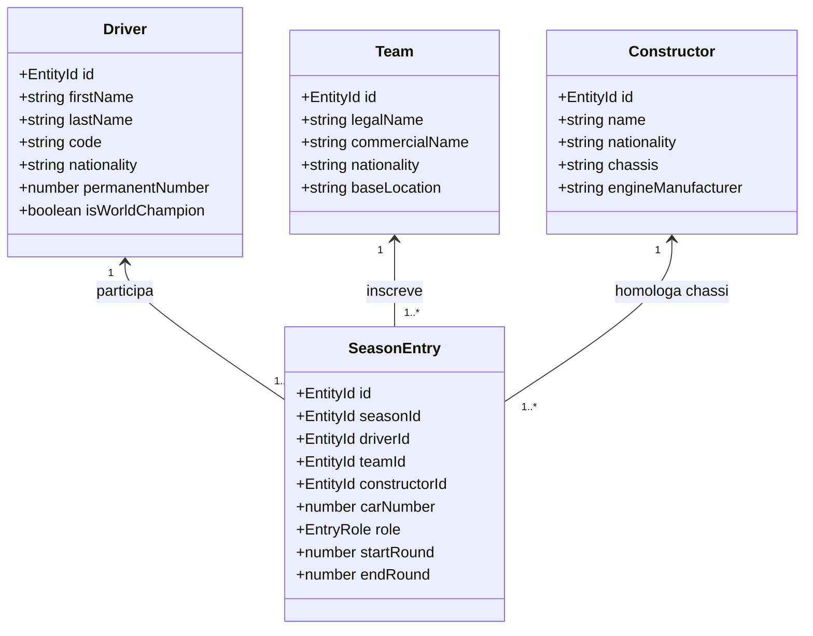
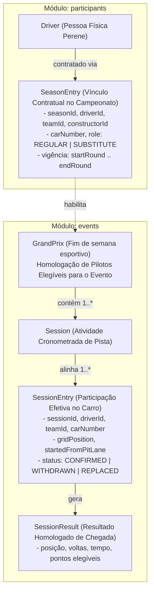
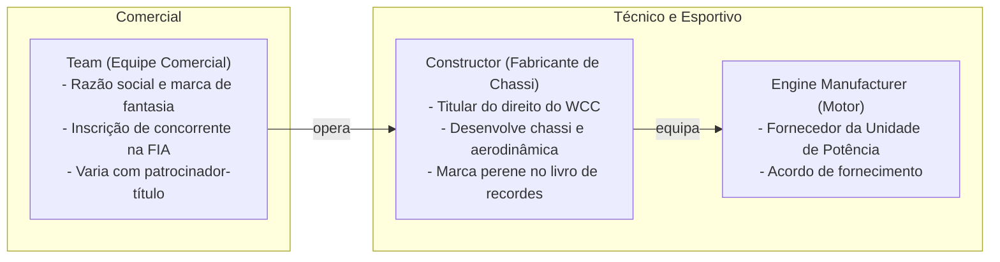
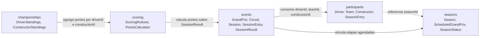

# Módulo Participants — Pilotos, Equipes, Construtores e Inscrições

> **Localização:** `docs/domain/participants.md`  
> **Caminho no código:** `packages/domain/src/participants/`  
> **Papel arquitetural:** Modelagem de competidores e vínculos contratuais/esportivos de participação  
> **Estado de desenvolvimento:** Validado: 100% implementado e validado (`driver.ts`, `team.ts`, `constructor.ts`, `season-entry.ts`, `entry-role.ts`)  
> **Documento pai:** [README.md](./README.md)  
> **Retrato arquitetural vivo:** [current-state.md](../architecture/current-state.md)  

---

## 1. Visão Geral

O módulo **`participants`** modela os atores humanos (atletas) e corporativos (equipes comerciais e construtores) que disputam as temporadas do Campeonato Mundial de Fórmula 1 da FIA.

Ele resolve uma das distinções ontológicas e desportivas mais fundamentais do automobilismo: **a separação rigorosa entre a identidade duradoura de um competidor ao longo da história e seu vínculo temporal específico com uma equipe e um construtor durante uma temporada de competição**.

Na Fórmula 1:
- Pilotos competem durante décadas, mudam de equipe entre temporadas ou no meio do mesmo campeonato (ex.: Max Verstappen e Daniil Kvyat em 2016; Pierre Gasly e Alexander Albon em 2019) e alteram seus números (ex.: adoção opcional do número `#1` pelo campeão mundial).
- Equipes comerciais alteram sua razão social, nomes de fantasia e patrocinadores-título com frequência (ex.: *Scuderia Ferrari HP*, *Oracle Red Bull Racing*, *Stake F1 Team Kick Sauber*).
- Construtores homologados pela FIA detêm a propriedade intelectual do chassi e representam o sujeito de direito oficial do Campeonato Mundial de Construtores (WCC).
- A participação efetiva de um piloto no carro durante uma sessão de pista cronometrada (ex.: treinos livres com pilotos reservas ou substituições de emergência por motivos de saúde) possui regras próprias de alinhamento e não se confunde com a titularidade do contrato de campeonato.

O F1Atlas não adota uma modelagem desnormalizada que funde piloto, carro, equipe e construtor em uma string estática ou registro monolítico. Cada conceito possui fronteira de responsabilidade, invariantes e ciclo de vida próprios.

---

## 2. Glossário e Diferenciação Conceitual



### 2.1. Conceitos Nucleares do Módulo

1. **Piloto (`Driver`):**
   - **Definição:** A pessoa física do atleta e competidor desportivo licenciado pela FIA.
   - **Natureza:** Entidade de domínio perene, cuja existência transcende equipes, contratos e temporadas.
   - **Propriedades fundamentais:** Identificador perene (`id: EntityId<"driver">`), nome completo (`firstName`, `lastName`), código de 3 letras de cronometragem da FIA (`code`, ex.: `VER`, `HAM`, `SEN`), nacionalidade desportiva de representação sob licença de sua ASN/FIA (`nationality`), número permanente de carreira (`permanentNumber`, entre 2 e 99, aplicável a partir de 2014) e privilégio de campeão vigente (`isWorldChampion`).

2. **Equipe Comercial Competidora (`Team`):**
   - **Definição:** A organização empresarial e esportiva detentora da inscrição de competidor (*Competitor/Entrant*) perante a FIA.
   - **Natureza:** Entidade operacional e comercial que gerencia a logística, os pilotos, a operação de pista e os contratos de patrocínio.
   - **Propriedades fundamentais:** Identificador perene (`id: EntityId<"team">`), razão social oficial (`legalName`), denominação comercial e fantasia da temporada (`commercialName`, ex.: "Mercedes-AMG PETRONAS Formula One Team"), país de licença desportiva (`nationality`) e sede operacional de fábrica (`baseLocation`, ex.: "Brackley, Reino Unido", "Maranello, Itália").

3. **Construtor Homologado FIA (`Constructor`):**
   - **Definição:** O fabricante técnico oficial do chassi automotivo, homologado nos termos do Regulamento Técnico e Esportivo da FIA.
   - **Natureza:** A âncora histórica oficial para a pontuação e titulação do Campeonato Mundial de Construtores (World Constructors' Championship — WCC).
   - **Propriedades fundamentais:** Identificador perene (`id: EntityId<"constructor">`), denominação canônica da marca do chassi (`name`, ex.: "Ferrari", "McLaren", "Williams", "Red Bull Racing"), nacionalidade técnica de registro (`nationality`), denominação do chassi homologado (`chassis`, ex.: "MCL39", "SF-25") e fabricante da Unidade de Potência / Motor (`engineManufacturer`, ex.: "Mercedes", "Ferrari", "Honda RBPT").

4. **Inscrição de Temporada (`SeasonEntry`):**
   - **Definição:** O vínculo jurídico-desportivo oficial que formaliza a inscrição de um piloto por uma equipe com um chassi específico em uma determinada temporada.
   - **Natureza:** Entidade de associação temporal de primeiro nível no módulo `participants`. Representa o direito de disputa no campeonato de pilotos (WDC) e construtores (WCC).
   - **Propriedades fundamentais:** Identificador unívoco (`id: EntityId<"season-entry">`), chave da temporada (`seasonId: EntityId<"season">`), piloto (`driverId`), equipe (`teamId`), construtor (`constructorId`), número oficial do carro para aquele vínculo (`carNumber`), papel desportivo contratual (`role: EntryRole`), etapa inicial de vigência (`startRound: number`) e etapa final de vigência (`endRound?: number`).

---

## 3. A Hierarquia Tripartite de Participação e Temporalidade

Para evitar a sobreposição de responsabilidades e anacronismos históricos, o F1Atlas adota uma distinção formal em três níveis de granularidade:



### 3.1. Diferenças Críticas entre Níveis de Participação

| Aspecto | Nível 1: Inscrição de Temporada (`SeasonEntry`) | Nível 2: Inscrição de Grande Prêmio (`GrandPrix`) | Nível 3: Participação em Sessão (`SessionEntry`) |
|---|---|---|---|
| **Módulo Canônico** | `participants` | `events` | `events` |
| **Escopo Temporal** | Campeonato anual ou intervalo contínuo de rodadas (`startRound` a `endRound`). | Fim de semana específico de corrida (Etapa N do calendário). | Sessão cronometrada atômica (FP1, Quali, Sprint, Corrida). |
| **Papel Regulamentar** | Atribuição de número do carro, inscrição perante a FIA e elegibilidade ao WDC/WCC. | Homologação final dos 2 carros e pilotos da equipe para a competição. | Alinhamento físico no box, posição de grid ou largada do pit lane. |
| **Substituição Típica** | Troca definitiva ou contratação intra-temporada (ex.: Sargeant $\rightarrow$ Colapinto). | Substituição de emergência comunicada antes da classificação (Art. 32.2). | Participação exclusiva de jovem piloto no TL1 (Art. 32.4). |
| **Gera Pontos?** | Habilita o participante a receber pontos nas tabelas de classificação acumuladas. | Não calcula pontos diretamente; agrupa as sessões do evento. | O resultado da sessão (`SessionResult`) gera pontos de acordo com a sessão (`RACE`/`SPRINT`). |

---

## 4. Papéis de Pilotos e Cenários Históricos Obrigatórios

### 4.1. Enumeração Tipada de Papéis (`EntryRole`)

Um piloto não pode ter seu papel reduzido a uma string arbitrária. No F1Atlas, o papel em `SeasonEntry` é governado pelo enum:

```typescript
export enum EntryRole {
  /** Piloto titular com assento primário contratado para a disputa do campeonato */
  REGULAR = "REGULAR",
  /** Piloto substituto convocado para cobrir ausência temporária ou definitiva de um titular */
  SUBSTITUTE = "SUBSTITUTE",
}
```

> [!NOTE]
> Pilotos de teste ou reservas que atuam **exclusivamente em Treinos Livres 1 (FP1)** para cumprimento da cota de jovens pilotos da FIA **não possuem `SeasonEntry`**, pois não estão inscritos para disputar o Grande Prêmio nem o Campeonato. Sua participação é modelada diretamente como `SessionEntry` no módulo `events`.

---

### 4.2. Análise dos Cenários Históricos Obrigatórios

#### Cenário A — Substituição de Emergência dentro do Mesmo Grande Prêmio
- **Caso Real:** GP da Arábia Saudita de 2024 (Round 2 da temporada).
  - Carlos Sainz pilotou o carro `#55` da Scuderia Ferrari no Treino Livre 1 (FP1) e no Treino Livre 2 (FP2) na quinta-feira.
  - Diagnosticado com apendicite aguda na manhã de sexta-feira, Sainz foi submetido a cirurgia e declarado inapto pela delegacia médica da FIA.
  - Oliver Bearman (piloto reserva da Ferrari) foi convocado antes da Classificação, assumindo o carro com o número temporário alocado pela FIA para a Ferrari (`#38`). Bearman disputou o FP3, a Classificação (11º no grid) e a Corrida (terminando em 7º lugar, marcando 6 pontos no WDC e WCC).
  - No GP seguinte (Round 3, Austrália), Carlos Sainz reassumiu o carro titular `#55` e venceu a corrida.
- **Modelagem Canônica no F1Atlas:**
  1. Carlos Sainz mantém sua `SeasonEntry` regular (`role: REGULAR`, `carNumber: 55`, `startRound: 1`, `endRound: 24`). A ausência na corrida não apaga sua inscrição no campeonato.
  2. Oliver Bearman recebe uma `SeasonEntry` extraordinária (`role: SUBSTITUTE`, `carNumber: 38`, `startRound: 2`, `endRound: 2`, `teamId: Ferrari`, `constructorId: Ferrari`). Isso garante que os 6 pontos marcados por ele na corrida sejam computados em sua carreira no WDC e para a Ferrari no WCC.
  3. No módulo `events`:
     - Sessões FP1 e FP2 do GP da Arábia Saudita possuem `SessionEntry` com `driverId: Sainz`, `carNumber: 55`.
     - Sessões FP3, Qualificação e Corrida possuem `SessionEntry` com `driverId: Bearman`, `carNumber: 38`.
  4. **Invariante Respeitada:** Não houve sobreposição de dois pilotos disputando a mesma sessão no mesmo carro. O histórico de voltas de Sainz no FP1/FP2 e a pontuação de Bearman na corrida permanecem perfeitamente íntegros e auditáveis.

#### Cenário B — Substituição Definitiva Durante a Temporada
- **Caso Real:** Temporada de 2024 na Williams Racing.
  - Logan Sargeant disputou as etapas 1 a 15 (até o GP da Holanda em Zandvoort).
  - A equipe encerrou o vínculo de Sargeant após o GP da Holanda e promoveu Franco Colapinto para as 9 etapas restantes (Round 16 em Monza até o Round 24 em Abu Dhabi).
- **Modelagem Canônica no F1Atlas:**
  1. A `SeasonEntry` original de Logan Sargeant é desativada via `deactivateEntry`, fixando `endRound: 15`.
  2. Uma nova `SeasonEntry` é criada para Franco Colapinto com `startRound: 16`, `endRound: 24`, `carNumber: 43`, `role: SUBSTITUTE` (ou `REGULAR` para a segunda metade).
  3. **Invariante Respeitada:** Os intervalos `[1, 15]` e `[16, 24]` são estritamente disjuntos para aquela vaga na Williams. Os resultados e estatísticas de Sargeant até a rodada 15 permanecem imutáveis.

#### Cenário C — Transferência de Piloto entre Equipes na Mesma Temporada
- **Casos Reais:**
  - Max Verstappen e Daniil Kvyat em 2016 (troca mútua entre Red Bull Racing e Scuderia Toro Rosso a partir do Round 5 na Espanha).
  - Pierre Gasly e Alexander Albon em 2019 (troca mútua durante as férias de verão a partir do GP da Bélgica em Spa-Francorchamps).
- **Modelagem Canônica no F1Atlas:**
  - Max Verstappen possui uma única entidade duradoura `Driver` (`id: EntityId<"driver">`, `permanentNumber: 33`).
  - Em 2016, Verstappen possui **duas** instâncias de `SeasonEntry`:
    - Inscrição 1: `teamId: Toro Rosso`, `constructorId: Toro Rosso`, `startRound: 1`, `endRound: 4`.
    - Inscrição 2: `teamId: Red Bull Racing`, `constructorId: Red Bull Racing`, `startRound: 5`, `endRound: 21`.
  - **Invariante Respeitada:** Os intervalos de rodadas são disjuntos. Na apuração do campeonato (`championships`):
    - O WDC soma todos os pontos das duas inscrições para o `driverId` de Verstappen.
    - O WCC credita os pontos das rodadas 1 a 4 à Toro Rosso e os pontos das rodadas 5 a 21 à Red Bull Racing.

#### Cenário D — Participação Exclusiva em Treino Livre (Young Driver FP1)
- **Caso Real:** Kimi Antonelli no GP da Itália de 2024 (Monza).
  - Participou apenas dos primeiros 10 minutos do Treino Livre 1 (FP1) no carro de George Russell na Mercedes.
  - Não participou da Qualificação, da Corrida e não disputou pontos.
- **Modelagem Canônica no F1Atlas:**
  - Antonelli possui cadastro durável em `Driver` (`EntityId<"driver">`).
  - **Não é criada uma `SeasonEntry` para Antonelli**, pois ele não foi inscrito para disputar etapas do campeonato.
  - No módulo `events`, a sessão FP1 de Monza possui uma `SessionEntry` apontando para `driverId: Antonelli`, `teamId: Mercedes`, com status da participação registrado.

---

## 5. Regras Oficiais da FIA e Versionamento Histórico

O F1Atlas reconhece que as regras esportivas variam conforme a era histórica da Fórmula 1. As regras abaixo são referenciadas e versionadas de acordo com os regulamentos formais:

### 5.1. Sistema de Numeração Permanente (Vigência: 2014 – Presente)
- **Base Normativa:** *FIA Formula One Sporting Regulations*, Artigo 9.2.
- **Regra Fundamental:** Cada piloto que ingressa na Fórmula 1 escolhe um número de carreira entre **2 e 99**. Esse número permanece alocado ao piloto por toda a sua trajetória na categoria.
- **Privilégio do Campeão Mundial:** O piloto vencedor do Campeonato Mundial de Pilotos (WDC) do ano anterior tem o direito exclusivo de utilizar o número **`#1`** durante a temporada seguinte. O uso é opcional: caso o campeão prefira manter seu número de carreira (como fez Lewis Hamilton com o `#44` em 2015, 2016 e 2018–2021), o número `#1` permanece vago e nenhum outro piloto pode adotá-lo. Quando o campeão opta por utilizá-lo (como Max Verstappen de 2022 a 2025), seu número permanente de carreira fica reservado.
- **Aposentadoria de Número por Homenagem:** O número **`#17`** foi permanentemente aposentado pela FIA em julho de 2015 em memória a Jules Bianchi, não podendo ser atribuído a nenhum competidor em nenhuma circunstância.
- **Período de Carência por Inatividade (*Grace Period*):** Quando um piloto se retira da Fórmula 1 ou fica sem assento oficial, seu número de carreira permanece protegido e reservado para ele durante **2 anos civis completos** após sua última participação em um GP. Apenas após esse biênio o número retorna ao banco de números disponíveis para novos estreantes.
- **Números de Teste / Reserva de Equipe:** A FIA aloca blocos de números reservados para cada equipe utilizar com pilotos reservas ou de testes que ainda não possuem número de carreira oficial (ex.: Ferrari `#38`/`#39`, Mercedes `#42`, Red Bull `#36`/`#37`, McLaren `#29`, Haas `#50`).

### 5.2. Limite e Regulação de Substituição de Pilotos
- **Base Normativa:** *FIA Formula One Sporting Regulations*, Artigo 32.
- **Limite por Carro:** Durante uma temporada, cada equipe pode utilizar no máximo **4 pilotos** em cada um dos seus dois carros inscritos (Art. 32.1).
- **Janela Limite de Troca:** Uma substituição de piloto para o fim de semana deve ser formalmente comunicada aos Comissários Desportivos (Stewards) antes do início da sessão de Classificação (ou da sessão de Qualificação Sprint, em eventos com formato Sprint) (Art. 32.2).
- **Proibição de Dupla Filiação no Mesmo Evento:** Um mesmo piloto não pode disputar sessões por duas equipes diferentes durante a mesma Competição/Grande Prêmio (Art. 32.3).

### 5.3. Era Histórica Anterior a 2014 (Referência de Compatibilidade)
- Até a temporada de 2013, os números dos carros eram atribuídos **anualmente às equipes** com base na ordem de classificação do Campeonato de Construtores do ano anterior:
  - Carros `#1` e `#2` para a equipe do piloto campeão mundial.
  - Carros `#3` e `#4` para a equipe subsequente, prosseguindo sucessivamente (o número 13 era tradicionalmente omitido por superstição).
- O modelo do F1Atlas suporta ambas as eras: o campo `permanentNumber` na entidade `Driver` é opcional (nulo para pilotos anteriores a 2014 que nunca retornaram à categoria), enquanto o campo `carNumber` na `SeasonEntry` é sempre obrigatório e reflete o número real do bólido naquela temporada.

---

## 6. Equipes, Construtores e Linhagem Histórica

### 6.1. O que Diferencia Equipe de Construtor?



- **Construtor (Fabricante do Chassi):** Para a FIA, o "Construtor" de um carro é a pessoa jurídica que detém a responsabilidade e os direitos de propriedade intelectual do chassi (Regulamento Esportivo, Art. 13 e Anexo 6 — *Listed Team Regulations*). O título do WCC é concedido à marca do chassi.
- **Equipe (Entrante Comercial):** É a estrutura operacional que emprega os mecânicos e pilotos e registra os carros na prova. Exemplos:
  - *Oracle Red Bull Racing* (Team) $\rightarrow$ *Red Bull Racing* (Constructor) $\rightarrow$ *Honda RBPT* (Engine).
  - *Stake F1 Team Kick Sauber* (Team) $\rightarrow$ *Kick Sauber* (Constructor) $\rightarrow$ *Ferrari* (Engine).
  - *Aston Martin Aramco F1 Team* (Team) $\rightarrow$ *Aston Martin* (Constructor) $\rightarrow$ *Mercedes* (Engine).

### 6.2. Decisão de Arquitetura: Linhagem Histórica (*Team Lineage*)

Um dilema clássico da história da Fórmula 1 reside nas transformações empresariais de longo prazo:
- A fábrica de Hinwil (Suíça): *Sauber* (1993–2005) $\rightarrow$ *BMW Sauber* (2006–2009) $\rightarrow$ *Sauber* (2010–2018) $\rightarrow$ *Alfa Romeo Racing* (2019–2023) $\rightarrow$ *Kick Sauber* (2024–2025) $\rightarrow$ *Audi* (a partir de 2026).
- A fábrica de Brackley (Reino Unido): *Tyrrell* (1968–1998) $\rightarrow$ *BAR* (1999–2005) $\rightarrow$ *Honda* (2006–2008) $\rightarrow$ *Brawn GP* (2009) $\rightarrow$ *Mercedes-Benz* (2010–presente).

**Decisão Adotada para o MVP (Temporada 2025):**
1. Para o escopo do MVP (temporada 2025), a separação clara entre `Team` e `Constructor` conectada pela `SeasonEntry` é **suficiente, correta e não gera dívida técnica**.
2. Não será introduzida antecipadamente uma abstração complexa como `TeamFranchise` ou `TeamLineage` no código do domínio sem necessidade operacional imediata.
3. **Proposta de Evolução:** No marco de consolidação histórica (fase 2026/2027), será avaliada a criação de uma entidade de agregação estatística (`TeamLineage`) para conectar séries temporais longas, preservando as identidades originais de cada era sem distorcer os dados da época.

---

## 7. Classificação Canônica das Invariantes

Todas as regras de negócio e restrições do módulo `participants` são classificadas formalmente em quatro categorias de governança:

| Categoria | Definição | Onde é Validada | Exemplos no Módulo |
|---|---|---|---|
| **A. Invariante Local** | Verificação restrita ao estado da própria entidade ou value object, sem dependências externas. | No construtor ou factory da entidade/VO. | Código de piloto com 3 letras maiúsculas; ano de fundação válido; strings não vazias. |
| **B. Invariante entre Entidades/Agregados** | Consistência relacional entre entidades ou agregados do domínio. | Em serviços de domínio ou métodos de agregação. | Um piloto não pode ter duas inscrições ativas e titulares no mesmo round; unicidade de número na equipe. |
| **C. Regra Regulamentar FIA** | Regra derivada dos regulamentos esportivos vigentes da entidade homologadora. | Em validações parametrizadas por temporada/regulamento. | Número `#1` restrito ao campeão anterior; proibição do `#17`; teto de 4 pilotos titulares por carro/ano. |
| **D. Política de Aplicação F1Atlas** | Diretriz do sistema para integridade histórica e imutabilidade de dados. | Nas regras operacionais de encerramento e transição. | Desativação de inscrição preserva resultados passados intactos; immutability via *copy-on-write*. |

### 7.1. Matriz Detalhada de Invariantes

#### Invariantes da Entidade `Driver`
1. **[Local / Tipo A]** `id` deve ser um `EntityId<"driver">` válido e não vazio.
2. **[Local / Tipo A]** `firstName` e `lastName` devem ser strings preenchidas após sanitização de whitespace.
3. **[Local / Tipo A]** `code` deve ser uma string com exatamente 3 caracteres alfabéticos maiúsculos ASCII (`/^[A-Z]{3}$/`).
4. **[Regulamentar / Tipo C]** `permanentNumber`, quando fornecido, deve ser um número inteiro no intervalo $[2, 99]$, excetuando-se estritamente o número $17$ (aposentado).
5. **[Regulamentar / Tipo C]** O número $1$ só é atribuível a um piloto caso `isWorldChampion === true` em relação à temporada anterior.

#### Invariantes da Entidade `Team`
1. **[Local / Tipo A]** `id` deve ser um `EntityId<"team">` válido.
2. **[Local / Tipo A]** `legalName` (razão social) e `commercialName` (nome de fantasia) devem ser strings não vazias.
3. **[Local / Tipo A]** `nationality` deve ser uma string não vazia representando o país de filiação desportiva.

#### Invariantes da Entidade `Constructor`
1. **[Local / Tipo A]** `id` deve ser um `EntityId<"constructor">` válido.
2. **[Local / Tipo A]** `name` deve ser uma string não vazia identificando a marca canônica do chassi (ex.: "Ferrari", "McLaren").
3. **[Local / Tipo A]** `chassis` e `engineManufacturer` são atributos identificadores da configuração técnica da temporada.

#### Invariantes da Entidade `SeasonEntry`
1. **[Local / Tipo A]** `id`, `seasonId`, `driverId`, `teamId` e `constructorId` são obrigatórios e tipados via `EntityId`.
2. **[Local / Tipo A]** `carNumber` deve ser um número inteiro no intervalo $[1, 99]$.
3. **[Local / Tipo A]** `startRound` deve ser um número inteiro positivo $\ge 1$.
4. **[Local / Tipo A]** Se `endRound` estiver definido, deve ser maior ou igual a `startRound` (`endRound >= startRound`).
5. **[Inter-entidade / Tipo B]** Dois pilotos titulares da mesma equipe não podem possuir o mesmo `carNumber` durante a mesma etapa (`roundNumber`).
6. **[Inter-entidade / Tipo B]** Um mesmo `driverId` não pode possuir duas inscrições ativas e simultâneas como `role: REGULAR` com intervalos de rodadas sobrepostos em equipes distintas.
7. **[Política F1Atlas / Tipo D]** O encerramento de uma inscrição (`deactivateEntry`) é uma operação imutável (*copy-on-write*) que preenche `endRound` sem apagar a inscrição nem modificar históricos passados.

---

## 8. Contratos de Operações do Domínio

As operações do módulo devem obedecer aos padrões arquiteturais do F1Atlas:
- Retorno explícito através da mônada `Result<T, DomainError>`.
- Identidades tipadas e imutáveis com `EntityId<TKind>`.
- Separação entre validação sintática e regras de negócio desportivas.

### 8.1. Operação: `createDriver`
- **Assinatura:**
  ```typescript
  createDriver(props: {
    id: EntityId<"driver">;
    firstName: string;
    lastName: string;
    code: string;
    nationality: string;
    permanentNumber?: number | null;
    isWorldChampion?: boolean;
    birthDate?: string | null;
  }): Result<Driver, DomainError>
  ```
- **Pré-condições:**
  - `props.code` deve conter exatamente 3 letras maiúsculas (ex.: "HAM").
  - Se `props.permanentNumber` for informado, não pode ser 17 e deve estar entre 1 e 99. Se for 1, `isWorldChampion` deve ser verdadeiro.
- **Pós-condições:**
  - Retorna instância imutável e congelada de `Driver`.
- **Possíveis Erros de Domínio:**
  - `INVALID_DRIVER_CODE`: Código com tamanho diferente de 3 ou caracteres inválidos.
  - `RETIRED_PERMANENT_NUMBER`: Tentativa de utilizar o número 17.
  - `UNAUTHORIZED_CHAMPION_NUMBER`: Tentativa de atribuir o número 1 sem comprovação de título mundial vigente.
  - `INVALID_PERMANENT_NUMBER`: Número fora do intervalo [1, 99].

### 8.2. Operação: `createTeam`
- **Assinatura:**
  ```typescript
  createTeam(props: {
    id: EntityId<"team">;
    legalName: string;
    commercialName: string;
    nationality: string;
    baseLocation?: string | null;
    foundedYear?: number | null;
  }): Result<Team, DomainError>
  ```
- **Pré-condições:** Razão social, nome fantasia e nacionalidade não vazios.
- **Pós-condições:** Retorna instância imutável de `Team`.

### 8.3. Operação: `createConstructor`
- **Assinatura:**
  ```typescript
  createConstructor(props: {
    id: EntityId<"constructor">;
    name: string;
    nationality: string;
    chassis?: string | null;
    engineManufacturer?: string | null;
  }): Result<Constructor, DomainError>
  ```
- **Pré-condições:** Nome da marca e nacionalidade não vazios.
- **Pós-condições:** Retorna instância imutável de `Constructor`.

### 8.4. Operação: `createSeasonEntry`
- **Assinatura:**
  ```typescript
  createSeasonEntry(props: {
    id: EntityId<"season-entry">;
    seasonId: EntityId<"season">;
    driverId: EntityId<"driver">;
    teamId: EntityId<"team">;
    constructorId: EntityId<"constructor">;
    carNumber: number;
    role: EntryRole;
    startRound?: number;
    endRound?: number;
  }): Result<SeasonEntry, DomainError>
  ```
- **Pré-condições:**
  - `carNumber` válido ($1 \le n \le 99$).
  - `startRound` $\ge 1$ (padrão: 1 se omitido).
  - Se `endRound` for fornecido, `endRound >= startRound`.
- **Pós-condições:** Retorna instância imutável de `SeasonEntry`.
- **Possíveis Erros:**
  - `INVALID_CAR_NUMBER`: Número de carro inválido.
  - `INVALID_ROUND_RANGE`: `endRound < startRound` ou rodada $< 1$.

### 8.5. Operação: `deactivateEntry`
- **Assinatura:**
  ```typescript
  deactivateEntry(
    entry: SeasonEntry,
    finalRound: number
  ): Result<SeasonEntry, DomainError>
  ```
- **Pré-condições:**
  - `finalRound >= entry.startRound`.
  - A inscrição não deve estar previamente desativada com etapa anterior a `finalRound`.
- **Pós-condições:**
  - Retorna uma nova instância imutável de `SeasonEntry` com `endRound` fixado em `finalRound`.
  - A instância original permanece inalterada (*copy-on-write*).

---

## 9. Matriz de Limites e Fronteiras entre Módulos



| Módulo | O que este módulo consome de `participants` | O que este módulo NUNCA deve transferir para `participants` |
|---|---|---|
| **`seasons`** | Não consome entidades de competidores. `Season` orquestra apenas o calendário de GPs e seu ciclo de vida. | Não transfere controle de rodadas ou homologação de etapas para `participants`. |
| **`events`** | Consome `driverId`, `teamId`, `constructorId` e `carNumber` para compor `SessionEntry` e `SessionResult`. | Não transfere tempos de volta, posições no grid, telemetria ou penalidades de pista para `participants`. |
| **`scoring`** | Consome os identificadores de piloto e construtor nos resultados de sessão para aplicar regras de pontuação. | Não transfere regras de pontuação, descarte ou pontuação por volta rápida para `participants`. |
| **`championships`** | Agrupa os pontos apurados por `DriverId` (WDC) e `ConstructorId` (WCC). | Não transfere posições na tabela, diferenças de pontos ou desempates para `participants`. |

---

## 10. Critérios de Aceitação e Testabilidade (BDD)

Quando o módulo for implementado, as suítes de teste deverão cobrir rigorosamente os seguintes cenários estruturados em formato **Dado — Quando — Então**:

### Cenário 1: Criação Válida de Piloto com Número Permanente
- **Dado** que os dados de um piloto são fornecidos com código FIA `"VER"`, nacionalidade `"NLD"` e número permanente `33`,
- **Quando** a operação `createDriver` for executada,
- **Então** o resultado deve ser sucesso (`isSuccess === true`), contendo a entidade `Driver` imutável, código `"VER"` e número `33`.

### Cenário 2: Rejeição de Número Aposentado (#17)
- **Dado** que uma tentativa de criação de piloto informe o número permanente `17`,
- **Quando** a operação `createDriver` for executada,
- **Então** o resultado deve ser falha (`isFailure === true`), retornando erro de domínio `RETIRED_PERMANENT_NUMBER`.

### Cenário 3: Atribuição do Número #1 por Campeão Mundial Vigente
- **Dado** que um piloto possui a flag `isWorldChampion === true` e solicita o número permanente `1`,
- **Quando** a operação `createDriver` for executada,
- **Então** o resultado deve ser sucesso, permitindo o uso do número `1`.

### Cenário 4: Rejeição do Número #1 por Não Campeão
- **Dado** que um piloto possui a flag `isWorldChampion === false` (ou omitida) e solicita o número permanente `1`,
- **Quando** a operação `createDriver` for executada,
- **Então** o resultado deve ser falha com código `UNAUTHORIZED_CHAMPION_NUMBER`.

### Cenário 5: Criação Válida de Inscrição de Temporada com Vigência Total
- **Dado** identificadores válidos de temporada, piloto, equipe e construtor, com `carNumber: 44` e `role: EntryRole.REGULAR`,
- **Quando** a operação `createSeasonEntry` for executada sem informar `endRound`,
- **Então** a inscrição deve ser criada com sucesso, `startRound: 1`, `endRound: undefined` e estado ativo.

### Cenário 6: Desativação Imutável de Inscrição em Caso de Substituição
- **Dado** uma inscrição ativa com `startRound: 1` e `endRound: undefined`,
- **Quando** a operação `deactivateEntry` for executada com `finalRound: 15`,
- **Então** o resultado deve retornar uma nova instância de `SeasonEntry` com `endRound: 15`, e a instância original deve permanecer inalterada.

### Cenário 7: Rejeição de Desativação com Etapa Inconsistente
- **Dado** uma inscrição com `startRound: 5`,
- **Quando** a operação `deactivateEntry` for executada com `finalRound: 4`,
- **Então** o resultado deve falhar com o código `INVALID_ROUND_RANGE`.

### Cenário 8: Convivência Histórica de Piloto Substituto e Titular (Cenário Bearman/Sainz)
- **Dado** uma inscrição titular de Sainz com `carNumber: 55` e rodadas `[1, 24]`,
- **Quando** for criada uma inscrição de substituto para Bearman com `carNumber: 38`, `role: EntryRole.SUBSTITUTE`, para as rodadas `[2, 2]`,
- **Então** a criação deve ser aceita com sucesso, permitindo que a apuração do campeonato atribua os pontos da rodada 2 a Bearman no WDC e à Ferrari no WCC.

---

## 11. Decisões Arquiteturais Registradas

| Decisão | Alternativas Avaliadas | Opção Escolhida | Justificativa |
|---|---|---|---|
| **Papel do Construtor na Pontuação do WCC** | 1. Pontuar a Equipe comercial (`Team`).<br/>2. Pontuar o Construtor (`Constructor`). | **Opção 2: Pontuar o Construtor.** | O regulamento oficial da FIA estipula expressamente que o título e a pontuação do WCC pertencem ao fabricante do chassi homologado. |
| **Modelagem de Pilotos Jovens de Treino Livre (TL1)** | 1. Criar uma `SeasonEntry` fictícia de campeonato.<br/>2. Modelar diretamente em `SessionEntry` no módulo `events`. | **Opção 2: Apenas `SessionEntry`.** | Pilotos que participam exclusivamente de TL1 não são inscritos no campeonato e não disputam o GP. Criar `SeasonEntry` para eles poluiria as estatísticas oficiais de competidores. |
| **Linhagem Histórica de Fábricas e Construtores** | 1. Criar entidade complexa de linhagem no MVP.<br/>2. Manter separação `Team` + `Constructor` e diferir agregação histórica. | **Opção 2: Diferir para consolidação (2026/2027).** | Evita sobreengenharia e complexidade incidental prematura no MVP da temporada 2025. |
| **Imutabilidade e Transições de Inscrições** | 1. Modificar o estado da inscrição existente por mutação direta.<br/>2. Padrão *Copy-on-write* retornando nova instância imutável. | **Opção 2: Copy-on-write.** | Preserva a integridade funcional, previne efeitos colaterais em cascata e assegura auditabilidade histórica. |

---

## 12. Limitações e Pendências de Investigação

1. **Grafias Históricas Divergentes e Dupla Nacionalidade:**
   - *Questão:* Pilotos históricos com mudanças de nacionalidade desportiva de representação (ex.: Alexander Albon correndo com licença tailandesa, embora nascido no Reino Unido) ou variações na documentação oficial de eras passadas.
   - *Status:* Para a era moderna (2025), a nacionalidade adotada é estritamente a da Superlicença emitida pela FIA sob a respectiva Autoridade Desportiva Nacional (ASN).
2. **Políticas de Reserva de Números de Carreira após Retirada:**
   - *Questão:* Validação mecânica da expiração do período de 2 anos de carência de um número permanente.
   - *Status:* Será implementada como política em serviço de domínio quando o catálogo de pilotos aposentados for integrado.
3. **Equipes sem Construtor Homólogo:**
   - *Questão:* Na era anterior a 1981, equipes privadas compravam chassis de terceiros (ex.: Rob Walker Racing competindo com chassis Lotus ou Brabham).
   - *Status:* Totalmente suportado pela modelagem: a `SeasonEntry` aceita qualquer combinação de `TeamId` e `ConstructorId`. Para 2025, a regra do *Listed Team* faz com que equipe e construtor representem a mesma organização técnica, embora mantenham separação comercial.

---

## 13. Referências Normativas e Fontes Oficiais

1. **FIA Formula One Sporting Regulations** (Atualização regulamentar anual):
   - *Artigo 9:* Números de identificação dos carros e alocação permanente.
   - *Artigo 13:* Homologação de construtores e elegibilidade de chassis.
   - *Artigo 32:* Inscrição e substituição de pilotos; limite de 4 pilotos por carro; participação de jovens pilotos no TL1.
2. **FIA International Sporting Code (Código Desportivo Internacional):**
   - Normas de emissão de Superlicença, licença de competidor e nacionalidade desportiva oficial perante ASN.
3. **F1Atlas Architecture & Governance:**
   - [`docs/domain/seasons.md`](./seasons.md): Ciclo de homologação de temporadas e agendamento de Grandes Prêmios.
   - [`docs/domain/events.md`](./events.md): Execução atômica de sessões e alinhamento de participantes (`SessionEntry`).
   - [`docs/domain/championships.md`](./championships.md): Apuração do Campeonato de Pilotos (WDC) e Construtores (WCC).
