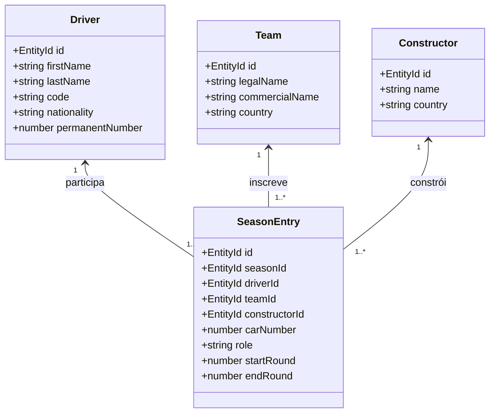

# Módulo Participants — Pilotos, Equipes, Construtores e Inscrições

> **Localização:** `docs/domain/participants.md`  
> **Caminho no código:** `packages/domain/src/participants/`  
> **Papel arquitetural:** Modelagem de competidores e vínculos temporais de participação  
> **Documento pai:** [README.md](./README.md)  

---

## 1. Visão Geral

O módulo **`participants`** modela os atores humanos e corporativos que disputam as competições da Fórmula 1. Ele resolve um dos desafios mais críticos de modelagem esportiva histórica: **a diferenciação rigorosa entre a identidade perene de um competidor e sua participação temporal vinculada a uma equipe em uma temporada específica**.

Na Fórmula 1, pilotos trocam de equipe entre temporadas e no meio de um mesmo ano; equipes mudam de patrocinador-título e de razão social; e construtores fornecem chassis e motores sob acordos contratuais distintos. O F1Atlas não trata esses conceitos como uma entidade única desnormalizada.

---

## 2. Diferenciação Conceitual entre os Participantes

1. **Piloto (`Driver`):** A pessoa física do atleta. Possui carreira contínua, biografia, nacionalidade, código oficial da FIA de três letras (ex.: `VER`, `HAM`, `NOR`, `SEN`) e número permanente de carreira. Sua existência transcende equipes e temporadas.
2. **Equipe (`Team`):** A entidade comercial e esportiva inscrita perante a FIA (ex.: "Scuderia Ferrari HP", "Oracle Red Bull Racing", "Mercedes-AMG PETRONAS F1 Team"). Pode mudar de denominação comercial por motivos de patrocínio sem perder sua identidade histórica.
3. **Construtor (`Constructor`):** O fabricante oficial do chassi reconhecido pelo regulamento para o Campeonato Mundial de Construtores (WCC). Para a FIA, o título de construtores pertence ao fabricante do chassi (ex.: `McLaren`, `Ferrari`, `Williams`, `Red Bull Racing`).
4. **Inscrição de Temporada (`SeasonEntry`):** O **vínculo contratual e temporal** que amarra um Piloto a uma Equipe e a um Construtor, com um número de carro específico e papel formal (`PRIMARY` ou `RESERVE`), durante um intervalo de etapas daquela temporada.

---

## 3. Responsabilidades

### O que pertence ao módulo `participants`:
- O cadastro durável de pilotos e verificação de números permanentes de carreira.
- O cadastro de equipes comerciais e construtores oficiais homologados pela FIA.
- A modelagem da temporalidade das inscrições (`SeasonEntry`), permitindo substituições de pilotos (ex.: pilotos reservas ou transferências intra-temporada) sem corromper dados do passado.

### O que NÃO pertence ao módulo `participants`:
- Resultados alcançados em pista ou posições de chegada (escopo de `events`).
- Posições no grid de largada ou início a partir do pit lane (escopo de `events/session-entry`).
- Soma de pontos do campeonato ou posições na tabela (escopo de `scoring` e `championships`).
- Direitos de imagem, fotografias ou logotipos proprietários (vetados por governança pública).

---

## 4. Componentes

| Arquivo TypeScript | Conceito Representado | Papel Arquitetural | Estado Atual |
|---|---|---|---|
| `participants/driver.ts` | Piloto (Atleta) | Entidade de Domínio | **Planejado** (planejamento via comentários nível 1 e 2) |
| `participants/team.ts` | Equipe Comercial Competidora | Entidade de Domínio | **Planejado** (planejamento via comentários nível 1 e 2) |
| `participants/constructor.ts` | Construtor de Chassi Oficial FIA | Entidade de Domínio | **Planejado** (planejamento via comentários nível 1 e 2) |
| `participants/season-entry.ts` | Inscrição Temporal de Temporada | Entidade de Associação Temporal | **Planejado** (planejamento via comentários nível 1 e 2) |

---

## 5. Regras de Negócio e Invariantes

### 5.1. Regras Confirmadas
1. **Número Permanente da FIA:** Desde a temporada de 2014, cada piloto escolhe um número de carreira entre 2 e 99 que o acompanha durante toda a sua permanência na F1.
2. **Privilégio do Campeão:** O número 1 é reservado exclusivamente ao piloto campeão mundial da temporada anterior. Caso ele opte por não utilizá-lo, nenhum outro competidor pode utilizá-lo.
3. **Unicidade de Número na Equipe:** Durante o mesmo Grande Prêmio, dois carros da mesma equipe não podem competir com o mesmo número.
4. **Vigência Temporal Estrita:** Uma `SeasonEntry` possui etapa inicial (`startRound`) e etapa final opcional (`endRound`). Quando um piloto reserva substitui um titular (ou assume o carro em definitivo), uma nova `SeasonEntry` é gerada ou o intervalo de vigência da anterior é encerrado, preservando a imutabilidade das etapas anteriores.

### 5.2. Regras Propostas
- **Suporte a Mutações Comerciais de Equipes:** Uma mesma organização de base (ex.: a fábrica em Hinwil) pode ter participado historicamente como *Sauber*, *BMW Sauber*, *Alfa Romeo Racing*, *Stake F1 Team Kick Sauber* e futuramente *Audi*. A modelagem deve suportar rastrear a linhagem histórica sem fundir artificialmente os nomes comerciais da época.

---

## 6. Operações e Comportamentos

- **`createDriver(props: { id, firstName, lastName, code, nationality, permanentNumber? }): Result<Driver, DomainError>`:**  
  Cria um competidor validando código FIA de três letras maiúsculas e número permanente no intervalo [1, 99].
- **`createTeam(props: { id, legalName, commercialName, country }): Result<Team, DomainError>`:**  
  Cadastra a equipe esportiva com razão social e nome comercial válidos.
- **`createConstructor(props: { id, name, country }): Result<Constructor, DomainError>`:**  
  Registra o construtor homologado para efeito do WCC.
- **`createSeasonEntry(props: { id, seasonId, driverId, teamId, constructorId, carNumber, role, startRound? }): Result<SeasonEntry, DomainError>`:**  
  Formaliza a participação contratual na temporada sob um número específico.
- **`deactivateEntry(entry: SeasonEntry, finalRound: number): Result<SeasonEntry, DomainError>`:**  
  Marca o encerramento da vigência ativa da inscrição em determinada etapa, permitindo a entrada de um piloto substituto sem deletar o histórico passado.

---

## 7. Exemplos Práticos da Fórmula 1

### Exemplo 1: Substituição de Piloto Titular por Reserva (Temporada 2024)
- **Cenário:** Carlos Sainz sofreu apendicite antes da qualificação no GP da Arábia Saudita (Round 2). Oliver Bearman assumiu o carro #38 da Ferrari naquela etapa.
- **Modelagem no F1Atlas:**
  - `SeasonEntry` A: Piloto `Carlos Sainz`, Carro `#55`, Equipe `Scuderia Ferrari`, papel `PRIMARY`.
  - `SeasonEntry` B: Piloto `Oliver Bearman`, Carro `#38`, Equipe `Scuderia Ferrari`, papel `RESERVE`, vigência exclusiva para o Round 2.
  - No Round 3 (Austrália), Sainz retornou ao carro `#55`. Nenhuma mutação destrutiva ocorreu no cadastro de Sainz ou Bearman.

### Exemplo 2: Troca Definitiva no Meio do Ano (Temporada 2024)
- **Cenário:** Logan Sargeant foi substituído por Franco Colapinto na Williams a partir do GP da Itália em Monza (Round 16 até o final do ano).
- **Modelagem no F1Atlas:**
  - Inscrição de Sargeant: `startRound: 1`, `endRound: 15`.
  - Inscrição de Colapinto: `startRound: 16`, `endRound: 24`, carro `#43`.
  - As pontuações e classificações até o Round 15 permanecem auditáveis e imutáveis.

---

## 8. Decisões Arquiteturais e Pendências

1. **Linhagem Histórica de Equipes (*Team Lineage*):**  
   *Questão:* Devemos criar uma entidade de nível superior `TeamFranchise` ou `Organization` para conectar a linhagem de equipes que mudaram de dono (ex.: Tyrrell -> BAR -> Honda -> Brawn GP -> Mercedes)?  
   *Decisão:* Para o MVP (2025), o vínculo direto por temporada via `Team` e `Constructor` é suficiente. A linhagem estendida será introduzida na consolidação histórica (fase 2026/2027) via ADR documentado.
2. **Números Temporários de Treino Livre (TL1 Young Drivers):**  
   *Questão:* Como modelar jovens pilotos que participam apenas do Treino Livre 1 em sextas-feiras utilizando números atribuídos pela FIA (ex.: #38, #50, #61)?  
   *Decisão:* Serão modelados como `SessionEntry` específica com papel de piloto de teste, sem exigir uma `SeasonEntry` titular completa de campeonato.
