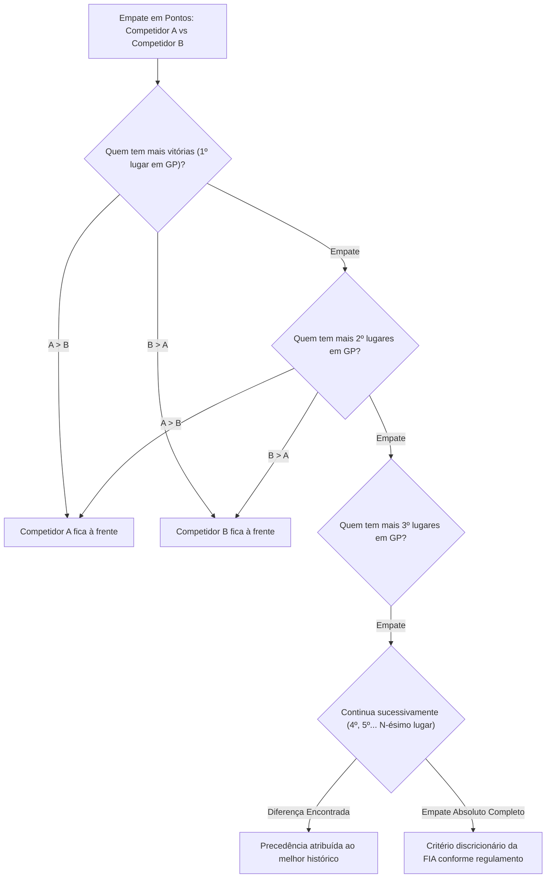

# Módulo Scoring — Regras e Motor de Cálculo de Pontuação

> **Localização:** `docs/domain/scoring.md`  
> **Caminho no código:** `packages/domain/src/scoring/`  
> **Papel arquitetural:** Motor determinístico puro de apuração de pontos e desempates da FIA  
> **Documento pai:** [README.md](./README.md)  

---

## 1. Visão Geral

O módulo **`scoring`** é o coração matemático e regulamentar do F1Atlas. Ele implementa as tabelas normativas da FIA e os serviços de cálculo determinístico de pontos para pilotos e construtores a partir dos resultados de pista, além de resolver empates na tabela através do sistema oficial de *countback*.

Cálculos esportivos no F1Atlas são **funções matemáticas puras**: não possuem estado interno mutável, não dependem de relógio de sistema e não sofrem efeitos colaterais de rede ou banco de dados.

---

## 2. Responsabilidades

### O que pertence ao módulo `scoring`:
- A representação configurável das tabelas de pontuação por temporada (`ScoringRuleset`).
- O cálculo determinístico dos pontos obtidos por um piloto ou equipe em uma sessão (`PointsCalculator`).
- A aplicação das regras de pontuação para Corridas Principais e Corridas Curtas (Sprint).
- O tratamento de provas interrompidas ou encurtadas por chuva ou bandeira vermelha.
- A resolução oficial de empates na pontuação do campeonato mundial através da contagem regressiva de posições de chegada (`TieBreakPolicy`).

### O que NÃO pertence ao módulo `scoring`:
- O armazenamento consolidado da tabela de classificação geral (escopo de `championships`).
- A aplicação de penalidades em tempo de volta ou desclassificações de pilotos (escopo de `events`).
- A gravação de pontuações em tabelas SQL ou leitura de arquivos JSON externos.

---

## 3. Componentes

| Arquivo TypeScript | Conceito Representado | Papel Arquitetural | Estado Atual |
|---|---|---|---|
| `scoring/scoring-ruleset.ts` | Tabela e Regras de Pontuação | Objeto de Valor / Configuração | **Planejado** (planejamento via comentários nível 1 e 2) |
| `scoring/points-calculator.ts` | Calculadora de Pontos | Serviço de Domínio Puro | **Planejado** (planejamento via comentários nível 1 e 2) |
| `scoring/tie-break-policy.ts` | Política de Desempate (Countback) | Serviço de Domínio / Política | **Planejado** (planejamento via comentários nível 1 e 2) |

---

## 4. O Sistema de Pontuação da Fórmula 1

### 4.1. Corrida Principal (Grand Prix Race)
A tabela padrão vigente para os 10 primeiros colocados em um GP completo:

| Posição | 1º | 2º | 3º | 4º | 5º | 6º | 7º | 8º | 9º | 10º | 11º+ |
|---|---|---|---|---|---|---|---|---|---|---|---|
| **Pontos** | 25 | 18 | 15 | 12 | 10 | 8 | 6 | 4 | 2 | 1 | 0 |

### 4.2. Corrida Sprint (Sprint Race)
A tabela padrão para as corridas de sábado dos finais de semana com formato Sprint (8 primeiros colocados):

| Posição | 1º | 2º | 3º | 4º | 5º | 6º | 7º | 8º | 9º+ |
|---|---|---|---|---|---|---|---|---|---|
| **Pontos** | 8 | 7 | 6 | 5 | 4 | 3 | 2 | 1 | 0 |

### 4.3. Regra da Volta Mais Rápida: A Mudança Normativa de 2025

> [!IMPORTANT]
> **Abolição do Ponto de Volta Rápida em 2025:**  
> Entre 2019 e 2024, a FIA concedia 1 ponto de bonificação ao autor da volta mais rápida da corrida principal, desde que ele terminasse entre os 10 primeiros colocados.  
> **Para o Campeonato Mundial de 2025 em diante, a FIA aprovou a revogação formal dessa bonificação.**  
> O F1Atlas reflete essa realidade histórica: o `ScoringRuleset` de 2025 possui `fastestLapBonusPoints = 0`, enquanto o motor mantém a capacidade de processar temporadas passadas (com 1 ponto) ou futuras sem modificação de código.

### 4.4. Provas Encurtadas (Regulamento FIA Pós-Spa 2021)
Para corridas interrompidas que não atinjam a distância total programada, o regulamento esportivo divide a pontuação em quatro faixas baseadas na distância percorrida pelo líder:
1. **Menos de 2 voltas completadas sob bandeira verde:** Nenhum ponto atribuído.
2. **Entre 2 voltas e 25% da distância:** Pontuação mínima (1º: 6 pts, 2º: 4 pts, 3º: 3 pts, 4º: 2 pts, 5º: 1 pt).
3. **Entre 25% e 50% da distância:** Pontuação intermediária (1º: 13 pts, 2º: 10 pts, 3º: 8 pts, 4º: 6 pts...).
4. **Entre 50% e 75% da distância:** Pontuação avançada (1º: 19 pts, 2º: 14 pts, 3º: 11 pts, 4º: 9 pts...).
5. **Acima de 75% da distância:** Pontuação integral regular (100%).

---

## 5. Política Oficial de Desempate (Countback System)

Quando dois ou mais competidores (pilotos ou construtores) acumulam rigorosamente a mesma pontuação na tabela, a FIA não permite sorteios ou critérios arbitrários. O desempate é resolvido pelo algoritmo determinístico de *Countback*:

---

## 6. Operações e Comportamentos

- **`createScoringRuleset(props): Result<ScoringRuleset, DomainError>`:**  
  Cria a especificação de pontuação garantindo ordem estritamente decrescente de pontos e valores não-negativos.
- **`getPointsForPosition(ruleset, sessionType, position, distancePercentage?): number`:**  
  Consulta os pontos de uma posição final (retorna 0 para posições fora da zona pontuável).
- **`calculateSessionPoints(result, sessionType, ruleset, distancePercentage?): { totalPoints, positionPoints, fastestLapPoints }`:**  
  Calcula a pontuação obtida por um piloto em uma sessão, anulando pontos se o competidor estiver com status `DSQ`.
- **`calculateConstructorPoints(resultsForConstructor, sessionType, ruleset, distancePercentage?): number`:**  
  Soma a pontuação individual válida dos carros do construtor na sessão.
- **`compareCompetitorsCountback(finishesA, finishesB): number`:**  
  Compara duas listas históricas de posições de chegada retornando número negativo se A tiver precedência, positivo se B tiver precedência, ou 0 em caso de empate total.
- **`resolveStandingsOrder(competitors): T[]`:**  
  Ordena a lista completa aplicando primeiro pontos e, em caso de empate, a política de countback.

---

## 7. Exemplo Prático: Cálculo de Corrida em 2025

- **Piloto A:** Conquistou a vitória no GP (1º lugar) e cravou a volta mais rápida da prova.  
  *Cálculo:* Posição = 25 pontos. Volta mais rápida (Regulamento 2025) = 0 pontos.  
  *Total:* **25 pontos** (e não 26 pontos como ocorria em 2024).
- **Piloto B:** Terminou em 10º lugar.  
  *Total:* **1 ponto**.
- **Piloto C:** Terminou em 11º lugar com volta mais rápida.  
  *Total:* **0 pontos** (inelegível tanto por posição quanto pelo regulamento 2025).

---

## 8. Decisões Arquiteturais e Pendências

1. **Pontos de Sprint na Política de Desempate:**  
   *Questão:* As posições de chegada em Sprint Races entram na contagem regressiva de desempate se o empate persistir após avaliar todas as Corridas Principais?  
   *Regulamento FIA:* Sim; o regulamento desportivo prevê que resultados de Sprint Races são considerados caso as posições de Grand Prix sejam idênticas. A `TieBreakPolicy` acomodará essa regra em sua versão final.
2. **Desempate de Construtores:**  
   *Questão:* No desempate de construtores, comparam-se os resultados somados da equipe ou o melhor resultado individual alcançado por qualquer um dos seus carros em cada GP?  
   *Regulamento FIA:* Considera-se o melhor resultado de chegada alcançado por qualquer carro da equipe (ex.: melhor resultado 1º lugar, depois 2º lugar).
