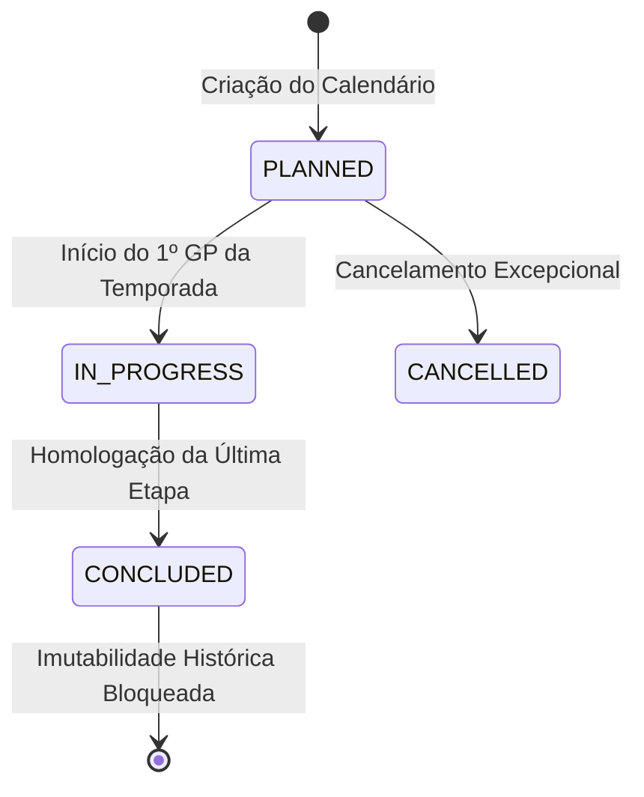
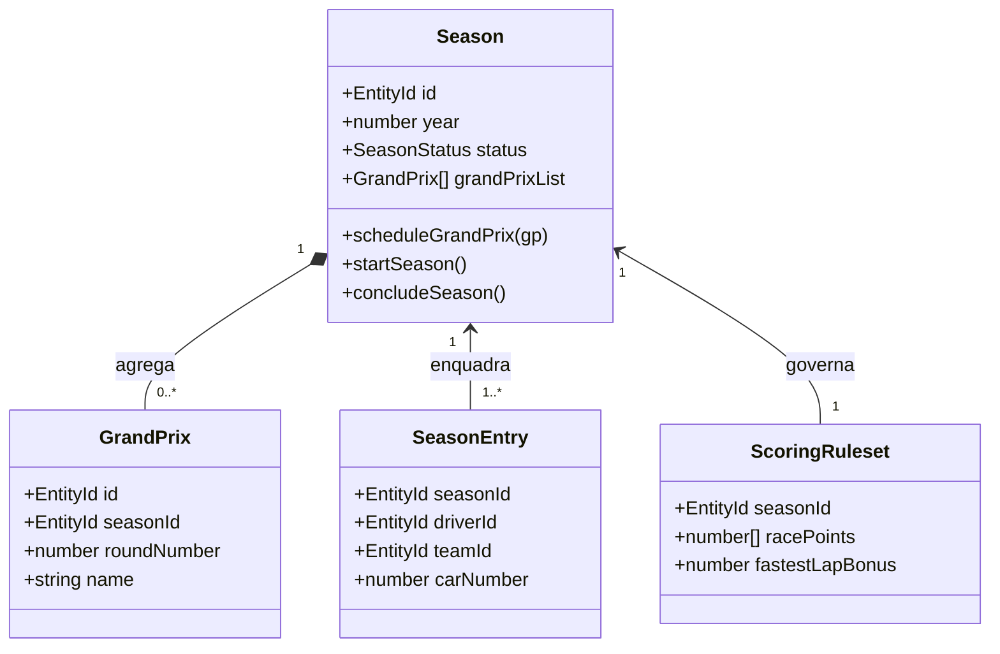

# Módulo Seasons — Temporadas e Ciclo de Vida

> **Localização:** `docs/domain/seasons.md`  
> **Caminho no código:** `packages/domain/src/seasons/`  
> **Papel arquitetural:** Agregado raiz de calendário anual e enquadramento de competições  
> **Documento pai:** [README.md](./README.md)  

---

## 1. Visão Geral

O módulo **`seasons`** representa a temporada anual da Fórmula 1 (ex.: Temporada 2025, 2026, 2027). Ele atua como a moldura temporal soberana para todos os eventos esportivos, definindo o calendário oficial de Grandes Prêmios, as inscrições vigentes e o ciclo de vida regulamentar do campeonato.

Na Fórmula 1, uma temporada não é apenas um ano numérico: é um ciclo fechado de governança esportiva com regulamento técnico e desportivo específico, calendário homologado pela FIA e classificação cumulativa única.

---

## 2. Responsabilidades

### O que pertence ao módulo `seasons`:
- A raiz de agregado `Season`, que coordena o calendário de Grandes Prêmios.
- O controle de ciclo de vida e transições de status da temporada (`SeasonStatus`).
- A garantia de que uma temporada concluída tenha seus resultados históricos blindados contra modificações indevidas.
- A validação de ordenação das etapas (`roundNumber`) ao longo do ano.

### O que NÃO pertence ao módulo `seasons`:
- A apuração dos pontos e posições de campeonato (escopo de `scoring` e `championships`).
- O gerenciamento de sessões individuais de treino, classificação e corrida (escopo de `events`).
- O cadastro biográfico vitalício de pilotos ou histórico comercial de equipes (escopo de `participants`).
- A definição de regulamentos de motores ou teto orçamentário.

---

## 3. Componentes

| Arquivo TypeScript | Conceito Representado | Papel Arquitetural | Estado Atual |
|---|---|---|---|
| `seasons/season.ts` | Temporada Oficial | Raiz de Agregado (Aggregate Root) | **Planejado** (planejamento via comentários nível 1 e 2) |
| `seasons/season-status.ts` | Estado da Temporada | Objeto de Valor / Máquina de Estados | **Planejado** (planejamento via comentários nível 1 e 2) |

---

## 4. Ciclo de Vida e Máquina de Estados

O ciclo de vida de uma temporada é governado pela máquina de estados definida em `SeasonStatus`:

### Regras de Transição de Estado:
- **`PLANNED` (Planejada):** A temporada possui calendário e participantes em definição. Permite alterações de datas, adição ou remoção de etapas e ajustes de inscrições.
- **`IN_PROGRESS` (Em Andamento):** A primeira atividade de pista oficial do ano teve início. O calendário torna-se restrito a alterações regulamentares excepcionais.
- **`CONCLUDED` (Concluída):** A última etapa foi encerrada e homologada pelos comissários. A temporada torna-se **bloqueada para modificações** (`isLockedForModifications === true`). Qualquer alteração futura exige procedimento formal de revisão histórica.
- **`CANCELLED` (Cancelada):** Aplicável somente a temporadas em estado `PLANNED` que não chegaram a ser disputadas.

---

## 5. Regras de Negócio e Invariantes

### 5.1. Regras Confirmadas
1. **Ano Válido do Campeonato:** O ano da temporada deve ser maior ou igual a 1950 (ano do campeonato mundial inaugural da FIA).
2. **Unicidade de Rodada:** Dentro de uma mesma temporada, não podem existir dois Grandes Prêmios com o mesmo número de rodada (`roundNumber`).
3. **Sequencialidade de Calendário:** As rodadas de Grandes Prêmios devem formar uma sequência inteira positiva ($1, 2, 3, \dots, N$).
4. **Proteção Histórica Pós-Conclusão:** Não é permitido adicionar, reagendar ou excluir Grandes Prêmios em uma temporada cujo status seja `CONCLUDED`.

### 5.2. Regras Propostas
- **Arquitetura Multi-Temporada Nativa:** O modelo de `Season` não deve embutir presunções de que as regras esportivas de 2025 se aplicam obrigatoriamente a 2026 ou 2027. Cada temporada aponta explicitamente para o seu conjunto de regras de pontuação (`ScoringRuleset`).
- **Tolerância a Cancelamento de Etapas:** O domínio deve permitir o cancelamento pontual de um Grande Prêmio agendado sem corromper os números de rodada das etapas anteriores já encerradas.

---

## 6. Relacionamentos

---

## 7. Operações e Comportamentos

- **`createSeason(props: { id, year, status? }): Result<Season, DomainError>`:**  
  Instancia e valida uma nova temporada com ano válido ($\ge 1950$), inicializando a lista de etapas vazia e o status `PLANNED`.
- **`scheduleGrandPrix(season: Season, grandPrix: GrandPrix): Result<Season, DomainError>`:**  
  Adiciona um Grande Prêmio ao calendário da temporada garantindo unicidade do `roundNumber` e conformidade de datas.
- **`startSeason(season: Season): Result<Season, DomainError>`:**  
  Transiciona o status da temporada para `IN_PROGRESS` a partir de `PLANNED`, validando que haja ao menos uma etapa agendada.
- **`concludeSeason(season: Season): Result<Season, DomainError>`:**  
  Encerra oficialmente a temporada, travando o calendário contra novas alterações e validando que todas as etapas foram concluídas ou canceladas.
- **`isValidTransition(current: SeasonStatus, target: SeasonStatus): boolean`:**  
  Avalia puramente se a transição entre dois estados é permitida pelo regulamento.
- **`isLockedForModifications(status: SeasonStatus): boolean`:**  
  Retorna `true` quando a temporada está `CONCLUDED`, impedindo mutações esportivas.

---

## 8. Exemplo Prático: Temporada 2025 da F1

1. **Janeiro de 2025:** A temporada é criada com `year = 2025` e status `PLANNED`. 24 Grandes Prêmios são agendados sequencialmente (Round 1 na Austrália, Round 2 na China... Round 24 em Abu Dhabi).
2. **Março de 2025:** No início do fim de semana do GP da Austrália em Melbourne, a temporada transiciona para `IN_PROGRESS`.
3. **Dezembro de 2025:** Após a bandeirada final e homologação dos resultados em Yas Marina, a temporada transiciona para `CONCLUDED`, blindando as tabelas históricas do WDC e WCC contra qualquer alteração acidental.

---

## 9. Decisões Arquiteturais e Pendências

1. **Agregação em Memória vs. Referência Oclusa:**  
   *Questão:* Deve a entidade `Season` manter todas as 24 entidades `GrandPrix` em uma coleção interna carregada em memória ou armazenar apenas identificadores (`EntityId`) e consultar via repositório?  
   *Decisão Preliminar:* No domínio puro, a raiz de agregado gerencia sua coleção de etapas para garantir invariantes de ordenação e datas. Em operações específicas de leitura, a aplicação pode carregar projeções leves sem hidratar o agregado completo.
2. **Cancelamentos de Etapas e Reordenamento:**  
   *Questão:* Se uma etapa for cancelada no meio do ano (como Imola em 2023 devido a enchentes), as rodadas subsequentes devem ser renumeradas ou a etapa cancelada permanece registrada como rodada cancelada?  
   *Diretriz FIA Adotada:* A etapa cancelada permanece no histórico como `CANCELLED` para preservar a integridade temporal e a memória documental da temporada.
