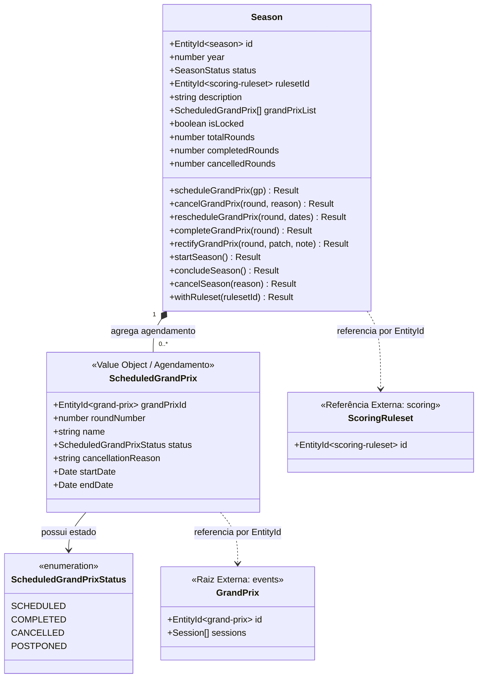
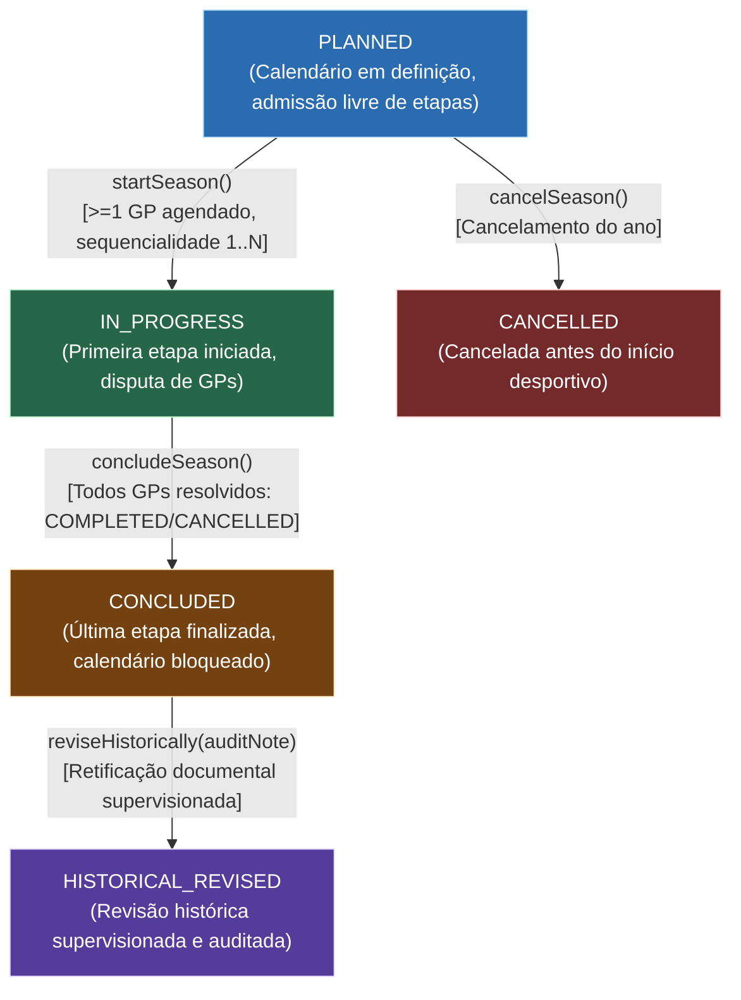
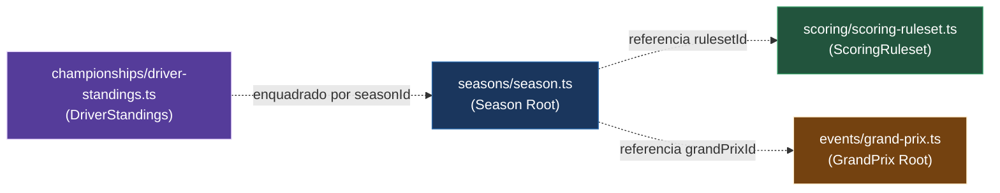

# Módulo Seasons — Temporadas, Calendário Oficial e Ciclo de Vida

> **Localização:** `docs/domain/seasons.md`  
> **Caminho no código:** `packages/domain/src/seasons/`  
> **Papel arquitetural:** Agregado raiz soberano de calendário anual, enquadramento temporal de competições e integridade histórica  
> **Documento pai:** [README.md](./README.md)  
> **Última auditoria e atualização:** 2026-11-02 (Auditoria Arquitetural e Refatoração de Domínio)  

---

## 1. Visão Geral

O módulo **`seasons`** modela a temporada anual da Fórmula 1 (ex.: Temporada 1950, 2021, 2023, 2025, 2026). Ele atua como a moldura temporal soberana para todos os acontecimentos esportivos, delimitando o calendário oficial homologado de Grandes Prêmios, as regras regulamentares aplicáveis e o ciclo de vida formal da disputa do campeonato mundial.

Na Fórmula 1, uma temporada não é uma mera propriedade numérica ou rótulo de banco de dados: é uma instituição desportiva anual delimitada no tempo, com governança esportiva fechada, calendário homologado pelo Conselho Mundial de Automobilismo da FIA (WMSC), regulamento técnico/esportivo específico e apuração de títulos mundiais (Pilotos e Construtores).

---

## 2. Glossário dos Conceitos

| Termo | Definição no Domínio F1Atlas |
|---|---|
| **Temporada (`Season`)** | Raiz de agregado que delimita o ano desportivo oficial da Fórmula 1 e coordena seu calendário homologado. |
| **Status da Temporada (`SeasonStatus`)** | Máquina de estados do ciclo de vida da temporada no sistema (`PLANNED`, `IN_PROGRESS`, `CONCLUDED`, `CANCELLED`, `HISTORICAL_REVISED`). |
| **Agendamento de GP (`ScheduledGrandPrix`)** | Modelo intermediário de agendamento que compõe o calendário da temporada, referenciando a identidade do GP sem carregar detalhes de pista. |
| **Status do Agendamento (`ScheduledGrandPrixStatus`)** | Estado da etapa no calendário oficial: `SCHEDULED`, `COMPLETED`, `CANCELLED`, `POSTPONED`. |
| **Número da Rodada (`roundNumber`)** | Índice ordinal positivo ($1 \dots N$) atribuído oficialmente pela FIA à etapa no calendário da temporada. |
| **Calendário Homologado** | Coleção ordenada de etapas agendadas que compõem o itinerário oficial do campeonato. |
| **Retificação Histórica** | Processo formal, supervisionado e auditável que permite corrigir registros factuais ou documentais pós-conclusão sem violar o bloqueio operacional ordinário. |
| **Imutabilidade Histórica** | Garantia de que temporadas concluídas não admitem alterações operacionais acidentais em seus calendários e resultados oficiais. |

---

## 3. Responsabilidades e Limites

### O que pertence ao módulo `seasons`:
- A raiz de agregado `Season`, responsável por coordenar a ordem e integridade do calendário anual de Grandes Prêmios.
- O ciclo de vida formal da temporada (`SeasonStatus`) e suas transições controladas.
- O modelo intermediário de calendário (`ScheduledGrandPrix`) e seu ciclo de vida (`ScheduledGrandPrixStatus`).
- A aplicação das invariantes de unicidade de rodadas, sequencialidade contínua ($1 \dots N$) e consistência temporal de datas.
- O cancelamento pontual de etapas (ex.: GP da Emilia-Romagna de 2023) preservando a rodada oficial e a identidade histórica do evento.
- O reagendamento formal de datas de etapas mantendo o enquadramento temporal da temporada.
- A blindagem de temporadas concluídas contra mutações operacionais ordinárias (`isLocked`).
- A permissão controlada de retificações históricas supervisionadas com notas de auditoria (`HISTORICAL_REVISED`).
- O vínculo referencial com o conjunto de regras de pontuação aplicáveis (`rulesetId: EntityId<'scoring-ruleset'>`).

### O que NÃO pertence ao módulo `seasons`:
- **Cálculo de pontos e critérios de desempate:** responsabilidade soberana do módulo `scoring` (`PointsCalculator`, `TieBreakPolicy`).
- **Tabelas de classificação acumulada (WDC e WCC):** responsabilidade soberana do módulo `championships` (`DriverStandings`, `ConstructorStandings`).
- **Gerenciamento de sessões de pista e tempos:** responsabilidade do módulo `events` (`GrandPrix`, `Session`, `SessionResult`).
- **Cadastro biográfico e histórico comercial de participantes:** responsabilidade do módulo `participants` (`Driver`, `Team`, `Constructor`, `SeasonEntry`).
- **Persistência relacional, ORM ou serialização HTTP:** detalhes das camadas de infraestrutura e contratos.

---

## 4. Componentes Existentes

| Arquivo TypeScript | Conceito Representado | Papel Arquitetural | Estado Atual |
|---|---|---|---|
| `seasons/season.ts` | Temporada Oficial e Calendário | Raiz de Agregado (Aggregate Root) | **Validado** (entidade imutável, modelo intermediário de calendário, sequencialidade 1..N, cancelamentos históricos e imutabilidade de datas) |
| `seasons/season-status.ts` | Estado da Temporada | Objeto de Valor / Máquina de Estados | **Validado** (transições operacionais do F1Atlas, bloqueio histórico e retificação supervisionada) |
| `seasons/index.ts` | Ponto de Entrada do Módulo | Barrel Export | **Validado** (exportação seletiva de tipos, factories e predicados públicos) |

---

## 5. Agregado e Relacionamentos

### 5.1. Decisão sobre o Limite de Agregação: Alternativa C

Após auditoria técnica e arquitetural, adotou-se formalmente a **Alternativa C — Modelo Intermediário de Calendário / Referência por Identidade**:



**Justificativa Arquitetural:**
- `Season` não deve carregar em memória entidades complexas de `GrandPrix` (com sessões de treinos, classificação, sprint, grid de largada, voltas e incidentes).
- Manter apenas `ScheduledGrandPrix` como registro leve de agendamento garante baixo acoplamento entre módulos conceituais (`seasons` $\leftrightarrow$ `events`), elimina dependências circulares e otimiza a pegada de memória do monólito modular.
- As invariantes transacionais de calendário (unicidade de rodada, sequencialidade, preservação de etapas canceladas) são integralmente resolvidas por `ScheduledGrandPrix`.

---

## 6. Ciclo de Vida da Temporada

O ciclo de vida da temporada percorre cinco fases operacionais controladas:



---

## 7. Máquina de Estados (`SeasonStatus`)

### 7.1. Tabela Canônica de Transições

| Estado Atual | Próximo Estado Alvo | Validação Local (`isValidTransition`) | Condições Adicionais do Agregado (`Season`) |
|---|---|:---:|---|
| `PLANNED` | `IN_PROGRESS` | **Permitida** | Calendário possui $\ge 1$ etapa agendada e as rodadas formam uma sequência contínua de 1 a N. |
| `PLANNED` | `CANCELLED` | **Permitida** | Motivo opcional de cancelamento registrado. |
| `IN_PROGRESS` | `CONCLUDED` | **Permitida** | Todas as etapas do calendário estão em estado terminal (`COMPLETED` ou `CANCELLED`). Proibido se houver etapas `SCHEDULED` ou `POSTPONED`. |
| `CONCLUDED` | `HISTORICAL_REVISED` | **Permitida** | Fornecimento obrigatório de nota de auditoria não vazia. |
| `CANCELLED` | Qualquer outro | **Proibida** | Estado terminal absoluto. |
| `HISTORICAL_REVISED` | Qualquer outro | **Proibida** | Estado de revisão pós-morte (permanece sob auditoria contínua). |
| Qualquer estado | Mesmo estado | **Proibida** | Transições reflexivas são rejeitadas. |

### 7.2. Natureza dos Estados
Os estados de `SeasonStatus` representam o modelo de ciclo de vida operacional e governança de dados do **F1Atlas**. Eles estruturam o sistema sem presumir que a FIA utilize exatamente esses termos em seus regulamentos administrativos.

---

## 8. Regras de Negócio

1. **Ano Mínimo Inaugural:** Nenhuma temporada pode possuir ano anterior a 1950 (ano do campeonato mundial inaugural da FIA).
2. **Unicidade de Rodada Oficial:** Dentro de uma mesma temporada, cada Grande Prêmio deve possuir um número ordinal de rodada (`roundNumber`) único.
3. **Unicidade de Identidade de GP:** O mesmo `grandPrixId` não pode ser agendado mais de uma vez na mesma temporada.
4. **Sequencialidade de Calendário Ininterrupta:** Para que a temporada seja iniciada (`startSeason`), o calendário oficial deve conter rodadas sequenciais ininterruptas de 1 até $N$.
5. **Preservação de Etapas Canceladas (Diretriz FIA):** Etapas canceladas durante a temporada permanecem registradas no histórico com status `CANCELLED` e seu `roundNumber` original preservado. Não há renumeracão das etapas seguintes.
6. **Encerramento Pleno do Calendário:** Uma temporada não pode ser concluída (`concludeSeason`) havendo etapas com status `SCHEDULED` ou `POSTPONED`. Todas as etapas agendadas devem ter sido disputadas (`COMPLETED`) ou formalmente canceladas (`CANCELLED`).
7. **Bloqueio Operacional Ordinário:** Temporadas com status `CONCLUDED`, `CANCELLED` ou `HISTORICAL_REVISED` estão bloqueadas (`isLocked === true`) para agendamentos ou cancelamentos ordinários.
8. **Retificação Histórica Auditável:** Correções em dados de etapas de temporadas concluídas exigem transição formal para `HISTORICAL_REVISED` e registro explícito da nota de auditoria.

---

## 9. Invariantes de Domínio

### 9.1. Invariantes Locais
- `id`: Instância válida e obrigatória de `EntityId<'season'>`.
- `year`: Inteiro positivo $\ge 1950$ (rejeita decimais, negativos e `NaN`).
- `status`: Valor pertencente ao enum estrito de `SeasonStatus`.

### 9.2. Invariantes do Agregado
- `grandPrixList`: Coleção imutável (`Object.freeze`) de instâncias `ScheduledGrandPrix`, sempre ordenada ascendentemente por `roundNumber`.
- `ScheduledGrandPrix`: Cópia defensiva profunda e congelamento de datas (`startDate`, `endDate`). Se ambas forem fornecidas, `endDate >= startDate`.
- Bloqueio operacional: Nenhuma mutação de calendário é aceita quando `this.isLocked === true`.

### 9.3. Invariantes Inter-Agregados
- A referência `rulesetId` (`EntityId<'scoring-ruleset'>`) aponta para um conjunto regulamentar de regras de pontuação válido e desacoplado.
- A referência `grandPrixId` (`EntityId<'grand-prix'>`) aponta para a raiz do GP no módulo `events`, sem acoplamento transacional.

### 9.4. Regras Regulamentares
- Diferenciação estrita entre cancelamento da temporada inteira (`cancelSeason`) e cancelamento pontual de etapa (`cancelGrandPrix`).
- Preservação da numeração de rodadas anunciada oficialmente pela FIA em caso de força maior.

---

## 10. Calendário e Temporalidade

### 10.1. Diferenciação Conceitual
O módulo `seasons` diferencia rigorosamente:
1. **Calendário Originalmente Anunciado:** A sequência de etapas inicialmente agendadas na fase `PLANNED`.
2. **Calendário Oficial Vigente:** A coleção ordenada atualizada refletindo etapas realizadas, canceladas ou reagendadas.
3. **Número da Rodada (`roundNumber`):** O índice oficial do GP na temporada (ex.: Round 6).
4. **Etapa Realizada (`COMPLETED`):** GP disputado e homologado esportivamente.
5. **Etapa Cancelada (`CANCELLED`):** GP que constava do calendário oficial mas não foi disputado.
6. **Etapa Adiada (`POSTPONED`):** GP aguardando definição de nova data.

### 10.2. O Caso do GP da Emilia-Romagna de 2023
Em maio de 2023, o Grande Prêmio da Emilia-Romagna em Imola foi cancelado devido às graves inundações na região:
- **Tratamento no F1Atlas:** A etapa é marcada como `cancelGrandPrix(6, 'Enchentes severas na região')`.
- **Integridade da Numeração:** O GP de Imola permaneceu como Rodada 6 nos anais da FIA. A etapa seguinte, o GP de Mônaco, continuou sendo a **Rodada 7**. A temporada teve 22 GPs disputados de 23 originalmente planejados, sem alteração artificial dos números de rodada.

---

## 11. Operações e Contratos Públicos

### Métodos da Raiz de Agregado `Season`:

```ts
// Fábrica Estática
static create(props: CreateSeasonProps): Result<Season, DomainError>

// Associação de Regulamento
withRuleset(rulesetId: EntityId<'scoring-ruleset'>): Result<Season, DomainError>

// Gestão de Calendário
scheduleGrandPrix(grandPrix: ScheduledGrandPrix): Result<Season, DomainError>
cancelGrandPrix(roundNumber: number, reason?: string): Result<Season, DomainError>
rescheduleGrandPrix(roundNumber: number, newDates: { startDate?: Date; endDate?: Date }): Result<Season, DomainError>
completeGrandPrix(roundNumber: number): Result<Season, DomainError>

// Gestão de Ciclo de Vida
startSeason(): Result<Season, DomainError>
concludeSeason(): Result<Season, DomainError>
cancelSeason(reason?: string): Result<Season, DomainError>
reviseHistorically(auditNote: string): Result<Season, DomainError>
rectifyGrandPrix(roundNumber: number, patch: PartialScheduledGrandPrix, auditNote: string): Result<Season, DomainError>

// Consultas Puras
getGrandPrixByRound(roundNumber: number): ScheduledGrandPrix | undefined
hasRound(roundNumber: number): boolean
get isLocked(): boolean
get totalRounds(): number
get completedRounds(): number
get cancelledRounds(): number
```

### Funções Utilitárias Puras de Módulo:
- `createSeason(props)`
- `scheduleGrandPrix(season, grandPrix)`
- `cancelGrandPrix(season, roundNumber, reason?)`
- `rescheduleGrandPrix(season, roundNumber, newDates)`
- `completeGrandPrix(season, roundNumber)`
- `startSeason(season)`
- `concludeSeason(season)`
- `cancelSeason(season, reason?)`
- `reviseHistorically(season, auditNote)`
- `isValidTransition(currentStatus, nextStatus)`
- `isLockedForModifications(status)`

---

## 12. Integração com Outros Módulos



- **Com `scoring`:** `Season` referencia o conjunto de regras de pontuação (`rulesetId`) vigente naquele ano (ex.: volta rápida bonificada de 2019 a 2024; sem bonificação a partir de 2025). `Season` **não calcula pontos**.
- **Com `events`:** `Season` agenda a realização de `GrandPrix` por meio de `ScheduledGrandPrix`. O detalhamento das sessões, voltas e tempos reside em `events/session.ts` e `events/session-result.ts`.
- **Com `championships`:** A tabela de pontuação anual aponta para a `seasonId` como seu contexto delimitador soberano.

---

## 13. Integridade e Retificação Histórica

Para equilibrar preservação de evidências históricas com a necessidade de retificar erros factuais comprovados em anais antigos:

1. **Proteção Operacional Padrão:** Uma temporada `CONCLUDED` não admite inserção de novos GPs nem cancelamentos ordinários.
2. **Canal Supervisionado de Revisão:** Mudanças pós-conclusão exigem transição formal para `HISTORICAL_REVISED`, alimentada por nota de auditoria explicativa.
3. **Rastreabilidade:** Todas as retificações (`rectifyGrandPrix`) gravam notas de auditoria imutáveis no campo descritivo da entidade.

---

## 14. Exemplos Históricos Reais

### 14.1. Temporada Nominal 2025
1. Temporada criada em `PLANNED` com `year = 2025` e `rulesetId = 'ruleset-2025'`.
2. 24 etapas agendadas em sequência ininterrupta de 1 a 24.
3. No início da primeira sessão do GP da Austrália, `startSeason()` é disparado (passando pela validação de sequencialidade $1 \dots 24$).
4. Cada etapa é progressivamente marcada como `completeGrandPrix(roundNumber)`.
5. Em Abu Dhabi (Round 24), após a última bandeirada e homologação dos comissários, `concludeSeason()` encerra o campeonato e bloqueia o ano contra alterações.

### 14.2. Temporada 2023 e o Cancelamento de Imola
1. O GP da Emilia-Romagna constava como Rodada 6.
2. Devido às inundações, aciona-se `cancelGrandPrix(6, 'Enchentes severas na região de Emilia-Romagna')`.
3. A rodada 6 é gravada como `CANCELLED`.
4. O GP de Mônaco permanece como Rodada 7.
5. Ao final do ano, `concludeSeason()` é aprovado com 22 etapas `COMPLETED` e 1 etapa `CANCELLED`, preservando integralmente o histórico da F1.

### 14.3. Temporada 2021 e o GP da Bélgica (Spa-Francorchamps)
1. A corrida sob chuva torrencial em Spa durou apenas 2 voltas atrás do Safety Car.
2. No módulo `events`, a corrida foi encerrada sob bandeira vermelha. No módulo `scoring`, foram atribuídos meios-pontos (half-points) conforme o regulamento de 2021.
3. No módulo `seasons`, a etapa em Spa permaneceu como uma etapa disputada e foi marcada como `completeGrandPrix(12)`.
4. Isso comprova que `Season` não interfere nas regras de pontuação de corridas encurtadas, mantendo sua responsabilidade restrita ao calendário.

---

## 15. Critérios de Aceitação

- [x] Raiz de agregado `Season` implementada como entidade imutável com `Object.freeze`.
- [x] Cópia defensiva profunda de propriedades `Date` em `ScheduledGrandPrix`.
- [x] Invariante de ano mínimo ($\ge 1950$) e unicidade de rodadas por temporada.
- [x] Invariante de sequencialidade ininterrupta ($1 \dots N$) validada em `startSeason`.
- [x] Operações de cancelamento (`cancelGrandPrix`) e reagendamento (`rescheduleGrandPrix`) implementadas.
- [x] Encerramento de temporada (`concludeSeason`) condicionado à resolução de todas as etapas agendadas.
- [x] Associação formal de `ScoringRuleset` via `withRuleset`.
- [x] Retificação histórica supervisionada e auditada via `rectifyGrandPrix` e `reviseHistorically`.
- [x] Cobertura de testes unitários superior aos thresholds do projeto (> 90% linhas, > 85% branches, > 90% funções).
- [x] 100% dos mutantes semânticos eliminados via Mutation Testing.
- [x] Quality gates de arquitetura e governança 100% aprovados.

---

## 16. Decisões Arquiteturais Registradas

| Decisão | Alternativas Avaliadas | Escolha Adotada | Justificativa |
|---|---|---|---|
| **Modelo de Calendário** | A. Agregação direta de `GrandPrix`<br/>B. Lista crua de `EntityId`<br/>C. Modelo Intermediário de Agendamento | **Alternativa C (`ScheduledGrandPrix`)** | Permite verificar ordenação, datas, cancelamentos e nomes sem hidratar a árvore completa de sessões de pista. |
| **Numeração de Etapas Canceladas** | A. Renumerar etapas seguintes<br/>B. Preservar `roundNumber` original | **Alternativa B (Preservar `roundNumber`)** | Respeita a tradição histórica e as publicações oficiais da FIA (ex.: Imola 2023 manteve Round 6). |
| **Sequencialidade de Calendário** | A. Exigir sequencialidade a cada inserção<br/>B. Reordenar na inserção e validar continuidade em `startSeason` | **Alternativa B** | Permite cadastrar etapas em qualquer ordem cronológica durante o planejamento, mas impede iniciar campeonatos com etapas faltantes. |
| **Proteção de Datas** | A. Confiar em TypeScript `readonly`<br/>B. Cópia defensiva profunda `new Date(d.getTime())` | **Alternativa B** | Objetos `Date` nativos do JS são mutáveis por referência; a cópia defensiva garante imutabilidade real em tempo de execução. |

---

## 17. Limitações e Pendências

- **Formatos Especiais de Fim de Semana (Sprint Weekends):** A indicação do formato do fim de semana pertence à raiz `events/grand-prix.ts`, não sendo embutida no agendamento preliminar de `Season`.
- **Fusos Horários:** Datas em `ScheduledGrandPrix` utilizam instâncias `Date` UTC padrão; a representação de fusos locais específicos dos circuitos reside em `events/circuit.ts`.

---

## 18. Referências Regulamentares

1. **FIA Formula One Sporting Regulations (2024/2025):** Artigo 5 (Competições do Campeonato), Artigo 6 (Convocação e Calendário de Rodadas).
2. **FIA International Sporting Code (ISC):** Artigo 2 (Conceito de Temporada e Campeonato Mundial), Artigo 13 (Procedimentos de Recursos e Retificações Históricas).
3. **F1 Official Season Calendars (1950–2025):** Registros históricos de cancelamentos excepcionais (GP da Emilia-Romagna 2023, GP da Austrália 2020, GP do Bahrein 2011).
