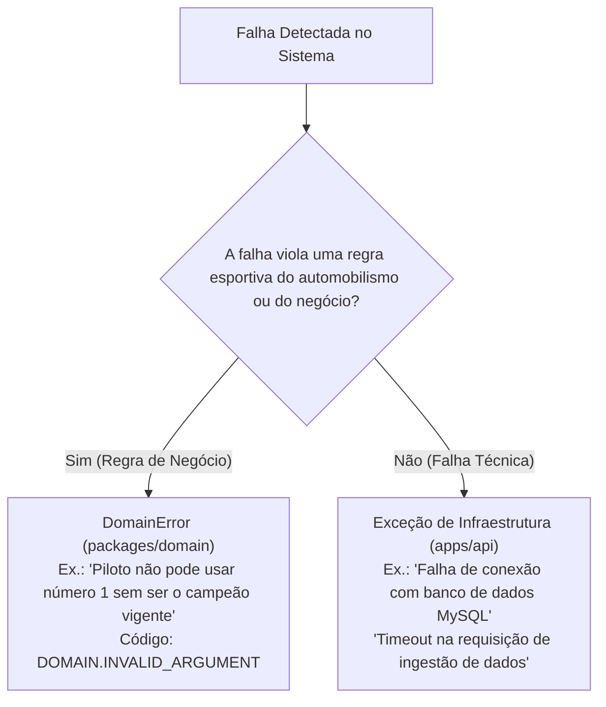

# Módulo Shared — Elementos Compartilhados e Primitivas

> **Localização:** `docs/domain/shared.md`  
> **Caminho no código:** `packages/domain/src/shared/`  
> **Papel arquitetural:** Primitivas fundamentais e padrões transversais do domínio  
> **Documento pai:** [README.md](./README.md)  

---

## 1. Visão Geral

O módulo **`shared`** fornece as abstrações fundamentais e tipos base compartilhados transversalmente por todas as entidades, objetos de valor e serviços da camada Domain. Ele resolve três necessidades essenciais em Domain-Driven Design (DDD) e Clean Architecture:

1. **Combate à "Obsessão por Primitivos" (Primitive Obsession):** Evitar que identificadores de entidades sejam tratados como simples strings soltas, impedindo a troca acidental entre um ID de piloto e um ID de circuito.
2. **Representação Semântica de Erros de Negócio:** Padronizar as falhas originadas de regras esportivas de forma tipada, imutável e contextualizada, desacoplada de códigos de transporte HTTP.
3. **Canal Explícito de Resultados Operacionais:** Modelar o desfecho de operações falíveis sem forçar o disparo disruptivo de exceções (`throw`), tornando os fluxos previsíveis na assinatura dos métodos.

---

## 2. Responsabilidades

### O que pertence ao módulo `shared`:
- Primitivas puras de identidade de entidades (`EntityId`).
- A classe base e predicados de erros de domínio (`DomainError`, `isDomainError`, `DomainErrorCode`).
- O container de retorno explícito de operações de negócio (`Result<T, E>`).
- Tipos transversais que não carregam conhecimento específico sobre o regulamento da Fórmula 1.

### O que NÃO pertence ao módulo `shared`:
- Entidades ou regras de negócio esportivas (ex.: pilotos, corridas, tabelas de pontos).
- DTOs de transporte ou serializadores JSON para a API.
- Utilitários genéricos de formatação de data ou string alheios ao domínio.
- Adaptadores de persistência ou clientes Prisma.

---

## 3. Componentes

| Arquivo TypeScript | Conceito Representado | Responsabilidade Arquitetural | Estado Atual |
|---|---|---|---|
| `shared/entity-id.ts` | Identidade de Entidade | Encapsular um valor primitivo imutável e sanitizado para identificação durável de entidades de domínio. | **Planejado** (planejamento via comentários nível 1 e 2) |
| `shared/domain-error.ts` | Erro de Regra de Negócio | Representar falhas de invariantes e regras esportivas com mensagem compreensível, código semântico e contexto imutável. | **Implementado** (classe base `DomainError`, factory `createDomainError`, códigos semânticos e type guard `isDomainError`) |
| `shared/result.ts` | Padrão Result (Either) | Encapsular o sucesso (`ok`) ou fracasso (`fail`) de operações com canal tipado de erro. | **Planejado** (planejamento via comentários nível 1 e 2) |

---

## 4. Regras e Invariantes

### 4.1. Regras Confirmadas
- **Imutabilidade Absoluta:** Tanto `EntityId`, quanto `DomainError` e `Result` devem ser rigorosamente imutáveis após a instanciação (uso de `Object.freeze`).
- **Independência de Transporte:** Erros de domínio nunca contêm referências a status HTTP (`400`, `404`, `500`) ou RFC 7807. A tradução para códigos de rede é responsabilidade exclusiva da API.
- **Não Vacuidade de Identidades:** Um `EntityId` não pode encapsular valores nulos, indefinidos ou strings vazias após sanitização (`trim`).
- **Exclusividade Mútua do Result:** Uma instância de `Result` nunca pode representar simultaneamente sucesso e falha. Se for sucesso, o canal de erro é nulo; se for falha, o canal de valor é indefinido.

### 4.2. Regras Propostas
- Adoção preferencial de `Result.fail(DomainError)` para erros operacionais previstos e validações de comando.
- Reserva de `throw new DomainError(...)` estritamente para quebra de invariantes estruturais em construtores de entidades, onde prosseguir corromperia o estado em memória.

### 4.3. Diferença entre Erro de Domínio e Falha de Infraestrutura



---

## 5. Critérios para Introduzir Abstrações em `shared` e Riscos de Acoplamento

> [!WARNING]
> **Risco de "Shared Dump" (Lixeira Compartilhada):**  
> Módulos com o nome `shared` correm o risco crônico de se tornarem depósitos desordenados de funções utilitárias e acoplamentos espúrios. 

Para prevenir a degradação arquitetural, toda inclusão em `shared` deve satisfazer três critérios inegociáveis:
1. **Universalidade Comprovada:** O componente deve ser demandado por no mínimo três subdomínios distintos do projeto.
2. **Neutralidade de Negócio:** O componente não pode possuir conhecimento sobre regras específicas da Fórmula 1 (ex.: regras de voltas ou pontuação jamais devem residir em `shared`).
3. **Ausência de Dependências Externas:** O componente deve ser implementável utilizando apenas recursos intrínsecos do TypeScript/JavaScript moderno.

---

## 6. Operações e Comportamentos

### 6.1. Operações de `entity-id.ts` (Planejadas)
- `createEntityId(rawValue: string): Result<EntityId, DomainError>`: Valida e sanitiza uma string não vazia encapsulando-a em uma identidade.
- `equals(other?: EntityId): boolean`: Compara a igualdade durável entre duas identidades por valor.
- `toValue(): string`: Extrai o primitivo bruto sanitizado para persistência ou serialização de contratos.

### 6.2. Operações de `domain-error.ts` (Implementadas)
- `new DomainError(code, message, context?)`: Criação direta de erro herdando nativamente de `Error` com `name` preservado e stack trace limpo.
- `createDomainError(code, message, context?): DomainError`: Fábrica declarativa para padronizar erros de regras de negócio.
- `isDomainError(error: unknown): error is DomainError`: Predicado de tipo seguro em runtime para diferenciar erros de domínio de exceções técnicas genéricas.

### 6.3. Operações de `result.ts` (Planejadas)
- `Result.ok<T>(value: T): Result<T, never>`: Cria um container indicando sucesso operacional com valor associado.
- `Result.fail<E>(error: E): Result<never, E>`: Cria um container indicando falha operacional com erro de domínio associado.
- `Result.combine(results: Result<unknown, unknown>[]): Result<void, DomainError>`: Avalia um array de validações, retornando o primeiro erro encontrado ou sucesso consolidado.

---

## 7. Exemplos Práticos de Uso

### Criação e Validação com `DomainError` e `Result`:
```typescript
// Exemplo conceitual da utilização conjunta dos elementos de shared
import { createDomainError, DomainErrorCode } from './domain-error.js';

// Caso uma regra de negócio de inscrição seja violada:
export function validarNumeroCarro(numero: number, ehCampeaoVigente: boolean) {
  if (numero === 1 && !ehCampeaoVigente) {
    return createDomainError(
      DomainErrorCode.OPERATION_NOT_ALLOWED,
      'O número 1 é reservado exclusivamente ao campeão mundial vigente.',
      { numero, ehCampeaoVigente }
    );
  }
  return null;
}
```

---

## 8. Decisões Arquiteturais e Pendências

1. **Brand Types vs. Value Object Class em `EntityId`:**  
   *Alternativa A:* Classes oferecem encapsulamento de métodos (`equals`, `toValue`) e validação em tempo de execução, ao custo de um pequeno overhead de objeto.  
   *Alternativa B:* Brand Types do TypeScript (`type DriverId = string & { readonly __brand: unique symbol }`) oferecem zero overhead de runtime, mas dependem de funções puras externas para validação e comparação.  
   *Decisão Pendente:* Avaliar na implementação se manteremos a classe `EntityId` ou migraremos para branded primitives.
2. **Interface Funcional Monádica vs. Procedural em `Result`:**  
   *Decisão Pendente:* Decidir se implementaremos encadeamento funcional (`.map()`, `.flatMap()`, `.match()`) ou métodos imperativos simples (`.getValue()`, `.getError()`, `.isSuccess()`). Recomenda-se iniciar com a interface simples para manter a curva de aprendizado baixa e evoluir se a complexidade justificar.
