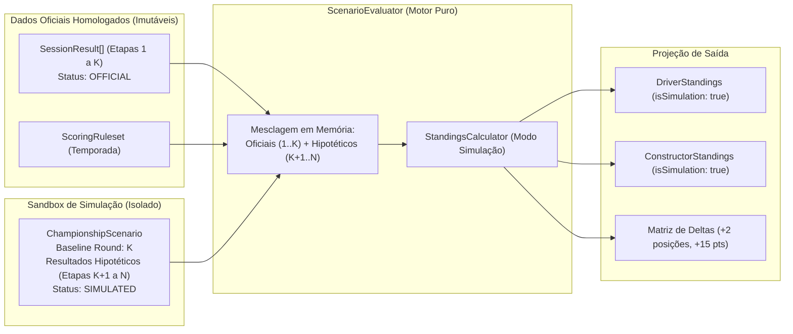

# Módulo Simulations — Cenários Hipotéticos e Avaliação de Simulações

> **Localização:** `docs/domain/simulations.md`  
> **Caminho no código:** `packages/domain/src/simulations/`  
> **Papel arquitetural:** Motor de análise determinística interativa ("What-If") e projeção de campeonatos  
> **Documento pai:** [README.md](./README.md)  

---

## 1. Visão Geral

O módulo **`simulations`** implementa a capacidade interativa diferenciadora do F1Atlas: permitir que usuários, analistas e entusiastas construam **cenários hipotéticos ("What-If" analysis)** para simular desfechos alternativos de corridas, testar hipóteses retrospectivas (ex.: *"E se o piloto X não tivesse abandonado o GP de Mônaco?"*) ou projetar as probabilidades matemáticas de título nas etapas finais de uma temporada.

O motor de simulação **reutiliza integralmente as mesmas regras determinísticas de pontuação e desempate** dos campeonatos oficiais, operando em um ambiente de sandbox isolado.

---

## 2. A Invariante Soberana de Simulação

> [!CAUTION]
> **INVARIANTE TRANSVERSAL INVIOLÁVEL DE DOMÍNIO (Invariante 8 do F1Atlas):**  
> `Resultados simulados nunca podem modificar, substituir ou ser exibidos como resultados oficiais.`  
> Qualquer estrutura de dados gerada por este módulo carrega explicitamente a marcação de simulação (`publicationState: 'SIMULATED'`, `isSimulation: true`), tornando impossível que uma projeção contamine o banco de dados histórico da FIA.

---

## 3. Responsabilidades

### O que pertence ao módulo `simulations`:
- A raiz de agregado `ChampionshipScenario`, que define o cenário de simulação ancorado em uma temporada oficial a partir de uma rodada de corte (`baselineRoundNumber`).
- A coleção de resultados hipotéticos criados ou alterados pelo usuário com status `SIMULATED`.
- O serviço de domínio `ScenarioEvaluator`, que mescla os resultados reais homologados até a rodada base com as hipóteses fornecidas, gerando as tabelas projetadas do WDC e WCC.
- O cálculo da matriz de variações (deltas de pontos e de posições) entre o campeonato real e o cenário simulado.
- O cálculo da margem matemática máxima restante (`calculateMaxRemainingPoints`) para identificar pilotos matematicamente eliminados da disputa pelo título.

### O que NÃO pertence ao módulo `simulations`:
- A persistência de resultados simulados nas tabelas de dados históricos oficiais.
- Modelagens estocásticas de Monte Carlo com telemetria pesada (pertencentes a serviços analíticos futuros).
- Apresentação de hipóteses como fatos jornalísticos no módulo editorial.

---

## 4. Componentes

| Arquivo TypeScript | Conceito Representado | Papel Arquitetural | Estado Atual |
|---|---|---|---|
| `simulations/championship-scenario.ts` | Cenário de Simulação | Raiz de Agregado / Entidade de Sandbox | **Planejado** (planejamento via comentários nível 1 e 2) |
| `simulations/scenario-evaluator.ts` | Avaliador de Cenários | Serviço de Domínio (Domain Service) | **Planejado** (planejamento via comentários nível 1 e 2) |

---

## 5. Arquitetura de Execução em Sandbox

---

## 6. Regras de Negócio e Invariantes

### 6.1. Regras Confirmadas
1. **Marcação Obrigatória de Simulação:** Todo resultado de sessão injetado em um cenário deve possuir obrigatoriamente `publicationState: 'SIMULATED'`. Tentativas de injetar resultados sem essa marcação provocam falha imediata via `DomainError`.
2. **Rodada de Corte Não-Negativa:** O `baselineRoundNumber` deve ser maior ou igual a 0 (0 representa simulação completa a partir da primeira corrida do ano).
3. **Determinismo:** O `ScenarioEvaluator` é uma função pura: as mesmas premissas de cenário associadas aos mesmos resultados históricos sempre geram rigorosamente o mesmo comparativo.
4. **Cálculo de Eliminação Matemática:** Um competidor está matematicamente eliminado do título quando a diferença de pontos para o líder for estritamente maior do que a pontuação máxima teórica restante somada em todas as corridas e sprints restantes da temporada.

### 6.2. Regras Propostas
- **Bifurcação de Cenários (Branching):** Permitir que um usuário clone um cenário existente para testar caminhos alternativos a partir de uma mesma rodada de corte.

---

## 7. Operações e Comportamentos

- **`createChampionshipScenario(props): Result<ChampionshipScenario, DomainError>`:**  
  Inicializa o sandbox de simulação vinculado a uma temporada e rodada de corte.
- **`addHypotheticalResult(scenario, result): Result<ChampionshipScenario, DomainError>`:**  
  Incorpora um resultado hipotético garantindo a validação de que seu status é `SIMULATED`.
- **`evaluateScenario(scenario, officialResults, ruleset): Result<{ simulatedDriverStandings, simulatedConstructorStandings, positionDeltas }, DomainError>`:**  
  Executa a avaliação completa gerando as classificações projetadas e a matriz de impacto.
- **`calculateMaxRemainingPoints(remainingRounds, remainingSprints, ruleset): number`:**  
  Calcula o teto matemático de pontos ainda em disputa para análises de eliminação de pilotos e construtores.

---

## 8. Exemplo Prático: Projeção de Título nas 3 Etapas Finais de 2025

- **Situação Real após o Round 21 (GP do Brasil):**
  - Piloto A: 380 pontos (Líder).
  - Piloto B: 345 pontos (2º colocado, a 35 pontos de distância).
  - Restam 3 Corridas Principais (25 pts cada) e 1 Sprint (8 pts).
- **Cálculo de Teto Restante:**
  - `calculateMaxRemainingPoints(3, 1, ruleset2025) = (3 * 25) + (1 * 8) = 83 pontos`.
  - Como $35 < 83$, o Piloto B permanece com chances matemáticas ativas de título.
- **Cenário Simulado criado pelo usuário:**
  - O usuário projeta que o Piloto B vencerá o GP de Las Vegas (Round 22) e a Sprint do Catar, enquanto o Piloto A terá um abandono (`DNF`).
  - `ScenarioEvaluator` recalcula a tabela: Piloto B sobe para 378 pontos, Piloto A permanece com 380 pontos; a diferença cai para apenas 2 pontos, com delta de variação de posições projetado.

---

## 9. Decisões Arquiteturais e Pendências

1. **Simulação Determinística vs. Probabilística:**  
   *Decisão:* O módulo de domínio foca exclusivamente em simulações **determinísticas** (o usuário define as chegadas e o domínio calcula o impacto exato com as regras da FIA). Projeções estocásticas baseadas em taxas históricas de DNF ou inteligência artificial serão isoladas na camada de aplicação.
2. **Ciclo de Vida de Cenários de Usuário:**  
   *Questão:* Devem os cenários pertencer a usuários autenticados ou funcionar de forma efêmera no frontend?  
   *Decisão:* O domínio é neutro quanto a autenticação. Ele recebe o cenário como estrutura de dados e emite o resultado projetado; a camada de aplicação gerencia se o cenário será salvo no banco ou mantido na sessão local do usuário.
